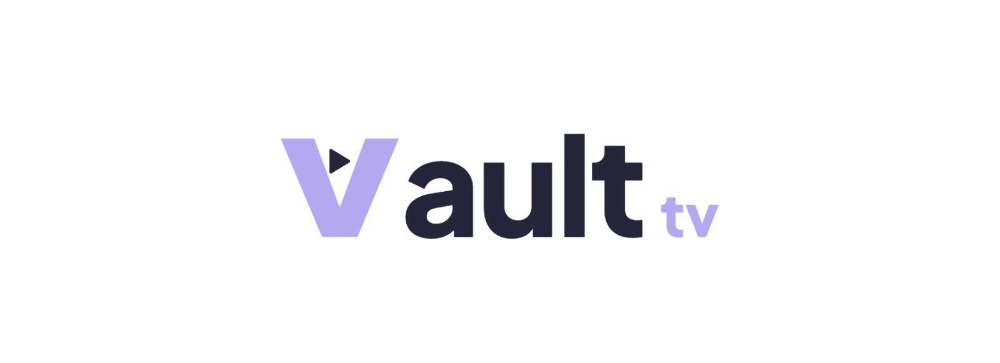

# Artefacto Prototipo 2
---
## Equipo

**Nombre:** 1A

**Integrantes:**

- Juan David Ardila Pacheco
- Juan David Cardenas Galvis
- Laura Vanesa Alvarez Lafont
- Daniel Santiago Rodriguez Rodriguez
- Nelson Ivan Castellanos Betancourt
- David Sebastian Hurtado Sanchez
---
## Sistema de software

**Nombre:** Vault tv



### Dominio y objetivo

El dominio es la transmisión audiovisual en vivo. En el prototipo 1 construimos lo básico: un streamer configura su canal y transmite, y los demás usuarios encuentran la transmisión, la reproducen y conversan en el chat.

Para el prototipo 2 el objetivo es que la plataforma funcione más allá del momento en vivo. Las transmisiones quedan grabadas, los usuarios siguen canales y reciben avisos, el streamer modera su chat y un administrador puede suspender cuentas o retirar contenido. Además de la web, ahora hay una aplicación móvil para Android.

### Funcionalidades

- **Cuentas:** registro, inicio y cierre de sesión, edición de perfil y avatar, y recuperación de contraseña por correo.
- **Configuración y emisión:** el propietario de un canal configura título, categoría y hasta cinco etiquetas. Desde OBS u otro cliente compatible con RTMPS inicia la transmisión, que se publica cuando se verifica que se puede reproducir. Si el emisor envía varias calidades, el espectador puede elegir entre ellas.
- **Descubrimiento:** listado de transmisiones en vivo ordenado por espectadores, búsqueda de canales y títulos, filtros por categoría y etiqueta, y sección de grabaciones.
- **Chat y moderación:** chat en tiempo real durante la transmisión. El streamer puede borrar mensajes, borrar todos los mensajes de un usuario y bloquearlo de forma temporal o permanente.
- **Grabaciones (VOD):** cada transmisión se graba automáticamente. Según la preferencia del canal se publica sola al terminar o queda pendiente para que el propietario la edite, la publique o la borre. Al verla se reproduce también el chat en el mismo orden en que se escribió (chat replay).
- **Subtítulos:** el propietario puede subir pistas WebVTT a sus grabaciones.
- **Seguimiento y notificaciones:** los usuarios siguen canales y reciben un aviso cuando un canal seguido sale en vivo. Los avisos llegan a una bandeja dentro de la plataforma y, si el usuario lo activa, también por correo.
- **Watch parties:** salas privadas, con código de acceso, donde se ven hasta cuatro transmisiones al mismo tiempo.
- **Administración:** un administrador lista usuarios y canales, suspende o reactiva cuentas y retira contenido. Una cuenta suspendida pierde sus sesiones, su transmisión se detiene y sus grabaciones dejan de estar disponibles.
- **Aplicación móvil:** cliente Android para espectadores con inicio de sesión, descubrimiento, reproducción en vivo y VOD, chat, seguimiento y bandeja de avisos.

### Límites de alcance

En este prototipo no incluimos pagos, suscripciones de pago ni contenido premium. La aplicación móvil no permite transmitir desde la cámara del teléfono. Los subtítulos se cargan como archivos WebVTT. No hay transcripción automática ni subtítulos en vivo. Las watch parties no sincronizan la reproducción entre dispositivos. El envío de notificaciones push al teléfono quedó pendiente. Los avisos funcionan por bandeja y correo.

---
## Estructuras arquitectónicas

### Vista de componentes y conectores


#### Elementos arquitectónicos

| Componente | Tipo | Tecnología | Responsabilidad |
|---|---|---|---|
| `web-fe (SSR)` | Presentación | TypeScript + React Router (Node.js) | Arma las páginas en el servidor con los datos iniciales y las entrega como HTML. |
| `mobile-app` | Presentación | Kotlin Multiplatform + Compose | Aplicación Android para espectadores: sesión, descubrimiento, en vivo, VOD, chat, seguimiento y bandeja de avisos. |
| `api-gateway` | Comunicación | Go | Arma en una sola respuesta los datos de cada pantalla (Explorar, canal, en vivo y VOD) consultando a Core, Streaming y VOD. Si una parte falla, devuelve las demás. También coordina la retirada de contenido. |
| `core-be` | Lógica | Java (Spring Boot) | Gestiona cuentas, perfiles, canales, catálogo de categorías y etiquetas y búsqueda de transmisiones. Registra usuarios, autentica y mantiene sesiones y valida permisos para los demás servicios. Crea cuenta, perfil y canal en una sola transacción. |
| `chat-be` | Lógica | Go | Gestiona salas de chat en los en vivos. Recibe, autoriza, deduplica, limita, ordena, guarda y reparte los mensajes en tiempo real. |
| `streaming-be` | Lógica | Rust | Gestiona la configuración de transmisión y las claves, controla el ciclo de las sesiones en vivo y su proyección pública. |
| `media-server` | Lógica | MediaMTX | Recibe datos por RTMPS y los entrega como HLS. |
| `media-recorder` | Lógica | Go (con FFmpeg) | Captura las grabaciones de las emisiones en un buffer durable en disco, las entrega a VOD y publica eventos al broker. |
| `vod-be` | Lógica | Go | Gestiona la biblioteca de grabaciones: metadatos, estado de publicación, manifiestos, subtítulos WebVTT y acceso a los archivos de video. |
| `notifications worker` | Lógica | TypeScript (Node.js) | Gestiona la bandeja, el marcado de leído, las preferencias y las entregas. Decide destinatarios a partir de los eventos y envía correos, incluido el de recuperación de contraseña. |
| `broker` | Comunicación | RabbitMQ | Reparte de forma durable los eventos y trabajos entre servicios, con una cola independiente por consumidor. No contiene reglas de negocio. |
| `reverse-proxy` | Lógica | Caddy | Recibe las solicitudes del cliente web, las dirige al servidor correspondiente y devuelve la respuesta. |
| `object-db` | Datos | MinIO (S3) | Almacena los archivos de imagen: avatares de perfil y portadas de canal. Solo `core-be` lo lee y escribe; las imágenes se entregan al navegador a través de `core-be`. |
| `core-db` | Datos | PostgreSQL | Persiste cuentas, sesiones, perfiles, canales, catálogo y la proyección de transmisiones que usa la búsqueda. Solo `core-be` lo lee y escribe. |
| `chat-db` | Datos | Redis | Almacena temporalmente los chats, secuencias y cuotas. Solo `chat-be` lo lee y escribe. |
| `streaming-db` | Datos | PostgreSQL | Persiste los datos de configuración de las sesiones en vivo, el outbox del contenido disponible para consumir y el estado de las sesiones. |
| `vod-db` | Datos | PostgreSQL | Persiste los metadatos de las grabaciones y su estado de publicación. Solo `vod-be` lo lee y escribe. |
| `vod-object-db` | Datos | MinIO (S3) | Almacena segmentos de video, manifiestos y subtítulos de las grabaciones. Solo `vod-be` escribe en él. |
| `notifications-db` | Datos | PostgreSQL | Persiste avisos, preferencias, dispositivos e intentos de entrega. |

#### Conectores

| Origen | Destino | Conector | Propósito |
|---|---|---|---|
| `web-client` | `web-fe` | REST | Solicita las páginas de la interfaz y recibe el HTML armado en el servidor. |
| `web-fe` | `api-gateway` | REST | Obtiene los datos de cada pantalla y las operaciones de sesión, canales y recursos. |
| `mobile-fe` | `api-gateway` | REST | La aplicación Android consulta los mismos datos y operaciones que la web. |
| `api-gateway` | `core-be` | REST | Registro, inicio y cierre de sesión, perfil, canales y catálogo de categorías y etiquetas. |
| `api-gateway` | `core-be` | GraphQL | Búsqueda y listado de transmisiones en vivo y canales. El cliente indica los campos y filtros que necesita por categoría y etiqueta. |
| `api-gateway` | `chat-be` | REST | Consulta el historial reciente de la sala para cargar mensajes previos y ordenarlos por secuencia. |
| `api-gateway` | `chat-be` | WebSocket | Canal bidireccional persistente: el cliente envía un mensaje y el chat lo reenvía a los demás usuarios. |
| `api-gateway` | `streaming-be` | REST | Consulta y modifica la configuración y el estado de las transmisiones. |
| `api-gateway` | `streaming-be` | HLS | Transporta el contenido audiovisual para su reproducción en el cliente. |
| `api-gateway` | `vod-be` | REST | Biblioteca de grabaciones, metadatos, publicación y retirada de contenido. |
| `api-gateway` | `notifications worker` | REST | Bandeja de avisos, marcado de leído y preferencias. |
| `broadcast-client` | `media-server` | RTMPS | Transporta audio y video desde el publicador (streamer). |
| `media-server` | `streaming-be` | REST | Datos de autorización, validación de manifiesto, segmentos y frames de reproducción. |
| `vod-be` | `media-recorder` | REST | VOD solicita al recorder las grabaciones capturadas. |
| `streaming-be` | `broker` | AMQP | Publica eventos del ciclo de vida de las sesiones, por ejemplo cuando un canal sale en vivo. |
| `broker` | `core-be` | AMQP | Core consume eventos para actualizar la proyección de Discovery. |
| `broker` | `chat-be` | AMQP | Chat consume eventos para abrir y cerrar las salas. |
| `broker` | `vod-be` | AMQP | VOD consume eventos para preparar la grabación. |
| `broker` | `notifications worker` | AMQP | Notificaciones consume eventos para avisar a los seguidores. |
| `media-recorder` | `broker` | AMQP | Publica eventos de la captura de las grabaciones. |
| `core-be` | `core-db` | DB Connector | Lectura y escritura de cuentas, sesiones, perfiles, catálogo y proyección de transmisiones. |
| `core-be` | `object-db` | S3 | Guardado y lectura de avatares y portadas. |
| `chat-be` | `chat-cache-db` | DB Connector | Estado en vivo del chat: mensajes recientes, secuencias y cuotas. |
| `chat-be` | `chat-db` | DB Connector | Guardado durable de mensajes y lectura del historial. |
| `streaming-be` | `streaming-db` | DB Connector | Configuración y ciclo de vida de las transmisiones. |
| `vod-be` | `vod-db` | DB Connector | Metadatos de las grabaciones y estado de publicación. |
| `vod-be` | `vod-object-db` | S3 | Escritura de segmentos de video, manifiestos y subtítulos. |
| `media-recorder` | `vod-object-db` | S3 | Lectura de los objetos de las grabaciones. |
| `notifications worker` | `notifications-db` | DB Connector | Avisos, preferencias, dispositivos e intentos de entrega. |

#### Estilos de arquitectura utilizados

La arquitectura sigue siendo mixta. Mantenemos los estilos del prototipo 1 y agregamos dos nuevos para la comunicación entre servicios.

**Cliente-servidor:** el navegador y la aplicación móvil piden datos y operaciones a los servicios a través del reverse proxy. OBS publica audio y video directamente al `media-server` por RTMPS.

**Separación por capas lógicas:** la presentación está en `web-fe` y en la aplicación móvil. La entrada está en el reverse proxy y el API Gateway. Las reglas de negocio están en Core, Streaming, Chat, VOD y Notificaciones, y la persistencia está en las bases de cada servicio.

**Arquitectura distribuida por servicios:** Core, Streaming, Chat, VOD y Notificaciones corren como procesos independientes, cada uno con su propia base de datos, y se comunican mediante contratos explícitos.

**API Gateway:** en lugar de que el cliente haga varias llamadas para armar una pantalla, el gateway las hace por él y devuelve todo junto. Así web y móvil reciben lo mismo y, si un servicio secundario falla, la pantalla se sigue mostrando con la información disponible.

**Publicador-suscriptor (eventos):** lo que no necesita respuesta inmediata viaja por RabbitMQ. Por ejemplo, cuando Streaming publica que un canal salió en vivo, Core actualiza Discovery, Chat abre la sala, VOD prepara la grabación y Notificaciones avisa a los seguidores, cada uno desde su propia cola y sin que Streaming tenga que esperarlos.

**Monolito Core con subarquitectura modular:** Cuentas, Canales, Catálogo, Discovery, Administración y Watch Party tienen responsabilidades separadas, pero comparten proceso y base de datos. Esto permite transacciones conjuntas cuando hace falta, como al registrar cuenta, perfil y canal.

### Vista de despliegue

El sistema se despliega en un único host (`node-1`) que ejecuta todos los componentes de backend como contenedores Docker, más un dispositivo Android que ejecuta el frontend móvil. Ambos pertenecen a la misma red Wi-Fi, proporcionada por un hotspot móvil.


Para ver el diagrama con mayor libertad y resolución, consultar: [Deployment View - ExcaliDash](https://draw.ivant.dev/shared/18b35695-2129-4265-b7be-5bc9cbc0bad0).

Todos los entornos de ejecución de `node-1` se ejecutan como contenedores Docker. Cada elemento de software se empaqueta en su propia imagen, con el runtime que necesita (Java, Rust, Go o Node.js), y se ejecuta como un contenedor aislado dentro del nodo. Los contenedores se definen y orquestan con Docker Compose, que los arranca juntos en una red interna compartida. El único elemento que no corre en Docker es el cliente móvil, que se ejecuta en el entorno de ejecución Android del dispositivo.

#### Elementos del entorno de ejecución

| Elemento de software | Tecnología en el entorno de ejecución | Puerto |
|---|---|---:|
| API Gateway | Go 1.26 | 3443 |
| `chat_be` | Go 1.26 | 8085 |
| `streaming_be` | Rust 1.98 | 8080 |
| `media_server` | MediaMTX | 8888 |
| `core_be` | Java 25, Spring Boot 4.1 | 8081 |
| `web_fe (SSR)` | Node.js 24 | 3000 |
| `vod_be` | Go 1.26 | 8098 |
| `media-recorder` | Go 1.26 | 8890 |
| `notifications worker` | Node.js 24, TypeScript 5.9 | 8095 |
| `broker` | RabbitMQ 4.3 | 5671 |
| `core-db` | PostgreSQL 18 | 5432 |
| `chat-db` | PostgreSQL 18 | 5432 |
| `notifications-db` | PostgreSQL 18 | 5432 |
| `streaming-db` | PostgreSQL 18.6 | 5432 |
| `vod-db` | PostgreSQL 18.6 | 5432 |
| `chat-cache-db` | Redis 8 | 6379 |
| `vod-object-db` | MinIO (S3) | 9000 |
| `object-db` | Volumen Docker | - |
| `mobile-fe` | Entorno de ejecución Android | - |

#### Relaciones

- **Deployed-in:** cada elemento de software se asigna a exactamente un entorno de ejecución mediante la relación `deployed-in`.
- **Comunicación Android a `node-1`:** Android llega a `node-1` por el puerto 3443 usando HTTPS. Ese puerto está en el borde de `node-1` y lo atiende el API Gateway.

#### Descripción de patrones arquitectónicos utilizados

**Despliegue orientado a contenedores:** cada componente se asigna a su propio entorno de ejecución, de modo que Java, Rust, Go y Node.js conviven en el mismo nodo sin conflictos de dependencias. Cada contenedor puede construirse, reiniciarse y reemplazarse sin afectar a los demás.

**Despliegue en un solo nodo con clientes remotos:** todo el stack corre en `node-1` y el cliente Android se conecta desde un dispositivo externo por la red hotspot. Es una configuración de prototipo que simplifica la operación, pero no incluye replicación.

### Vista en capas


El sistema está organizado en cuatro capas.

| Capa | Elementos | Función |
|---|---|---|
| Presentation | `web-fe (SSR)`, `mobile-fe` | Es la parte con la que interactúa el usuario. Web se encarga de las vistas, formularios, reproductores y estado de la interfaz. Mobile cumple una función parecida desde la aplicación móvil y además maneja aspectos propios de la plataforma y la sesión local. Desde esta capa se consumen las capacidades que ofrecen los servicios del sistema. |
| Orchestration / Communication | `api-gateway`, RabbitMQ | El API Gateway sirve como punto de composición para algunas solicitudes: consulta los servicios necesarios y reúne la información que necesita el cliente. RabbitMQ actúa como intermediario para la comunicación por eventos entre los servicios. No contiene reglas de negocio; facilita el intercambio de mensajes. |
| Logic | `core-be`, `chat-be`, `vod-be`, `streaming-be`, `media-recorder`, `notifications`, MediaMTX | Aquí están las principales capacidades del sistema. Core maneja cuentas, administración, canales, taxonomía, Discovery y Watch Party. Chat se encarga de mensajes, salas y moderación. VOD gestiona grabaciones, publicación y pistas WebVTT. Streaming controla el ciclo de vida de las emisiones y los permisos de los espectadores. Media-recorder coordina la captura durable de segmentos: consulta el estado de Streaming, obtiene los segmentos, los entrega a VOD y publica eventos cuando son confirmados. Notifications coordina los avisos y sus entregas. MediaMTX se usa para la ingesta y entrega de medios, aunque es un producto externo y no contiene reglas propias del negocio de Vault TV. |
| Data | `core-db`, `object-db`, `chat-cache-db`, `chat-db`, `vod-db`, `vod-object-db`, `streaming-db`, `notifications-db` | Contiene los almacenes que usa cada servicio. Se utilizan PostgreSQL, Redis y almacenamiento de objetos según la necesidad de cada dominio. Cada servicio conserva el control de sus propios datos, por lo que otro componente no debería escribir directamente en una base que no le pertenece. |

La separación por capas indica la responsabilidad principal de cada elemento. No significa que existan cuatro máquinas distintas ni que todas las solicitudes tengan que pasar siempre por las cuatro capas.

Dentro de la capa de negocio los servicios se comunican de dos formas: por HTTP cuando necesitan una respuesta inmediata, como al validar un permiso, y por eventos a través de RabbitMQ cuando no, como al avisar que un canal salió en vivo. El gateway solo compone consultas, no escribe en bases ajenas ni toma decisiones de permisos.

#### Relaciones entre elementos

Las flechas del diagrama representan relaciones de uso. Se leen como origen `allowed-to-use` destino: el elemento de origen utiliza una capacidad que ofrece el destino.

Estas flechas no muestran el orden de ejecución ni necesariamente la dirección en la que viajan los datos.

| Origen / destino | Conector | Propósito |
|---|---|---|
| Web / Mobile → API Gateway | `allowed-to-use` | Web y Mobile usan el Gateway cuando necesitan una respuesta construida a partir de varios servicios. El acceso público pasa primero por Caddy, que se encarga del enrutamiento de entrada. |
| Web / Mobile → APIs de dominio | `allowed-to-use` vía Caddy | Algunas solicitudes pueden ir directamente a Core, Streaming, Chat, VOD o Notifications. Caddy dirige cada ruta al servicio correspondiente, así que no todo el tráfico pasa por el Gateway. |
| API Gateway → Core / Streaming / VOD | `allowed-to-use` | El Gateway consulta estos servicios para reunir información o reenviar una operación. No accede directamente a sus bases de datos ni reemplaza sus reglas de autorización. |
| Core / Chat / VOD / Streaming / Media-recorder / Notifications → RabbitMQ | `allowed-to-use` | Estos procesos usan RabbitMQ para publicar o consumir eventos. La flecha apunta hacia el broker porque representa una dependencia de uso, no el recorrido de un mensaje. |
| Streaming → MediaMTX | `allowed-to-use` | Streaming usa MediaMTX para controlar y observar el manejo de los medios. Las decisiones funcionales siguen estando en Streaming. |
| Media-recorder → Streaming | `allowed-to-use` | Media-recorder consulta el estado privado de las sesiones de grabación para saber qué emisiones debe capturar y en qué estado se encuentran. |
| Media-recorder → MediaMTX | `allowed-to-use` | Media-recorder obtiene los segmentos generados por MediaMTX. Puede hacerlo mediante HTTPS o leyendo el inventario y los archivos del volumen compartido, según el modo de captura. |
| Media-recorder → VOD | `allowed-to-use` | Media-recorder entrega a VOD los segmentos capturados y verificados. VOD confirma la entrega y realiza la escritura definitiva en el almacenamiento de objetos. |
| Media-recorder → RabbitMQ | `allowed-to-use` | Publica eventos cuando un segmento ha sido confirmado y cuando una grabación queda cerrada. RabbitMQ solo transporta estos eventos; no decide cuándo debe cerrarse una grabación. |
| Media-recorder → `vod-object-db` | `allowed-to-use` | Puede leer objetos de S3/MinIO con credenciales restringidas cuando VOD necesita recuperar bytes mediante el endpoint privado del recorder. No tiene la responsabilidad principal de escribir los objetos definitivos. |
| Media-recorder → `recorder-spool` | `allowed-to-use` | Usa almacenamiento local para conservar checkpoints y archivos temporales mientras espera que los segmentos sean entregados y confirmados. |
| Streaming / Chat / VOD / Notifications → Core | `allowed-to-use` | Estos servicios consultan a Core cuando necesitan información como identidad, propiedad, estado de cuenta o contexto de autorización. Cada servicio mantiene las reglas propias de su dominio. |
| Core → Streaming / Chat → VOD | `allowed-to-use` | Son consultas entre servicios del mismo nivel. Esto no significa que compartan tablas ni que un servicio pueda modificar directamente la persistencia del otro. |
| Cada servicio → sus almacenes | `allowed-to-use` | Cada servicio usa los almacenes que pertenecen a su dominio. Los demás componentes deben pedir la información mediante las interfaces publicadas por ese servicio. |

#### Entrada e infraestructura

El API Gateway es la entrada al sistema. Recibe las rutas públicas por el puerto 3443 y las envía al destino correspondiente. Algunas rutas las enruta directamente a Chat, Notifications u otras APIs de dominio. Otras, las que requieren composición o reenvío, las resuelve él mismo: compone la respuesta de varios servicios o reenvía la operación al servicio dueño.

#### Excepción del broker en la estructura por capas

En una arquitectura por capas estricta, lo normal es que las dependencias vayan hacia abajo:

`Presentation → Orchestration → Logic → Data`

En nuestro diagrama hay una excepción. Los servicios de Logic apuntan hacia RabbitMQ, aunque el broker está ubicado en Orchestration / Communication.

Esto pasa porque RabbitMQ no funciona como una capa superior que tome decisiones de negocio o controle a los servicios. Su papel es técnico: ofrece la infraestructura de mensajería que los componentes necesitan para publicar y consumir eventos.

Por ejemplo, que `Notifications` `allowed-to-use` RabbitMQ significa que Notifications usa la capacidad de mensajería que ofrece RabbitMQ. No quiere decir que la flecha esté mostrando el recorrido de un mensaje ni que Notifications siempre esté enviando información al broker. Si Notifications está consumiendo eventos, también necesita conectarse a RabbitMQ y usar ese servicio.

Por eso las flechas se dibujan desde los servicios de Logic hacia RabbitMQ: lo que queremos mostrar en esta vista es quién depende de quién.

Sabemos que esto rompe la regla descendente de una arquitectura en capas estricta. Por esa razón, nuestra vista no se plantea como un Strict Layered Pattern puro, sino como una organización general por capas con una excepción para la comunicación por eventos.

#### Patrones utilizados

**Arquitectura en capas (n-tier):** el sistema se organiza en cuatro niveles: Presentation, Orchestration / Communication, Logic y Data. Esta separación ayuda a ubicar cada elemento según su responsabilidad principal y a entender el sistema sin entrar de inmediato en detalles de implementación. No significa que existan cuatro máquinas diferentes ni que todas las solicitudes tengan que pasar siempre por las cuatro capas. Tampoco se trata de una arquitectura en capas estricta, ya que RabbitMQ está en Orchestration / Communication y es utilizado directamente por servicios de Logic.

**API Gateway (orquestador):** en la capa de entrada, el gateway recibe una petición por pantalla y la reparte entre Core, Streaming y VOD. Ese trabajo no queda en el cliente.

**Patrón interno de cada componente:** cada servicio de la capa de negocio tiene su propia organización por dentro. Streaming usa arquitectura hexagonal (puertos y adaptadores): el dominio y los casos de uso están separados de los adaptadores de HTTP, PostgreSQL y Media. Core es un monolito modular, con un paquete por dominio (cuentas, canales, catálogo, Discovery y Watch Party).

### Vista de descomposición

La vista de descomposición se encuentra en el siguiente enlace: [Vista de descomposición](https://draw.ivant.dev/shared/a494089f-441c-47b6-9e8c-b062954ef01a).

La vista muestra cómo dividimos el sistema en partes cada vez más pequeñas. Se lee de arriba hacia abajo en cuatro niveles: el sistema (Vault TV), los módulos, los submódulos y las funcionalidades. En total son 8 módulos, 27 submódulos y 77 funcionalidades.

#### Elementos

- **Sistema:** Vault TV, la raíz del árbol.
- **Módulos:** las piezas grandes en que dividimos el sistema. Cada una se desarrolla y se despliega por separado: Core, Streaming, Chat, VOD, Notificaciones, API Gateway, Web SSR y App móvil.
- **Submódulos:** las partes en que se organiza cada módulo por dentro.
- **Funcionalidades:** lo que el usuario o el sistema puede hacer con cada submódulo.

#### Relaciones

La única relación de esta vista es `es parte de`, que en el diagrama se dibuja como una flecha del padre al hijo. Cada funcionalidad pertenece a un solo submódulo y cada submódulo a un solo módulo. Un módulo puede ir directo a sus funcionalidades cuando no necesita submódulos, como Web SSR. Las flechas no representan llamadas ni flujo de datos; eso lo muestra la vista de componentes y conectores.

#### Patrones utilizados

**Descomposición por dominio de negocio:** separamos los módulos por área del negocio (emisión, chat, grabaciones y avisos) y no por tipo técnico. Esto permitió trabajar en paralelo.

**Monolito modular en Core:** Cuentas, Canales, Catálogo, Discovery, Administración y Watch Party son submódulos con fronteras claras dentro de un mismo ejecutable. Lo decidimos así porque comparten datos y algunas operaciones necesitan una sola transacción, como el registro, que crea la cuenta, el perfil y el canal al mismo tiempo.

**Un módulo por cliente:** la web y la aplicación móvil son módulos separados aunque ofrezcan funciones parecidas, porque usan tecnologías distintas y se despliegan por separado.

Cada módulo de esta vista corresponde a un componente de la vista de componentes y conectores y a un contenedor de la vista de despliegue.

---
## Prototipo

### Manual de despliegue local de Vault TV

#### Prerrequisitos

- Git.
- Docker Desktop con Docker Compose 2.24.4 o superior.
- Python 3.12 o superior.
- OpenSSL.
- Al menos 30 GB de espacio disponible para Docker.

#### Descargar los artefactos

```bash
git clone https://github.com/SWARCH-1A/streaming.git
cd streaming
```

#### Construir y ejecutar el sistema

```bash
python3 infra/local/dev.py init
python3 infra/local/dev.py build
python3 infra/local/dev.py up
python3 infra/local/dev.py status
```

Después de iniciar los servicios, acceder a:

```text
https://localhost:3445
```

Para detener el sistema:

```bash
python3 infra/local/dev.py down
```

El comando `init` genera automáticamente los secretos y certificados locales; no es necesario configurar cada servicio manualmente.
