## Equipo

Nombre: 1A

#### Integrantes

- Juan David Ardila Pacheco
- Juan David Cardenas Galvis
- Laura Vanesa Alvarez Lafont
- Nelson Ivan Castellanos Betancourt
- David Sebastian Hurtado Sanchez

## Software System

**Nombre:** Vault tv

**Logo:**


### Dominio y objetivo

El dominio es la transmisión audiovisual en vivo. En el prototipo 1 construimos lo básico: un streamer configura su canal y transmite, y los demás usuarios encuentran la transmisión, la reproducen y conversan en el chat.

Para el prototipo 2 el objetivo es que la plataforma funcione más allá del momento en vivo. Las transmisiones quedan grabadas, los usuarios siguen canales y reciben avisos, el streamer modera su chat y un administrador puede suspender cuentas o retirar contenido. Además de la web, ahora hay una aplicación móvil para Android.

### Funcionalidades

- Cuentas: registro, inicio y cierre de sesión, edición de perfil y avatar, y recuperación de contraseña por correo.
- Configuración y emisión: el propietario de un canal configura título, categoría y hasta cinco etiquetas. Desde OBS u otro cliente compatible con RTMPS inicia la transmisión, que se publica cuando se verifica que se puede reproducir. Si el emisor envía varias calidades, el espectador puede elegir entre ellas.
- Descubrimiento: listado de transmisiones en vivo ordenado por espectadores, búsqueda de canales y títulos, filtros por categoría y etiqueta, y sección de grabaciones.
- Chat y moderación: chat en tiempo real durante la transmisión. El streamer puede borrar mensajes, borrar todos los mensajes de un usuario y bloquearlo de forma temporal o permanente.
- Grabaciones (VOD): cada transmisión se graba automáticamente. Según la preferencia del canal se publica sola al terminar o queda pendiente para que el propietario la edite, la publique o la borre. Al verla se reproduce también el chat en el mismo orden en que se escribió (chat replay).
- Subtítulos: el propietario puede subir pistas WebVTT a sus grabaciones.
- Seguimiento y notificaciones: los usuarios siguen canales y reciben un aviso cuando un canal seguido sale en vivo. Los avisos llegan a una bandeja dentro de la plataforma y, si el usuario lo activa, también por correo.
- Watch parties: salas privadas, con código de acceso, donde se ven hasta cuatro transmisiones al mismo tiempo.
- Administración: un administrador lista usuarios y canales, suspende o reactiva cuentas y retira contenido. Una cuenta suspendida pierde sus sesiones, su transmisión se detiene y sus grabaciones dejan de estar disponibles.
- Aplicación móvil: cliente Android para espectadores con inicio de sesión, descubrimiento, reproducción en vivo y VOD, chat, seguimiento y bandeja de avisos.

### Límites de alcance

En este prototipo no incluimos pagos, suscripciones de pago ni contenido premium. La aplicación móvil no permite transmitir desde la cámara del teléfono. Los subtítulos se cargan como archivos WebVTT. No hay transcripción automática ni subtítulos en vivo. Las watch parties no sincronizan la reproducción entre dispositivos. El envío de notificaciones push al teléfono quedó pendiente. Los avisos funcionan por bandeja y correo.

## Estructuras Arquitectónicas

### Vista de componentes y conectores

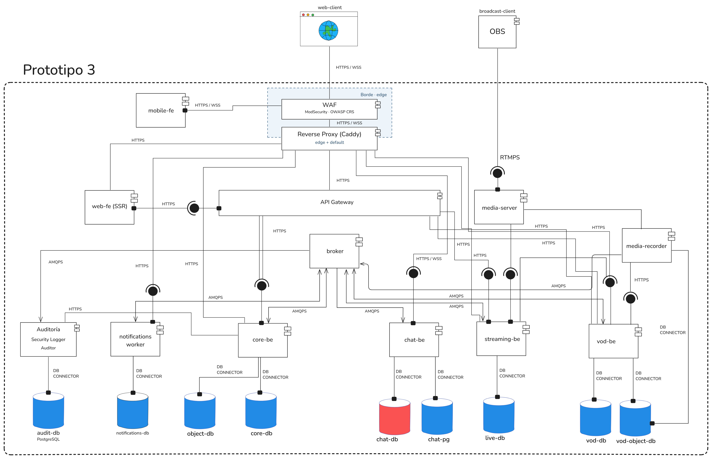

#### Elementos arquitectónicos

| **Componente** | **Tipo** | **Tecnología** | **Responsabilidad** |
| --- | --- | --- | --- |
| web-fe (SSR) | Presentación | TypeScript + React Router (Node.js) | Arma las páginas en el servidor con los datos iniciales y las entrega como HTML. |
| mobile-app | Presentación | Kotlin Multiplatform + Compose | Aplicación Android para espectadores: sesión, descubrimiento, en vivo, VOD, chat, seguimiento y bandeja de avisos. |
| api-gateway | Comunicación | Go | Arma en una sola respuesta los datos de cada pantalla (Explorar, canal, en vivo y VOD) consultando a Core, Streaming y VOD. Si una parte falla, devuelve las demás. También coordina la retirada de contenido. |
| core-be | Lógica | Java (Spring boot) | Gestiona cuentas, perfiles, canales, catálogo de categorías y etiquetas y búsqueda de transmisiones. Registra usuarios, autentica y mantiene sesiones y valida permisos para los demás servicios. Crea cuenta, perfil y canal en una sola transacción. |
| chat-be | Lógica | Go | Gestiona salas de chat en los en vivos. Recibe, autoriza, deduplica, limita, ordena, guarda y reparte los mensajes en tiempo real |
| streaming-be | Lógica | Rust | Configuración de transmisión y claves, controla el ciclo de las sesiones en vivo y su proyección pública. |
| media-server | Lógica | MediaMTX | Recibe datos por RTMPS y los entrega cómo HLS. |
| media-recorder | Lógica | Go (con FFmpeg) | Captura las grabaciones de las emisiones en un buffer durable en disco, las entrega a VOD y publica eventos al broker. |
| vod-be | Lógica | Go | Biblioteca de grabaciones: metadatos, estado de publicación, manifiestos, subtítulos WebVTT y acceso a los archivos de video. |
| notifications worker | Lógica | TypeScript (Node.js) | Bandeja, marcado de leído, preferencias y entregas. Decide destinatarios a partir de los eventos y envía correos, incluido el de recuperación de contraseña. |
| broker | Comunicación | RabbitMQ | Reparte de forma durable los eventos y trabajos entre servicios, con una cola independiente por consumidor. No contiene reglas de negocio. |
| reverse-proxy | Comunicación | Caddy | Recibe del WAF por HTTPS y dirige cada ruta al servicio que le corresponde, también por HTTPS. Envía la cabecera HSTS y elimina las cabeceras de identidad de servicio que mande un cliente externo. |
| object-db | Datos | MinIO (S3) | Almacena los archivos de imagen: avatares de perfil y portadas de canal. Solo core-be lo lee y escribe; las imágenes se entregan al navegador a través de core-be. |
| core-db | Datos | PostgreSQL | Persiste cuentas, sesiones, perfiles, canales, catálogo y la proyección de transmisiones que usa la búsqueda. Solo core-be lo lee y escribe. |
| chat-db | Datos | Redis | Almacena temporalmente los chats, secuencias, cuotas. Solo chat lo lee y escribe |
| streaming-db | Datos | PostgreSQL | Persistir los datos de configuración de las sesiones en vivo, outbox del contenido disponible para consumir y el estado de las sesiones. |
| vod-db | Datos | PostgreSQL | Metadatos de las grabaciones y su estado de publicación. Solo vod-be lo lee y escribe. |
| vod-object-db | Datos | MinIO (S3) | Segmentos de video, manifiestos y subtítulos de las grabaciones. Solo vod-be escribe en él. |
| notifications-db | Datos | PostgreSQL | Avisos, preferencias, dispositivos e intentos de entrega. |
| waf | Seguridad (entrada) | nginx + ModSecurity v3 + OWASP CRS 4.25 | Es la única entrada pública del sistema, por HTTPS. Revisa cada petición y bloquea con 403 los ataques (inyección SQL, XSS, path traversal) antes de que lleguen a Caddy. Lo que deja pasar lo reenvía cifrado a Caddy. |
| auditoria (Security Logger y Auditor) | Lógica | Go | Recibe por RabbitMQ los eventos de seguridad de Core, VOD y el WAF. Los guarda sin duplicados en audit-db y se los entrega a Core para la consola de administración (/admin/audit). |
| waf-relay | Comunicación | Go | Lee los bloqueos que registra el WAF y los publica en RabbitMQ para que Auditoría los guarde. |
| audit-db | Datos | PostgreSQL | Guarda la traza de eventos de seguridad. Auditoría escribe con un usuario y lee con otro, y ninguno puede editar ni borrar registros. |
| chat-pg | Datos | PostgreSQL | Guarda los mensajes del chat de forma durable y el historial. Solo chat-be lo lee y escribe. |

#### Conectores

| **Origen** | **Destino** | **Conector** | **Propósito** |
| --- | --- | --- | --- |
| web-client | waf | HTTPS (REST / WebSocket) | Todas las peticiones del navegador entran por el WAF. |
| web-fe | api-gateway | REST | Obtiene los datos de cada pantalla y las operaciones de sesión, canales y recursos. |
| mobile-fe | api-gateway | REST | La aplicación Android consulta los mismos datos y operaciones que la web. |
| api-gateway | core-be | REST | Registro, inicio y cierre de sesión, perfil, canales y catálogo de categorías y etiquetas. |
| api-gateway | core-be | GraphQL | Búsqueda y listado de transmisiones en vivo y canales. El cliente indica los campos y filtros que necesita, por categoría y etiqueta. |
| api-gateway | chat-be | REST | Consulta del historial reciente de la sala para cargar mensajes previos y ordenarlos por secuencia. |
| api-gateway | chat-be | WebSocket | Canal bidireccional persistente: el cliente envía un mensaje y el chat lo reenvía a los demás usuarios. |
| api-gateway | streaming-be | REST | Consulta y modificación de configuración y estado de las transmisiones. |
| api-gateway | streaming-be | HLS | Transporta el contenido audiovisual para su reproducción en el cliente. |
| api-gateway | vod-be | REST | Biblioteca de grabaciones, metadatos, publicación y retirada de contenido. |
| api-gateway | notifications worker | REST | Bandeja de avisos, marcado de leído y preferencias. |
| broadcast-client | media-server | RTMPS | Transporte de audio y video desde el publicador (streamer). |
| media-server | streaming-be | REST | Datos de autorización, validación de manifiesto, segmentos y frames de reproducción. |
| vod-be | media-recorder | REST | VOD solicita al recorder las grabaciones capturadas. |
| streaming-be | broker | AMQPS | Publica eventos del ciclo de vida de las sesiones, por ejemplo cuando un canal sale en vivo. |
| broker | core-be | AMQPS | Core consume eventos para actualizar la proyección de Discovery. |
| broker | chat-be | AMQPS | Chat consume eventos para abrir y cerrar las salas. |
| broker | vod-be | AMQPS | VOD consume eventos para preparar la grabación. |
| broker | notifications worker | AMQPS | Notificaciones consume eventos para avisar a los seguidores. |
| media-recorder | broker | AMQPS | Publica eventos de la captura de las grabaciones. |
| core-be | core-db | DB Connector | Lectura y escritura de cuentas, sesiones, perfiles, catálogo y proyección de transmisiones. |
| core-be | object-db | S3 | Guardado y lectura de avatares y portadas. |
| chat-be | chat-cache-db | DB Connector | Estado en vivo del chat: mensajes recientes, secuencias y cuotas. |
| chat-be | chat-db | DB Connector | Guardado durable de mensajes y lectura del historial. |
| streaming-be | streaming-db | DB Connector | Configuración y ciclo de vida de las transmisiones. |
| vod-be | vod-db | DB Connector | Metadatos de las grabaciones y estado de publicación. |
| vod-be | vod-object-db | S3 | Escritura de segmentos de video, manifiestos y subtítulos. |
| media-recorder | vod-object-db | S3 | Lectura de los objetos de las grabaciones. |
| notifications worker | notifications-db | DB Connector | Avisos, preferencias, dispositivos e intentos de entrega. |
| mobile-fe | waf | HTTPS (REST) | La app Android entra por el mismo origen HTTPS que la web. |
| waf | reverse-proxy | HTTPS | Reenvía las peticiones permitidas y verifica el certificado de Caddy. |
| reverse-proxy | web-fe, api-gateway, core-be, chat-be, streaming-be, vod-be, notifications | HTTPS | Envía cada ruta al servicio que la atiende. |
| vod-be | broker | AMQPS | Publica eventos de seguridad, por ejemplo cuando se niega editar o borrar una grabación. |
| core-be | broker | AMQPS | Publica eventos de seguridad (por ejemplo, accesos denegados de administración). |
| waf | waf-relay | Volumen compartido | El WAF escribe un archivo por cada bloqueo y el relay los lee. |
| waf-relay | broker | AMQPS | Publica los bloqueos del WAF. |
| broker | auditoria | AMQPS | Auditoría consume los eventos de Core, VOD y el WAF. |
| auditoria | audit-db | DB Connector (TLS) | Guarda y consulta los eventos de seguridad. |
| core-be | auditoria | REST (HTTPS) | Core consulta los eventos para la consola /admin/audit, después de verificar que el usuario es ADMIN. |

#### Estilos de Arquitectura utilizado:

La arquitectura sigue siendo mixta. Mantenemos los estilos del prototipo 1 y agregamos dos nuevos para la comunicación entre servicios.

**Cliente - servidor:** el navegador y la aplicación móvil piden datos y operaciones a los servicios a través del reverse proxy. OBS publica audio y video directamente al media-server por RTMPS.

**Separación por capas lógicas:** la presentación está en web-fe y en la aplicación móvil. La entrada, en el reverse proxy y el API Gateway. Las reglas de negocio, en Core, Streaming, Chat, VOD y Notificaciones y la persistencia, en las bases de cada servicio.

**Arquitectura distribuida por servicios:** Core, Streaming, Chat, VOD y Notificaciones corren como procesos independientes, cada uno con su propia base de datos, y se comunican mediante contratos explícitos.

**API Gateway:** en lugar de que el cliente haga varias llamadas para armar una pantalla, el gateway las hace por él y devuelve todo junto. Así web y móvil reciben lo mismo, y si un servicio secundario falla la pantalla se sigue mostrando con lo demás.

**Publicador - suscriptor (eventos)**: lo que no necesita respuesta inmediata va por RabbitMQ. Por ejemplo, cuando Streaming publica que un canal salió en vivo, Core actualiza Discovery, Chat abre la sala, VOD prepara la grabación y Notificaciones avisa a los seguidores, cada uno desde su propia cola y sin que Streaming tenga que esperarlos.

**Monolito Core con subarquitectura modular:** Cuentas, Canales, Catálogo, Discovery, Administración y Watch party tienen responsabilidades separadas, pero comparten proceso y base de datos. Esto permite transacciones conjuntas cuando hace falta, como al registrar cuenta, perfil y canal.

### Vista de despliegue

El sistema se despliega en un único host (node-1) que ejecuta todos los componentes de backend como contenedores Docker, más un dispositivo Android/iOS que ejecuta el frontend móvil (mobile-fe). Ambos pertenecen a la misma red Wi-Fi, proporcionada por un hotspot móvil.

Elementos de entorno son node-1, máquina anfitriona que ejecuta todo el stack en contenedores; el dispositivo móvil, entorno de ejecución Android/iOS para mobile-fe; y la red Hotspot Wi-Fi, red compartida que conecta el dispositivo móvil con node-1.


Todos los entornos de ejecución de node-1 se ejecutan como contenedores Docker. Cada servicio y base de datos de backend se empaqueta en su propia imagen de contenedor con el runtime o motor correspondiente y se ejecuta de forma aislada dentro del nodo. Los contenedores se definen y orquestan con Docker Compose, que los arranca juntos en redes internas compartidas. El único elemento que no corre en Docker es el cliente móvil (mobile-fe), que se ejecuta en el entorno de ejecución Android/iOS del dispositivo.

| **Elemento de software** | **Tecnología del entorno de ejecución** | **Puertos internos** |
| --- | --- | --- |
| WAF | nginx, ModSecurity y OWASP CRS 4.25 | 8443 |
| Reverse Proxy | Caddy 2 | 3443 |
| API Gateway | Go 1.26 | 8097 |
| web-fe (SSR) | Node.js 24 | 3443 |
| core-be | Java 25 y Spring Boot 4.1 | 8081, 8082 |
| chat-be | Go 1.26 | 8085, 8086 |
| streaming-be | Rust 1.98 y adaptador Media | 8080, 8090, 8091, 8888 |
| media-server | MediaMTX 1.21 | 1936, 8888, 9997 |
| vod-be | Go 1.26 | 8098, 8099 |
| media-recorder | Go 1.26 | 8890 |
| notifications | Node.js 24 y TypeScript 5.9 | 8095 |
| broker | RabbitMQ 4.3 | 5671 |
| Auditoría — Logger y Auditor | Go 1.26 | 8096 |
| waf-relay | Go 1.26 | — |
| core-db | PostgreSQL 18 | 5432 |
| chat-pg | PostgreSQL 18 | 5432 |
| notifications-db | PostgreSQL 18 | 5432 |
| live-db | PostgreSQL 18.6 | 5432 |
| vod-db | PostgreSQL 18.6 | 5432 |
| audit-db | PostgreSQL 18 | 5432 |
| chat-db | Redis 8 | 6379 |
| vod-object-db | MinIO, compatible con S3 | 9000 |
| object-db | Almacenamiento de objetos de Core | — |
| mailpit | Mailpit 1.27 | 1025, 8025 |
| mobile-fe | Android/iOS y Kotlin Multiplatform | — |

#### Relaciones

- **Deployed-in (líneas punteadas)**. Cada elemento de software se asigna a exactamente un entorno de ejecución, mediante la relación deployed-in.

- **Comunicación Android/iOS a node-1.** El cliente mobile-fe llega a node-1 por el puerto 8443 (WAF) / 3443 (Reverse Proxy) usando HTTPS.

#### Descripción de patrones arquitectónicos utilizados

- **Despliegue orientado a contenedores.** Cada componente se asigna a su propio entorno de ejecución, de modo que Java, Rust, Go y Node.js conviven en el mismo nodo sin conflictos de dependencias. Cada contenedor puede construirse, reiniciarse y reemplazarse sin afectar a los demás.

- **Despliegue orientado a contenedores.** Cada componente se asigna a su propio entorno de ejecución, de modo que Java, Rust, Go, Node.js, Caddy, Nginx, PostgreSQL, Redis, MinIO y Mailpit conviven en el mismo nodo sin conflictos de dependencias. Cada contenedor puede construirse, reiniciarse y reemplazarse sin afectar a los demás.

- **Despliegue en un solo nodo con clientes remotos.** Todo el stack corre en node-1 y el cliente mobile-fe se conecta desde un dispositivo externo por la red hotspot. Es una configuración de prototipo que simplifica la operación, pero no incluye replicación.

### Vista en capas

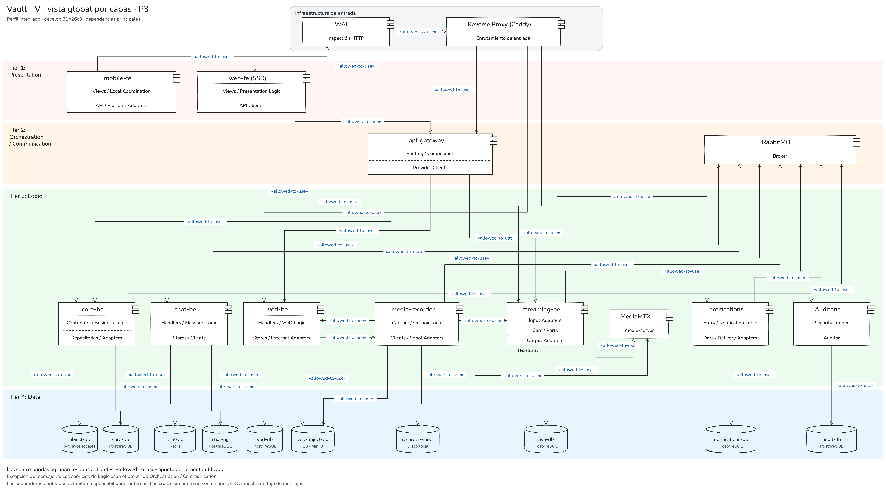

Organizamos Vault TV en cinco capas lógicas.

| **Capa** | **Elementos** | **Función** |
| --- | --- | --- |
| Tier 1  Entrada al sistema | WAF y Reverse Proxy (Caddy) | El WAF inspecciona las solicitudes HTTP. Caddy dirige las peticiones admitidas a Web SSR, al API Gateway o al servicio de dominio que corresponda. |
| Tier 2  Presentation | mobile-fe y web-fe (SSR) | La aplicación móvil gestiona la interacción y la sesión en el dispositivo. Web SSR genera el HTML y presenta la consola de auditoría en Administración. |
| Tier 3  Orchestration / Communication | API Gateway y RabbitMQ | El Gateway reúne los datos de las pantallas. RabbitMQ distribuye eventos entre los servicios que los publican y los que los consumen. |
| Tier 4  Logic | Core, Chat, VOD, Media Recorder, Streaming, MediaMTX, Notifications y Auditoría | Agrupa las funciones de la plataforma. MediaMTX recibe las emisiones y Media Recorder captura los segmentos. En Auditoría, el Security Logger registra la evidencia y el Auditor atiende las consultas de Core. |
| Tier 5  Data | core-db, object-db, chat-db, chat-pg, vod-db, vod-object-db, recorder-spool, live-db, notifications-db y audit-db | Reúne los almacenes que utiliza cada servicio. Chat usa Redis para el estado en vivo y PostgreSQL para el historial. VOD escribe los objetos definitivos en MinIO y Auditoría guarda la evidencia en PostgreSQL. |

Las capas agrupan los componentes según su responsabilidad principal. La vista de despliegue describe su distribución física. Cada solicitud recorre los componentes que necesita. Una consulta de catálogo llega a core, mientras que explorar pasa por el Gateway para reunir datos de varios servicios.

Los servicios usan HTTPS para consultas que requieren una respuesta inmediata, como comprobar un permiso. Los eventos que pueden procesarse de forma asíncrona pasan por RabbitMQ, como el aviso de que un canal salió en vivo. El Gateway compone consultas y reenvía a VOD la orden de retirada administrativa. Cada dominio conserva su autorización y el acceso a sus datos.

#### Relaciones entre elementos

Las 37 flechas de la figura representan la relación «allowed-to-use». La punta señala el componente cuya capacidad se utiliza. Por ejemplo, Auditoría apunta a RabbitMQ porque usa el broker, aunque sea RabbitMQ quien le entrega los eventos.

| **Origen → destino** | **Propósito** |
| --- | --- |
| mobile-fe → WAF | Accede al origen web desde la aplicación móvil. |
| WAF → Caddy | Reenvía por HTTPS las solicitudes que pasan la inspección. |
| Caddy → web-fe (SSR) | Enruta las peticiones de páginas y recursos web. |
| Caddy → API Gateway | Enruta las consultas de pantalla y la orden de retirada administrativa. |
| Caddy → Core | Enruta las operaciones de cuentas y canales, las consultas de Catálogo y Discovery y las consultas administrativas de auditoría. |
| Caddy → Chat | Enruta el historial, el replay y el chat en vivo. |
| Caddy → Streaming | Enruta las operaciones de emisión y la reproducción HLS en vivo. |
| Caddy → VOD | Enruta las operaciones sobre grabaciones y las peticiones de reproducción. |
| Caddy → Notifications | Enruta las consultas de bandeja y las operaciones sobre preferencias. |
| web-fe (SSR) → API Gateway | Solicita datos compuestos para renderizar las páginas. |
| API Gateway → Core | Consulta datos de canales y de Discovery para componer pantallas. |
| API Gateway → Streaming | Consulta el estado de las emisiones y los datos de las sesiones en vivo. |
| API Gateway → VOD | Consulta grabaciones para los agregados y reenvía la orden de retirada al servicio. |
| Core → Auditoría | Verifica el rol ADMIN y solicita la evidencia al Auditor. |
| Core → RabbitMQ | Publica eventos de cuentas, seguimiento y auditoría. Consume eventos de emisión para actualizar Discovery. |
| Chat → RabbitMQ | Consume eventos de sesiones y grabaciones para gestionar las salas y el replay. |
| Streaming → RabbitMQ | Publica cambios del ciclo de vida de las emisiones y consume cambios de estado de cuentas. |
| VOD → RabbitMQ | Consume eventos de grabación y publica cambios de disponibilidad y eventos de auditoría. |
| Media Recorder → RabbitMQ | Publica eventos de segmentos confirmados y de cierre de grabación. |
| Notifications → RabbitMQ | Consume eventos de emisiones y seguimiento. Publica trabajos de entrega. |
| Auditoría → RabbitMQ | Consume los eventos que registra el Security Logger. |
| Streaming → MediaMTX | Usa la interfaz de control de MediaMTX para gestionar y consultar el estado de los medios. |
| Media Recorder → Streaming | Consulta el estado de las sesiones para saber qué emisiones debe capturar. |
| Media Recorder → MediaMTX | Obtiene los segmentos y el inventario de grabación que genera MediaMTX. |
| Media Recorder → VOD | Entrega los segmentos capturados para que VOD los verifique y almacene. |
| VOD → Media Recorder | Solicita los bytes de una grabación mediante la interfaz privada del Recorder. |
| Core → core-db | Persiste cuentas, canales, taxonomía y proyecciones de Discovery. |
| Core → object-db | Guarda y recupera imágenes de perfiles y canales. |
| Chat → chat-db | Mantiene en Redis el estado del chat en vivo, las secuencias y las cuotas. |
| Chat → chat-pg | Conserva los mensajes para consultar el historial y el replay. |
| Streaming → live-db | Persiste el estado de las emisiones y los datos del adaptador de medios. |
| VOD → vod-db | Guarda los metadatos, las pistas de subtítulos y el estado de publicación. |
| VOD → vod-object-db | Escribe y administra los objetos definitivos de las grabaciones en MinIO. |
| Media Recorder → vod-object-db | Lee objetos de MinIO cuando VOD le solicita los bytes. |
| Media Recorder → recorder-spool | Conserva segmentos pendientes y puntos de control en disco local. |
| Notifications → notifications-db | Persiste avisos, preferencias y estados de entrega. |
| Auditoría → audit-db | Guarda los eventos y registra las lecturas autorizadas de la evidencia. |

#### Entrada e infraestructura

En el perfil integrado, el WAF recibe el tráfico web en el puerto HTTPS 3445 del anfitrión por defecto y reenvía por HTTPS a Caddy, que escucha en el puerto interno 3443. Caddy selecciona el destino según la ruta. El API Gateway interviene para componer pantallas y reenviar la retirada administrativa a VOD.

#### Dependencias hacia capas superiores

En una arquitectura por capas estricta, las dependencias siguen un orden descendente:

Entrada al sistema → Presentation → Orchestration / Communication → Logic → Data

En Vault TV hay dos tipos de dependencias que apuntan hacia una capa superior. La primera aparece en el acceso móvil. Mobile pertenece a Presentation (Tier 2) porque se encarga de la interfaz en el dispositivo, pero usa el WAF de Entrada al sistema (Tier 1) para enviar sus solicitudes. El WAF las inspecciona y reenvía las admitidas a Caddy, que selecciona el destino según la ruta.

La segunda aparece en la comunicación por eventos. Los servicios de Logic (Tier 4) usan RabbitMQ, ubicado en Orchestration / Communication (Tier 3). El broker ofrece la infraestructura para publicar y consumir eventos. Cada servicio conserva la responsabilidad de decidir qué hacer con la información que recibe.

Por ejemplo, Notifications «allowed-to-use» RabbitMQ significa que Notifications usa el broker para recibir eventos. Cuando Streaming anuncia que un canal salió en vivo, RabbitMQ entrega el evento a Notifications y este prepara el aviso. En la vista por capas, la flecha apunta de Notifications a RabbitMQ porque representa la dependencia de uso. En la vista de componentes y conectores, la entrega del evento se muestra en el sentido contrario.

Estas dos excepciones permiten conservar la organización de las cinco capas por responsabilidad y representar las dependencias reales de acceso y mensajería.

#### Patrones utilizados

**Arquitectura por capas (n-tier):** Las cinco bandas separan la entrada, la presentación, la coordinación, las funciones de dominio y la persistencia. Esto permite ubicar un cambio de interfaz en Web SSR o Mobile mientras se mantengan los contratos que usan.

**Reverse Proxy y API Gateway:** Caddy controla el enrutamiento de entrada. El Gateway resuelve la composición cuando una pantalla necesita datos de varios dominios, como Explorar.

**Organización interna:** Streaming usa una arquitectura hexagonal que separa su lógica de los adaptadores de entrada y salida. Core es un monolito modular que agrupa cuentas, canales, catálogo, Discovery y Watch Party.Core / VOD / Auditoría → RabbitMQ

### Vista de descomposición

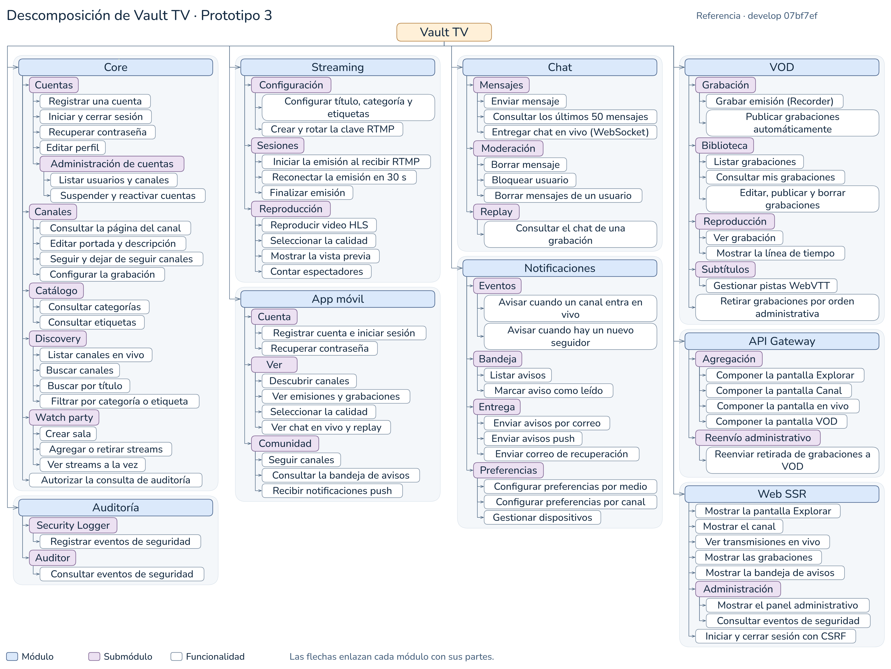

La vista muestra cómo organizamos Vault TV en módulos y qué funcionalidades pertenecen a cada uno. El árbol contiene 9 módulos, 28 submódulos y 79 funcionalidades representadas. Las ramas más detalladas alcanzan cinco niveles. Por ejemplo, desde Vault TV se llega a Core, luego a Cuentas, a Administración de cuentas y, finalmente, a la función de suspender y reactivar cuentas.

#### Elementos

**Sistema:** Vault tv, la raíz del árbol.

**Módulos:** Core, Streaming, Chat, VOD, Notificaciones, API Gateway, Web SSR, App móvil y Auditoría. Cada uno agrupa una responsabilidad principal, como gestionar las emisiones, componer las pantallas o conservar la evidencia de seguridad.

**Submódulos:** las partes en que se organiza cada módulo por dentro.

**Funcionalidades:** lo que el usuario o el sistema puede hacer con cada submódulo.

#### Relaciones

La única relación de esta vista es es parte de, que en el diagrama se dibuja como una flecha del padre al hijo. Cada funcionalidad pertenece a un solo submódulo y cada submódulo a un solo módulo. Un módulo puede ir directo a sus funcionalidades cuando no necesita submódulos, como Web SSR. Las flechas no representan llamadas ni flujo de datos; eso lo muestra la vista de componentes y conectores.

#### Patrones utilizados

**Descomposición por dominio de negocio:** separamos los módulos por área del negocio (emisión, chat, grabaciones, avisos) y no por tipo técnico. Lo que permitió trabajar en paralelo.

**Monolito modular en Core:** Cuentas, Canales, Catálogo, Discovery, Administración y Watch party son submódulos con fronteras claras dentro de un mismo ejecutable. Lo decidimos así porque comparten datos y algunas operaciones necesitan una sola transacción, como el registro, que crea la cuenta, el perfil y el canal al mismo tiempo.

**Un módulo por cliente:** la web y la aplicación móvil son módulos separados aunque ofrezcan funciones parecidas, porque usan tecnologías distintas y se despliegan por separado.

Cada módulo de esta vista corresponde a un componente de la vista de componentes y conectores y a un contenedor de la vista de despliegue.

## Atributos de calidad

### Escenarios de seguridad

#### Canal Seguro

Un atacante conectado a la misma red que Vault tv intenta capturar el tráfico entre el navegador y el sistema, o entre dos servicios internos, para leer credenciales, cookies de sesión o datos de los usuarios.

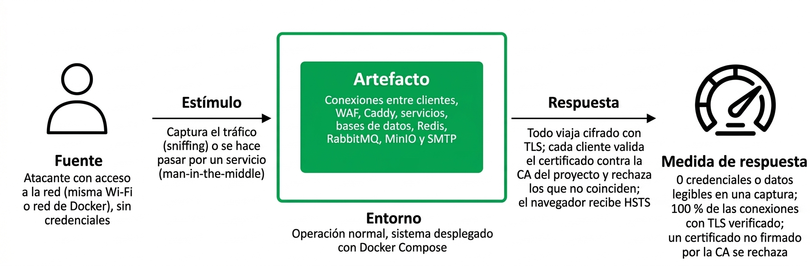

Tácticas aplicadas:

- Cifrar datos: TLS en todas las conexiones, públicas e internas.

- Autenticar actores: cada cliente verifica el certificado y el nombre del servidor antes de enviar datos.

- Limitar la exposición: la única entrada pública es el WAF por HTTPS, no hay ningún puerto HTTP publicado.

- Verificar la integridad de los mensajes: TLS usa cifrado autenticado, así que un mensaje modificado en el camino se descarta.

#### Reverse Proxy

El navegador y la aplicación móvil de Vault TV usan un mismo origen HTTPS para acceder a los servicios publicados.

La fuente es un cliente de la LAN situado fuera de las redes de contenedores. Su estímulo es consultar catálogo y explorar, solicitar rutas reservadas o desconocidas e intentar conectarse directamente a los puertos de los proveedores. El artefacto comprende la entrada HTTPS, las reglas de Caddy y la publicación de puertos. Caddy actúa como Reverse Proxy, es decir, recibe las solicitudes de los clientes y las dirige al servicio interno correspondiente sin exponer directamente esos servicios. El entorno es la operación normal, con los servicios disponibles y el certificado validado con la CA del ensayo. Se espera que Caddy reenvíe las consultas válidas y rechace las rutas evaluadas, mientras los puertos de los proveedores permanecen privados. La medida esperada es 2 de 2 consultas con HTTP 200 y los datos correctos, 4 de 4 rutas con HTTP 404 de Caddy y 0 de 6 conexiones TCP directas.

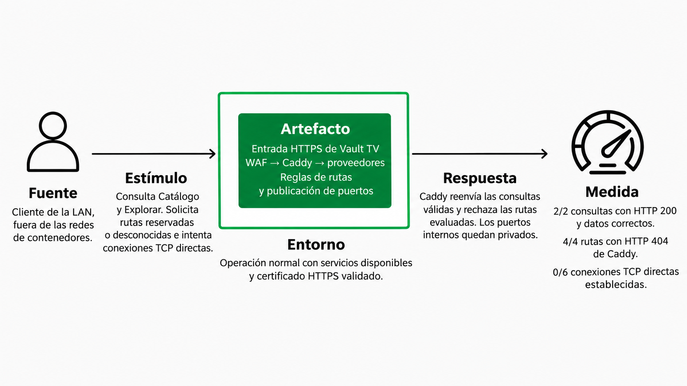

Táctica aplicada:

- Limitar acceso: Caddy rechaza las rutas reservadas y retira las cabeceras de identidad de servicio enviadas por el cliente. La configuración del despliegue mantiene privados los puertos de los proveedores.

#### Segmentación de red

La fuente corresponde a un atacante que logró comprometer la instancia de Chat. Su estímulo radica en efectuar accesos directos hacia las bases de datos de Core, VOD y Auditoría, valiéndose de la resolución DNS o de direcciones IP conocidas. El artefacto comprende a dichos almacenes de datos, mientras que el entorno es el funcionamiento habitual del despliegue orquestado con Docker Compose, manteniendo la máquina anfitriona fuera del control del atacante. La respuesta proyectada consiste en bloquear tales intentos de comunicación, preservando el aislamiento y la disponibilidad de los datos para cada componente legítimo. Como medida de evaluación, se establece un 0 % de tráfico concedido desde Chat hacia almacenes no asignados y un 100 % de efectividad en las solicitudes originadas por sus respectivos servicios propietarios.

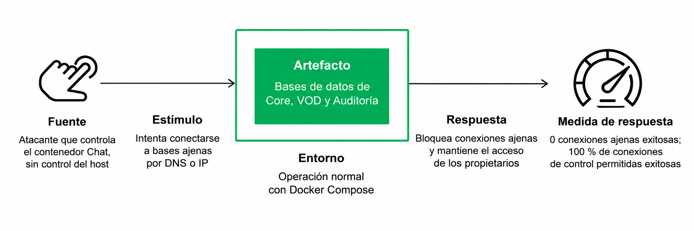

Mediante este escenario validamos el aislamiento requerido a nivel de infraestructura. Si bien Chat gestiona el flujo de mensajes e interactúa con determinadas APIs, sus casos de uso no justifican un canal directo hacia la persistencia de usuarios o de grabaciones. Permitir que la totalidad de los contenedores convivan en una misma red expondría recursos críticos en caso de una vulnerabilidad en este servicio.

Tácticas aplicadas:

- Limitar acceso: cada servicio se conecta únicamente a los segmentos de red estrictamente necesarios para el consumo de sus dependencias directas.

- Separar entidades: los almacenes de datos pertenecientes a diferentes dominios permanecen aislados en redes internas independientes.

- Limitar la exposición: las instancias de persistencia no mapean ni exponen sus puertos hacia el nodo anfitrión (host) y permanecen segregadas de la red de exposición de APIs.

#### Zero trust

Los patrones anteriormente mencionados protegen el perímetro, cifran el canal, dejan una sola entrada pública y separan redes. Zero Trust nace de que ninguno de estos toma en cuenta si un atacante ya controla un componente, por ejemplo por una dependencia del proyecto vulnerable. Si estar dentro de la red bastará para entrar, comprometer un solo componente daría acceso a los datos de todos. Por eso adoptamos Zero Trust en todo el sistema: ninguna conexión interna se acepta por su origen, todas presentan una identidad.

La definición corta de zero trust es “no confiar en la ubicación de red; autenticar cada acceso, autorizarlo con mínimo privilegio y verificarlo en cada conexión”

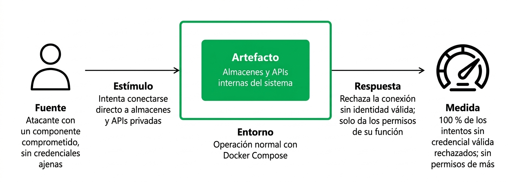

La fuente es un atacante que ya controla un componente interno, sin las credenciales de los demás. Su estímulo es intentar conectarse directamente a los almacenes de datos y a las APIs privadas, saltándose los componentes de entrada. El artefacto son esos almacenes y APIs internas, y el entorno es la operación normal del sistema. La respuesta esperada es que cada componente rechace la conexión que no presenta una identidad válida y que, a una identidad válida, solo le conceda los permisos de su función. La medida que lo comprueba: el 100 % de los intentos sin credencial, con credencial incorrecta o con la de otro servicio se rechazan, y ninguna identidad obtiene permisos de más.

Tácticas aplicadas:

- Autenticar actores: cada conexión interna presenta su identidad: token por servicio

- Autorizar actores: cada entidad recibe solo sus permisos

- Limitar acceso: las APIs internas viven en listeners separados de los públicos y ningún servicio tiene permisos de configuración ni comandos administrativos.

- Separar entidades: una base y una credencial por servicio; ninguno conoce la de otro.

#### Security Logger y Auditor

Aparte de prevenir acciones indebidas, se requiere resguardar registros para analizar incidentes. Si en Vault tv un perfil no autorizado pretende modificar, divulgar o borrar la emisión grabada de otro canal, el sistema bloquea la acción. A su vez, el mecanismo de rastreo documenta el usuario involucrado, el contenido objetivo, la marca temporal y la respuesta generada.

La definición corta de los registros de auditoría de seguridad es “mantener una traza durable y auditable de los eventos críticos del sistema, detallando el sujeto, la acción, el recurso afectado, la fecha y el resultado obtenido”.

Dentro de la solución, los componentes Core y VOD persisten los eventos en sus almacenes locales previa publicación hacia RabbitMQ. Posteriormente, el servicio Logger procesa y guarda la traza en una base dedicada únicamente a auditoría, aplicando deduplicación ante reintentos de mensajería. La herramienta Auditor habilita su lectura mediante el módulo de administración, previo control de sesión y rol ADMIN ejecutado por Core.

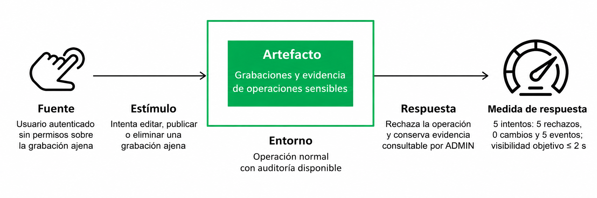

La fuente es un usuario autenticado sin derechos sobre el contenido ni privilegios de administración. Su estímulo consiste en forzar cambios, la publicación o la eliminación del archivo. El artefacto abarca la grabación y la traza asociada, mientras que el entorno corresponde a la ejecución habitual del stack con la recolección de eventos activa. La respuesta proyectada requiere que VOD deniegue la solicitud y genere un registro inmutable con la identidad, operación, elemento objetivo, marca de tiempo, resultado y código de correlación para análisis posterior. Como medida de evaluación, cinco peticiones no válidas deben producir cinco denegaciones sin alteración del recurso y generar cinco registros atribuidos correctamente. Se establece una latencia máxima de dos segundos para la disponibilidad del evento tras la respuesta de la API.

Tácticas aplicadas:

- Mantener una pista de auditoría: asegurar la persistencia durable y correlacionada de eventos, contemplando reintentos y descarte de duplicados.

- Autorizar actores: verificar el rol ADMIN al procesar cada consulta de la bitácora.

- Limitar acceso: restringir la lectura interna exclusivamente al Auditor y aplicar privilegios de base de datos que impidan la edición o borrado de la información de auditoría.

#### WAF (Application Firewall)

El Proxy Inverso decide a dónde va cada petición, pero no mira qué trae. Una inyección SQL, un XSS o un path traversal llegaban al servicio, y su rechazo dependía solo del código de cada uno de los cinco runtimes (Java, Rust, Go, TypeScript). Un solo fallo de validación quedaba expuesto sin otra barrera. Además, el administrador no tenía forma de saber que la plataforma estaba siendo atacada.

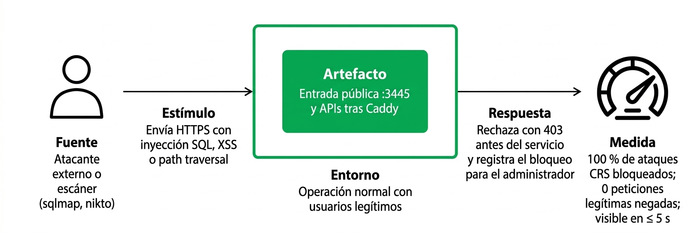

La fuente es un atacante externo o un escáner automático. Su estímulo son peticiones HTTPS con carga maliciosa, como inyección SQL, XSS o path traversal. El artefacto es la entrada pública del sistema y las APIs que hay detrás de Caddy, en un entorno de operación normal con usuarios legítimos al mismo tiempo. La respuesta esperada es que el WAF rechace la petición con 403 antes de que llegue a cualquier servicio y registre el bloqueo para el administrador. La medida que lo comprueba: el 100 % de las peticiones que coinciden con las reglas OWASP CRS se bloquean, ninguna petición legítima se bloquea y cada bloqueo se ve en la consola de auditoría en 5 s o menos.

Tácticas aplicadas:

- Limitar el acceso: el WAF bloquea con 403 desde un puntaje de 5 y acota métodos y tamaños de las peticiones.

- Limitar la exposición: la única entrada pública es el WAF por HTTPS; ningún servicio se alcanza directamente desde fuera.

- Separar entidades: el WAF solo comparte la red edge con Caddy, y su relay solo alcanza al broker.

- Auditar: cada bloqueo queda como evento de seguridad visible en /admin/audit.

### Pruebas de Rendimiento

Se registraron 180 mediciones en 21 escenarios. Se estimaron rodillas en Web SSR y en el canal con arranque gradual. Las cuotas del firewall de aplicación web (WAF) marcaron varios umbrales HTTP.

#### Resultados por escenario

| **Escenario** | **Última estable** | **Umbral operativo** |
| --- | --- | --- |
| WAF y proxy Caddy | 800 req/s | 800 a 1 150 req/s |
| Explorar y Grabaciones en Web SSR | 425 VU | 425 a 600 VU |
| Página de canal en Web SSR | 500 VU | 500 a 550 VU |
| Canal con arranque gradual | 1 000 VU | 1 000 a 1 050 VU |
| Agregado de canal en API Gateway | 980 req/s | 980 a 1 080 req/s |
| Taxonomía de Core | 980 req/s | 980 a 1 080 req/s |
| Discovery y búsqueda en Core | 10 req/s | 10 a 20 req/s |
| Canales y perfiles en Core | 980 req/s | 980 a 1 080 req/s |
| Sesión autenticada en Core | 980 req/s | 980 a 1 080 req/s |
| Inicio de sesión en Core | 295 req/s | 295 a 310 req/s |
| Watch party en Core | 980 req/s | 980 a 1 080 req/s |
| Estado de emisión en Streaming | 850 req/s | 850 a 925 req/s |
| Publicación RTMPS en Streaming y MediaMTX | 5 fuentes | 5 a 6 fuentes |
| Listas HLS en MediaMTX | 980 req/s | 980 a 1 080 req/s |
| Reproducción HLS en MediaMTX | 25 reproductores | 25 a 50 reproductores |
| Chat en vivo por WebSocket | 500 conexiones | 500 a 600 conexiones |
| Chat de una grabación | 980 req/s | 980 a 1 080 req/s |
| Biblioteca VOD | 980 req/s | 980 a 1 080 req/s |
| Lectura de segmentos VOD | 980 req/s | 980 a 1 080 req/s |
| Bandeja y preferencias de notificaciones | 980 req/s | 980 a 1 080 req/s |

#### Cómo leer los resultados

La banda naranja indica el tramo entre la última carga estable y el primer fallo repetido. La azul señala una rodilla estimada donde subió la latencia y el rendimiento creció poco o cayó.

El p95 es el tiempo dentro del cual se completó el 95 % de las operaciones válidas. VU significa usuarios virtuales y req/s, solicitudes por segundo. Las gráficas muestran el último intento de cada carga y las tablas reúnen todos los intentos medidos.

k6 generó la carga HTTP y WebSocket. Se usaron FFmpeg para RTMPS y Firefox para HLS. El generador y la aplicación compartieron el equipo físico.

#### WAF y proxy Caddy

20 s por escalón

El **WAF y el proxy Caddy** recibieron solicitudes HTTPS de k6 a un recurso estático. El umbral quedó entre **800 y 1 150 req/s**, con un 11,4 % de HTTP 429 en ambos intentos a 1 150.

| Latencia p95 | Rendimiento |
| :---: | :---: |
| 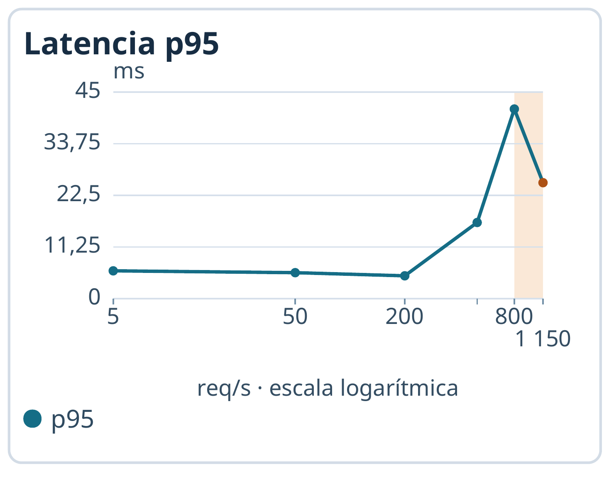 | 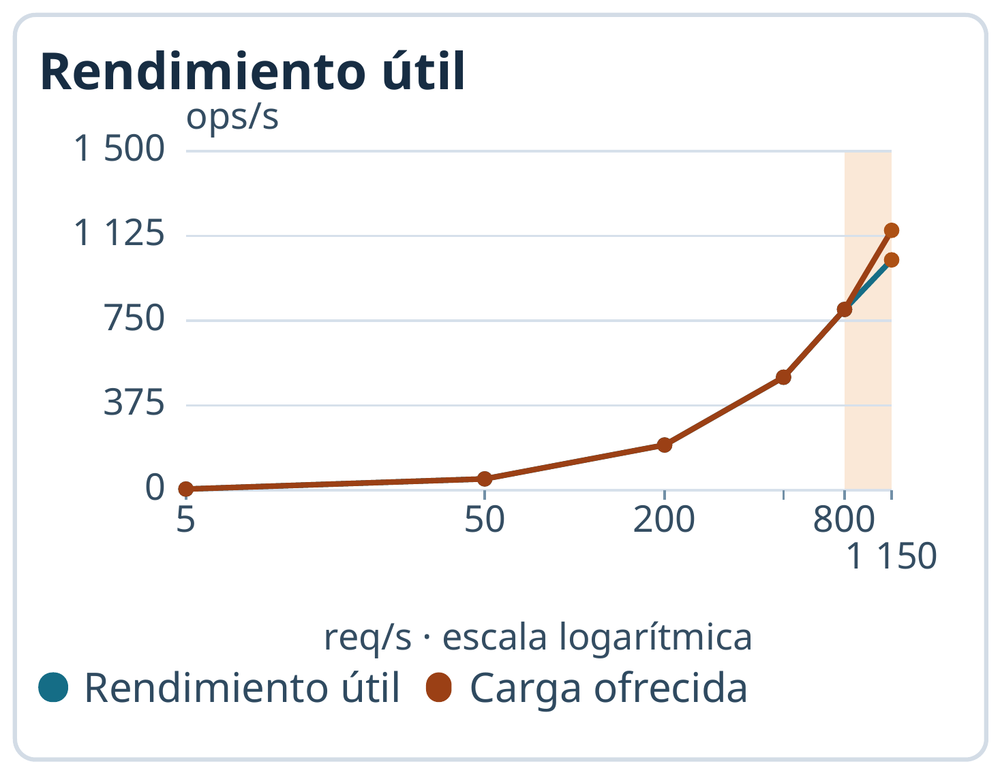 |

| **Carga (req/s)** | **Intento** | **Rendimiento (ops/s)** | **Error (%)** | **p95 (ms)** |
| --- | --- | --- | --- | --- |
| 5 | 1 | 5 | 0 | 6,054 |
| 50 | 1 | 50 | 0 | 5,657 |
| 200 | 1 | 200 | 0 | 4,973 |
| 500 | 1 | 499,75 | 0 | 16,59 |
| 800 | 1 | 800,05 | 0 | 41,321 |
| 1 150 | 1 | 1 019,5 | 11,35 | 27,725 |
| 1 150 | 2 | 1 019,2 | 11,38 | 25,27 |

#### Explorar y Grabaciones en Web SSR

24 s por escalón

El **frontend Web SSR** sirvió Explorar y Grabaciones con pausas de un segundo. La rodilla de **300 a 425 VU** se observó cuando el p95 subió de 0,57 a 1,15 s y el rendimiento apenas creció. El WAF devolvió HTTP 429 a 600 VU.

| Latencia p95 | Rendimiento |
| :---: | :---: |
| 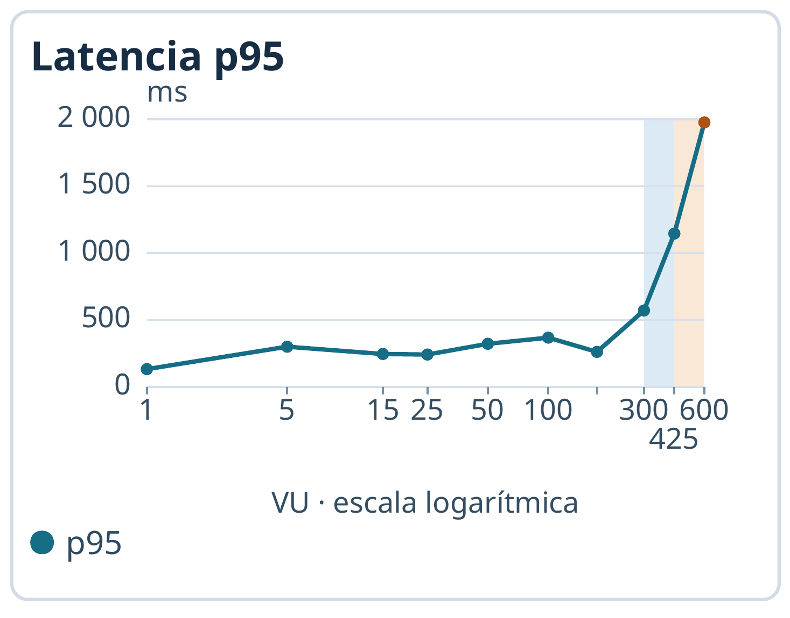 | 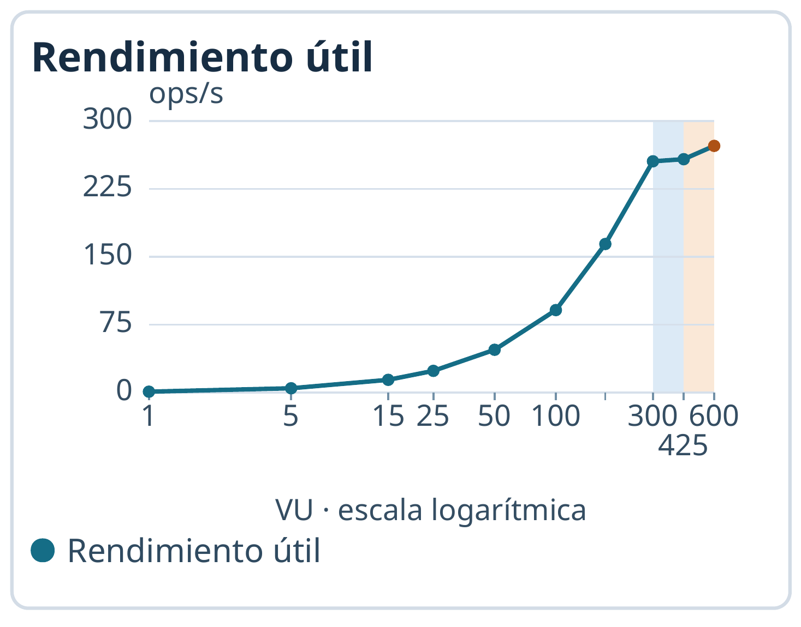 |

| **Carga (VU)** | **Intento** | **Rendimiento (ops/s)** | **Error (%)** | **p95 (ms)** |
| --- | --- | --- | --- | --- |
| 1 | 1 | 0,96 | 0 | 132,818 |
| 5 | 1 | 4,71 | 0 | 300,51 |
| 15 | 1 | 14,04 | 0 | 245,915 |
| 25 | 1 | 23,96 | 0 | 241,852 |
| 50 | 1 | 47,25 | 0 | 322,17 |
| 100 | 1 | 91,12 | 0 | 368,071 |
| 175 | 1 | 164,17 | 0 | 261,686 |
| 300 | 1 | 255,58 | 0 | 571,472 |
| 425 | 1 | 257,92 | 0 | 1 146,212 |
| 600 | 1 | 256,83 | 1,38 | 1 724,11 |
| 600 | 2 | 272,62 | 1,1 | 1 977,687 |

#### Página de canal en Web SSR

16 s por escalón

El **frontend Web SSR** renderizó la página de un canal ficticio con usuarios que entraron en paralelo. El umbral de **500 a 550 VU** se debió a la cuota de conexiones del WAF al inicio.

| Latencia p95 | Rendimiento |
| :---: | :---: |
| 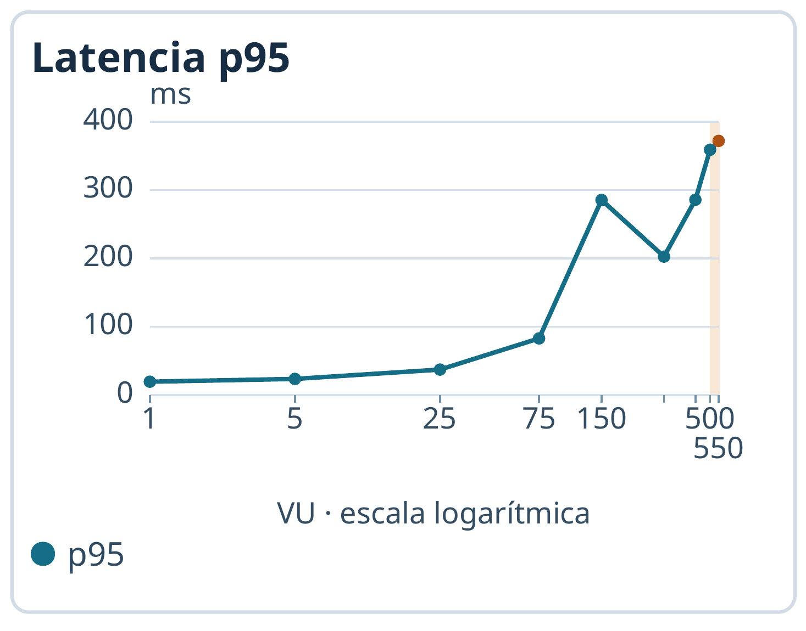 | 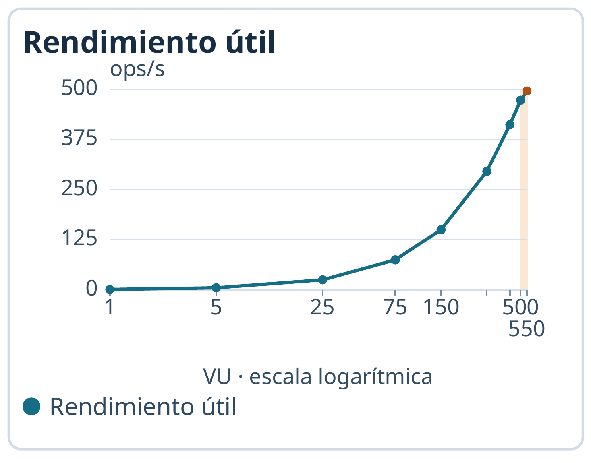 |

| **Carga (VU)** | **Intento** | **Rendimiento (ops/s)** | **Error (%)** | **p95 (ms)** |
| --- | --- | --- | --- | --- |
| 1 | 1 | 1 | 0 | 19,529 |
| 5 | 1 | 5 | 0 | 23,598 |
| 25 | 1 | 25 | 0 | 37,282 |
| 75 | 1 | 75 | 0 | 82,941 |
| 150 | 1 | 150 | 0 | 285,647 |
| 300 | 1 | 295,94 | 0 | 202,702 |
| 425 | 1 | 412 | 0 | 286,01 |
| 500 | 1 | 473,19 | 0 | 359,224 |
| 550 | 1 | 487,5 | 0,29 | 514,997 |
| 550 | 2 | 496,31 | 0,09 | 372,141 |

#### Canal con arranque gradual

16 s por escalón

Se cargó la **página de canal de Web SSR** con usuarios que entraron gradualmente. El p95 subió de 392 a 627 ms con poco aumento de rendimiento y la rodilla se estimó entre **650 y 850 VU**. El WAF rechazó solicitudes a 1 050 VU.

| Latencia p95 | Rendimiento |
| :---: | :---: |
| 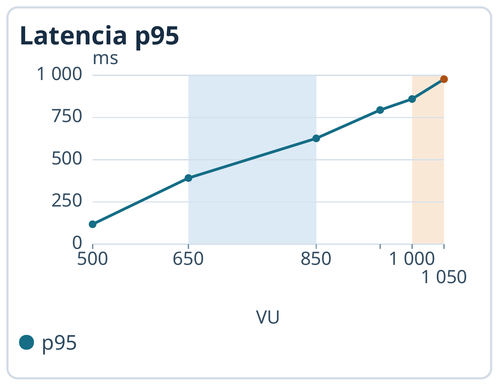 | 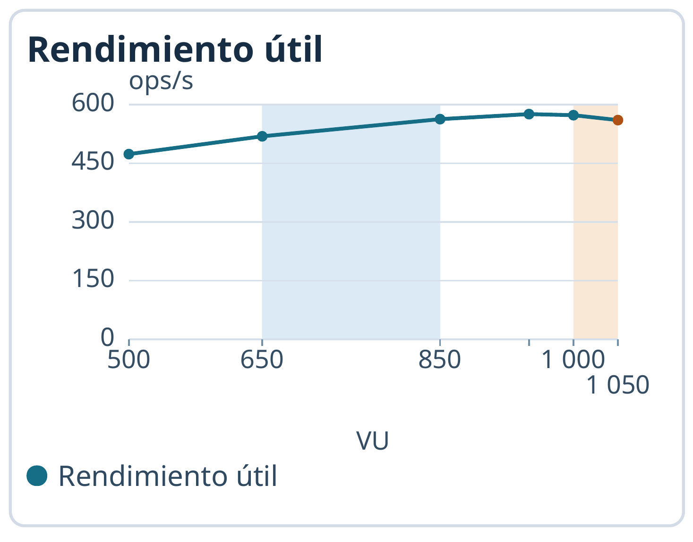 |

| **Carga (VU)** | **Intento** | **Rendimiento (ops/s)** | **Error (%)** | **p95 (ms)** |
| --- | --- | --- | --- | --- |
| 500 | 1 | 473,62 | 0 | 117,926 |
| 650 | 1 | 519,19 | 0 | 391,633 |
| 850 | 1 | 563,06 | 0 | 626,669 |
| 950 | 1 | 575,94 | 0 | 794,576 |
| 1 000 | 1 | 573,19 | 0 | 859,895 |
| 1 050 | 1 | 571,25 | 3,32 | 957,971 |
| 1 050 | 2 | 560,62 | 4,81 | 977,282 |

#### Agregado de canal en API Gateway

16 s por escalón

El **API Gateway** compuso la ficha de un canal con datos de Core, Streaming y VOD. El umbral fue de **980 a 1 080 req/s**, con cerca de 5,2 % de rechazos del WAF en ambos intentos a 1 080.

| Latencia p95 | Rendimiento |
| :---: | :---: |
| 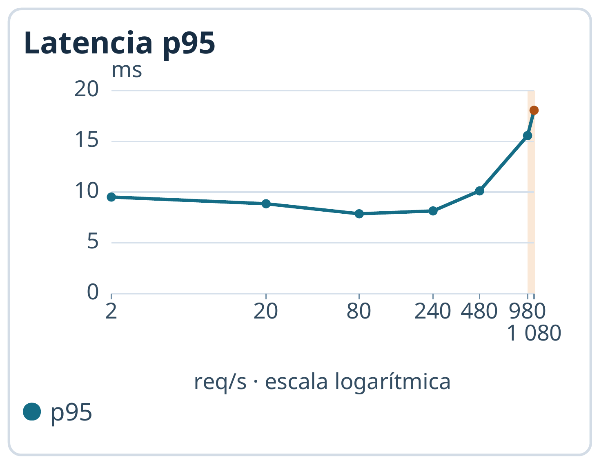 |  |

| **Carga (req/s)** | **Intento** | **Rendimiento (ops/s)** | **Error (%)** | **p95 (ms)** |
| --- | --- | --- | --- | --- |
| 2 | 1 | 2 | 0 | 9,515 |
| 20 | 1 | 20 | 0 | 8,853 |
| 80 | 1 | 80,06 | 0 | 7,864 |
| 240 | 1 | 240,06 | 0 | 8,146 |
| 480 | 1 | 480 | 0 | 10,12 |
| 980 | 1 | 980,06 | 0 | 15,563 |
| 1 080 | 1 | 1 024,19 | 5,17 | 18,984 |
| 1 080 | 2 | 1 024,56 | 5,14 | 18,059 |

#### Taxonomía de Core

24 s por escalón

Se probó **Taxonomía en Core** consultando categorías y etiquetas. El umbral fue de **980 a 1 080 req/s**, con cerca de 5,9 % de HTTP 429 del WAF a 1 080 y un p95 válido de unos 11 ms.

| Latencia p95 | Rendimiento |
| :---: | :---: |
| 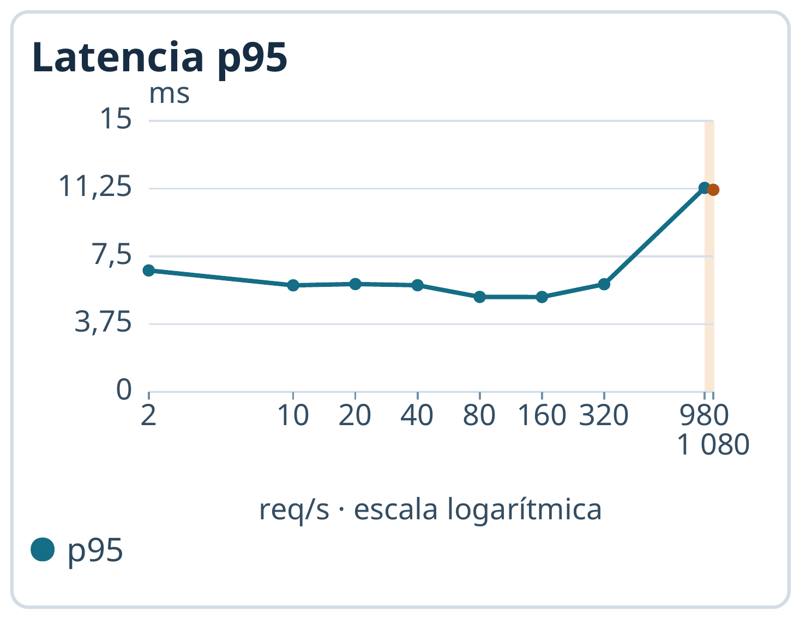 | 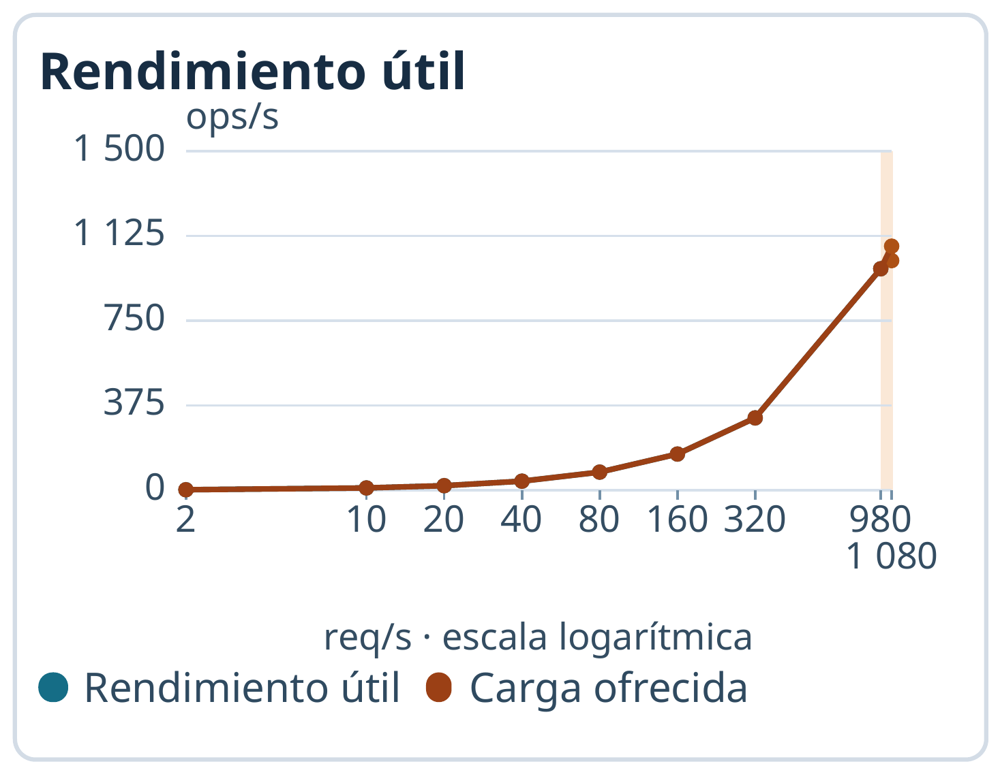 |

| **Carga (req/s)** | **Intento** | **Rendimiento (ops/s)** | **Error (%)** | **p95 (ms)** |
| --- | --- | --- | --- | --- |
| 2 | 1 | 2,04 | 0 | 6,724 |
| 10 | 1 | 10,04 | 0 | 5,9 |
| 20 | 1 | 20 | 0 | 5,971 |
| 40 | 1 | 40 | 0 | 5,905 |
| 80 | 1 | 80,04 | 0 | 5,258 |
| 160 | 1 | 160,04 | 0 | 5,254 |
| 320 | 1 | 320 | 0 | 5,961 |
| 980 | 1 | 980,04 | 0 | 11,292 |
| 1 080 | 1 | 1 016,12 | 5,92 | 11,2 |
| 1 080 | 2 | 1 016,08 | 5,92 | 11,187 |

#### Discovery y búsqueda en Core

24 s por escalón

Se probó **Discovery en Core** con dos consultas GraphQL en partes iguales, emisiones en directo y búsqueda de canales. El umbral fue de **10 a 20 req/s**. La cuota rechazó el 46,2 % a 20 req/s.

| Latencia p95 | Rendimiento |
| :---: | :---: |
| 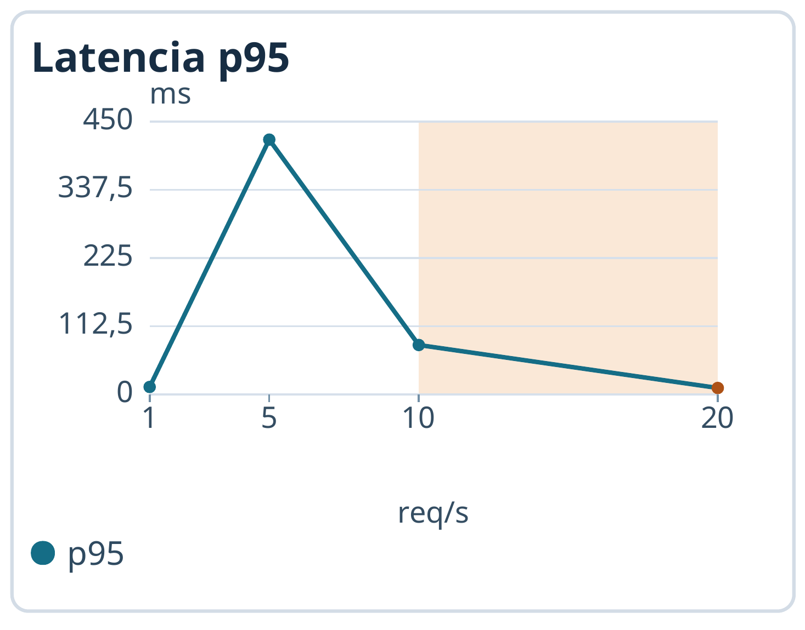 | 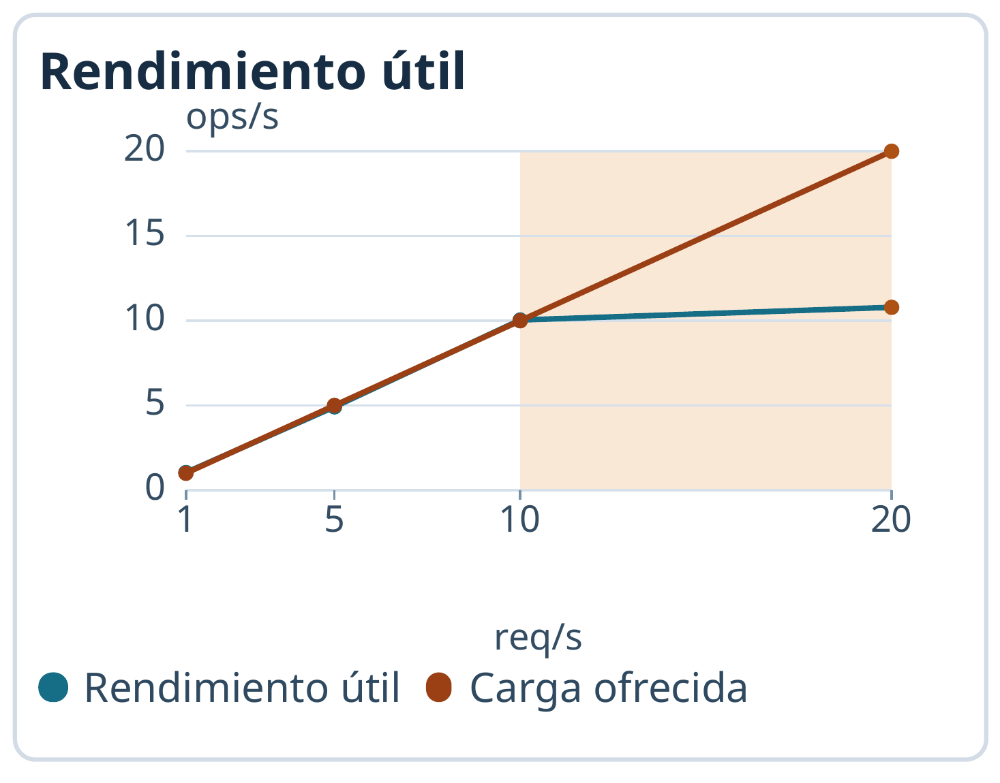 |

| **Carga (req/s)** | **Intento** | **Rendimiento (ops/s)** | **Error (%)** | **p95 (ms)** |
| --- | --- | --- | --- | --- |
| 1 | 1 | 1,04 | 0 | 12,286 |
| 5 | 1 | 4,92 | 0 | 420,416 |
| 10 | 1 | 10,04 | 0 | 81,515 |
| 20 | 1 | 10,79 | 46,15 | 11,336 |
| 20 | 2 | 10,79 | 46,15 | 10,618 |

#### Canales y perfiles en Core

16 s por escalón

Se probaron **los canales y perfiles de Core** leyendo el canal y el perfil público de una cuenta ficticia. El umbral de **980 a 1 080 req/s** se asoció a la cuota del WAF, con cerca de 5,2 % de rechazos a 1 080.

| Latencia p95 | Rendimiento |
| :---: | :---: |
| 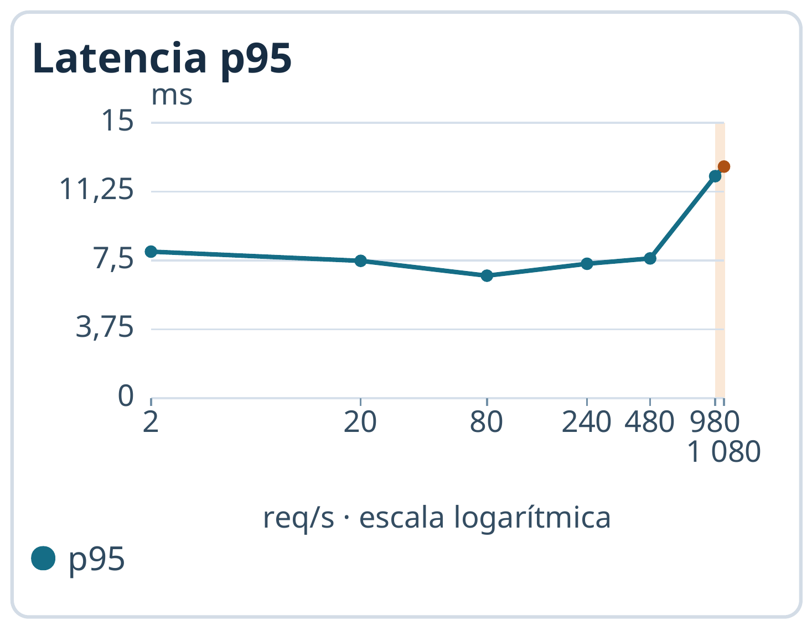 |  |

| **Carga (req/s)** | **Intento** | **Rendimiento (ops/s)** | **Error (%)** | **p95 (ms)** |
| --- | --- | --- | --- | --- |
| 2 | 1 | 2,06 | 0 | 7,984 |
| 20 | 1 | 20,06 | 0 | 7,481 |
| 80 | 1 | 80,06 | 0 | 6,673 |
| 240 | 1 | 240 | 0 | 7,323 |
| 480 | 1 | 480 | 0 | 7,614 |
| 980 | 1 | 980 | 0 | 12,095 |
| 1 080 | 1 | 1 024,19 | 5,17 | 12,093 |
| 1 080 | 2 | 1 024,25 | 5,17 | 12,618 |

#### Sesión autenticada en Core

16 s por escalón

Se probó **la validación de sesión en Core** leyendo el perfil propio con una sesión ficticia válida. El umbral fue de **980 a 1 080 req/s**, con HTTP 429 del WAF en ambos intentos a 1 080.

| Latencia p95 | Rendimiento |
| :---: | :---: |
| 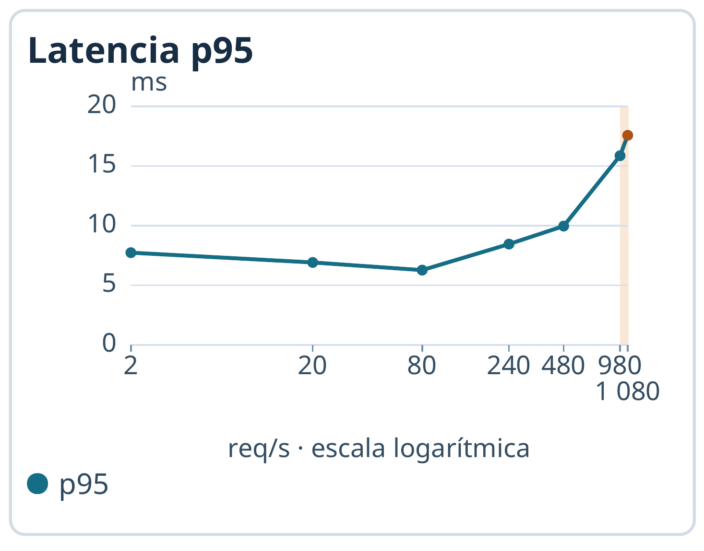 |  |

| **Carga (req/s)** | **Intento** | **Rendimiento (ops/s)** | **Error (%)** | **p95 (ms)** |
| --- | --- | --- | --- | --- |
| 2 | 1 | 2 | 0 | 7,737 |
| 20 | 1 | 20,06 | 0 | 6,917 |
| 80 | 1 | 80,06 | 0 | 6,276 |
| 240 | 1 | 240,06 | 0 | 8,457 |
| 480 | 1 | 480,06 | 0 | 9,968 |
| 980 | 1 | 980,06 | 0 | 15,868 |
| 1 080 | 1 | 1 024,19 | 5,17 | 16,915 |
| 1 080 | 2 | 1 023,88 | 5,2 | 17,58 |

#### Inicio de sesión en Core

16 s por escalón

k6 probó **la autenticación de Core** con cinco cuentas ficticias. El umbral quedó entre **295 y 310 req/s**. A 310, el primer intento registró fallos de CSRF y HTTP 429 y el segundo registró HTTP 403.

| Latencia p95 | Rendimiento |
| :---: | :---: |
| 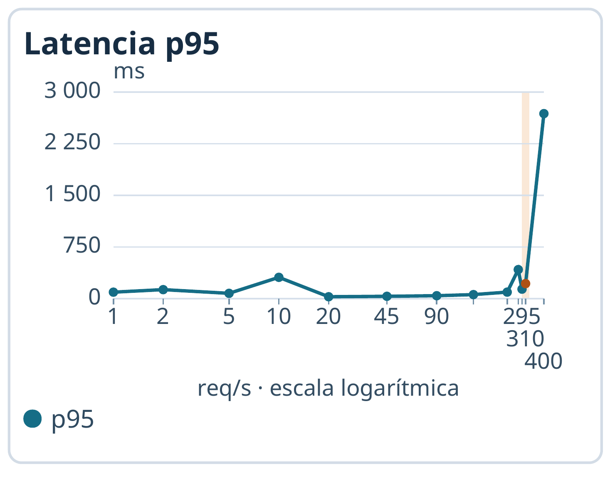 | 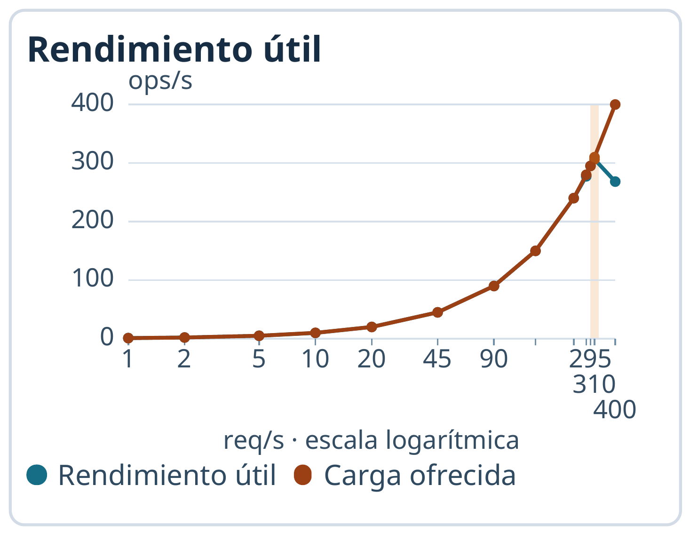 |

| **Carga (req/s)** | **Intento** | **Rendimiento (ops/s)** | **Error (%)** | **p95 (ms)** |
| --- | --- | --- | --- | --- |
| 1 | 1 | 1,06 | 0 | 93,892 |
| 2 | 1 | 2,06 | 0 | 130,716 |
| 5 | 1 | 5 | 0 | 76,991 |
| 10 | 1 | 9,88 | 0 | 309,412 |
| 20 | 1 | 20,06 | 0 | 27,403 |
| 45 | 1 | 45 | 0 | 33,921 |
| 90 | 1 | 90 | 0 | 42,489 |
| 150 | 1 | 150 | 0 | 58,408 |
| 240 | 1 | 240,06 | 0 | 94,598 |
| 280 | 1 | 277,38 | 0 | 421,762 |
| 295 | 1 | 295,06 | 0 | 137,611 |
| 310 | 1 | 276,56 | 1,62 | 2 169,528 |
| 310 | 2 | 306,38 | 1,01 | 218,182 |
| 400 | 1 | 268,31 | 27,56 | 2 687,766 |

#### Watch party en Core

16 s por escalón

Se probó **Watch party de Core** consultando una sala privada de ensayo. El umbral fue de **980 a 1 080 req/s**, con cerca de 5,2 % de errores por HTTP 429 del WAF a 1 080.

| Latencia p95 | Rendimiento |
| :---: | :---: |
| 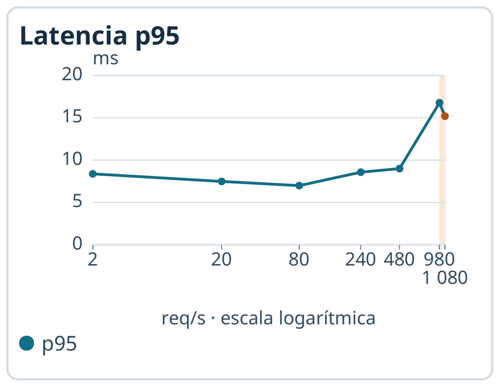 |  |

| **Carga (req/s)** | **Intento** | **Rendimiento (ops/s)** | **Error (%)** | **p95 (ms)** |
| --- | --- | --- | --- | --- |
| 2 | 1 | 2,06 | 0 | 8,379 |
| 20 | 1 | 20 | 0 | 7,486 |
| 80 | 1 | 80 | 0 | 6,993 |
| 240 | 1 | 240,06 | 0 | 8,578 |
| 480 | 1 | 480,06 | 0 | 9,003 |
| 980 | 1 | 980,06 | 0 | 16,786 |
| 1 080 | 1 | 1 024,06 | 5,18 | 15,853 |
| 1 080 | 2 | 1 024,44 | 5,15 | 15,195 |

#### Estado de emisión en Streaming

16 s por escalón

Se probó **la API de Streaming** consultando el estado y la configuración de una emisión. La cuota de conexiones del WAF marcó el umbral de **850 a 925 req/s**. A 725 req/s, el primer intento tuvo 2,74 % de errores y el segundo 0 %.

| Latencia p95 | Rendimiento |
| :---: | :---: |
| 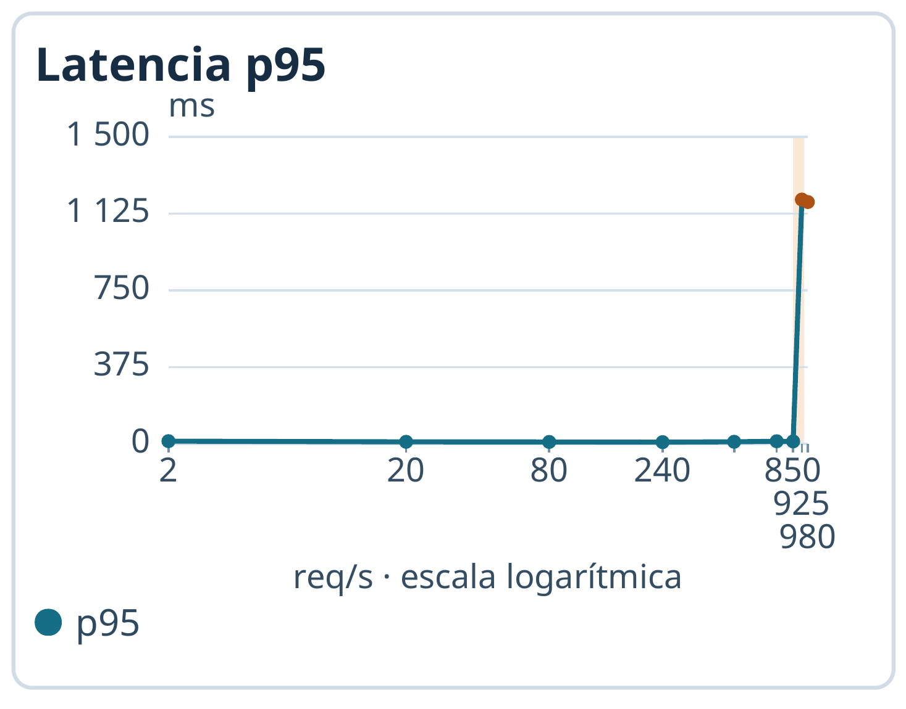 | 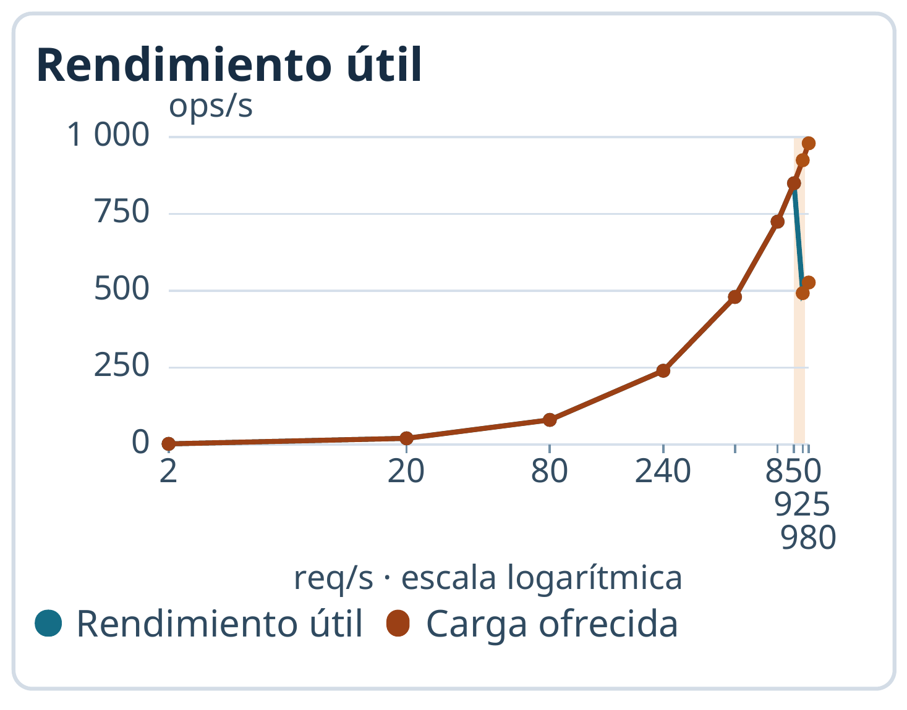 |

| **Carga (req/s)** | **Intento** | **Rendimiento (ops/s)** | **Error (%)** | **p95 (ms)** |
| --- | --- | --- | --- | --- |
| 2 | 1 | 2 | 0 | 13,252 |
| 20 | 1 | 20,06 | 0 | 10,008 |
| 80 | 1 | 80,06 | 0 | 9,403 |
| 240 | 1 | 240 | 0 | 8,629 |
| 480 | 1 | 480,06 | 0 | 10,253 |
| 725 | 2 | 725,06 | 0 | 12,765 |
| 850 | 1 | 850 | 0 | 12,046 |
| 925 | 1 | 829,69 | 8,37 | 1 012,034 |
| 925 | 2 | 492,44 | 45,61 | 1 194,033 |
| 980 | 1 | 645,69 | 32,8 | 1 194,386 |
| 980 | 2 | 527,06 | 45,12 | 1 181,903 |

#### Publicación RTMPS en Streaming y MediaMTX

18 s por escalón

Se probaron **MediaMTX y la admisión de sesiones de Streaming** publicando emisiones RTMPS 720p30. El umbral fue de **5 a 6 fuentes**. A seis, el cupo de Streaming dejó cinco fuentes reproducibles por HLS en ambos intentos.

| Latencia p95 | Rendimiento |
| :---: | :---: |
| 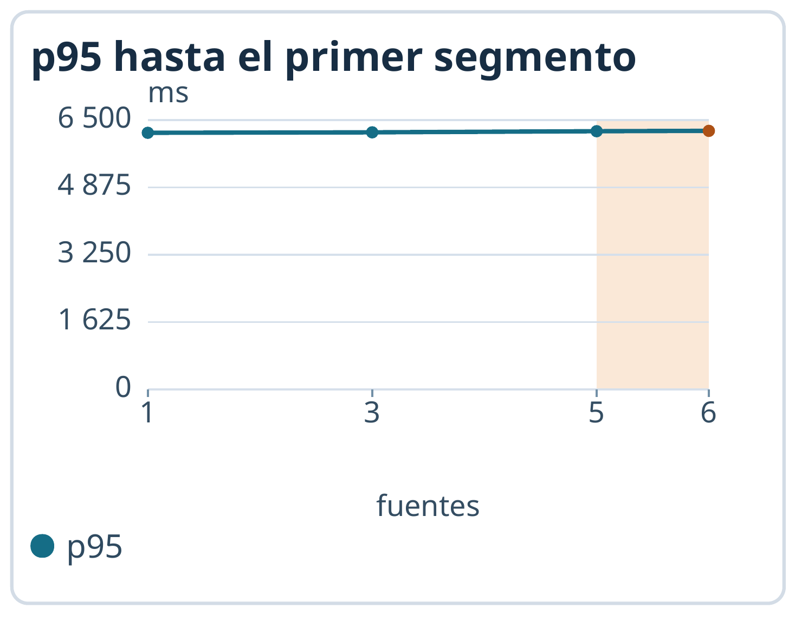 | 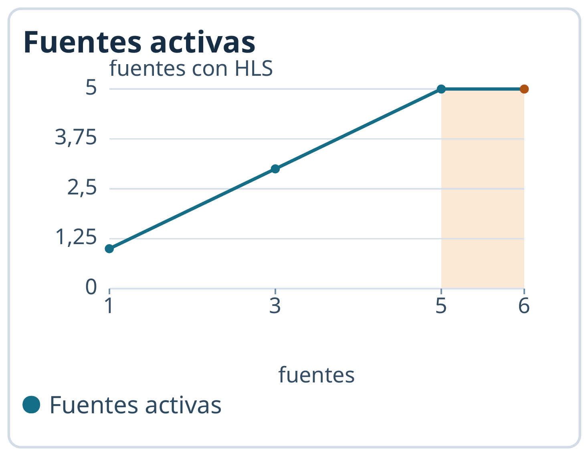 |

| **Carga (fuentes)** | **Intento** | **Rendimiento<br>(fuentes con HLS)** | **Error (%)** | **p95 (ms)** |
| --- | --- | --- | --- | --- |
| 1 | 1 | 1 | 0 | 6 194,811 |
| 3 | 1 | 3 | 0 | 6 206,013 |
| 5 | 1 | 5 | 0 | 6 233,07 |
| 6 | 1 | 5 | 16,67 | 6 294,764 |
| 6 | 2 | 5 | 16,67 | 6 241,505 |

#### Listas HLS en MediaMTX

18 s por escalón

k6 probó **la entrega de listas HLS de MediaMTX** con cinco emisiones. El umbral fue de **980 a 1 080 req/s**, con cerca de 5,4 % de HTTP 429 del WAF a 1 080.

| Latencia p95 | Rendimiento |
| :---: | :---: |
| 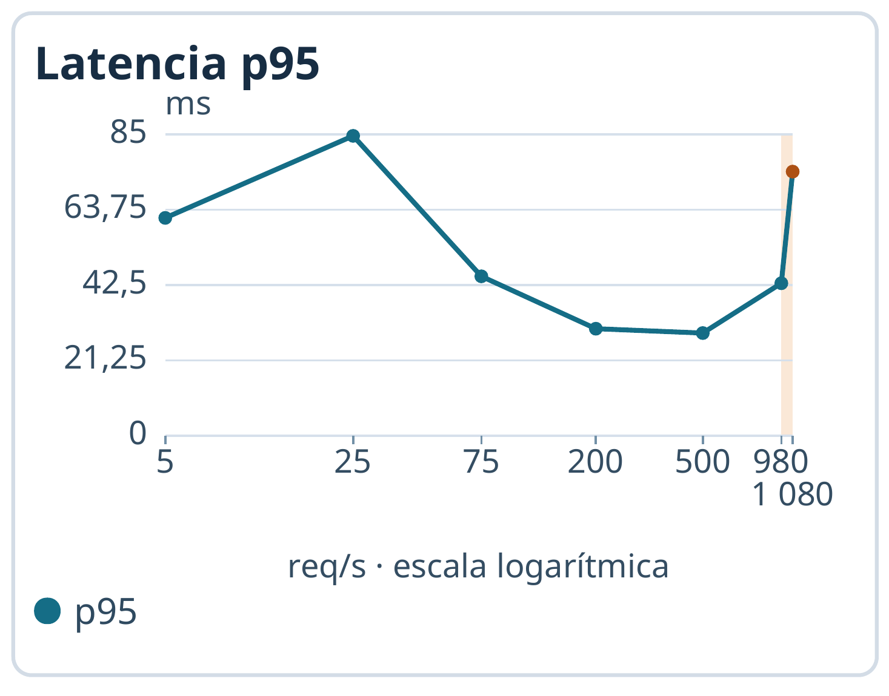 | 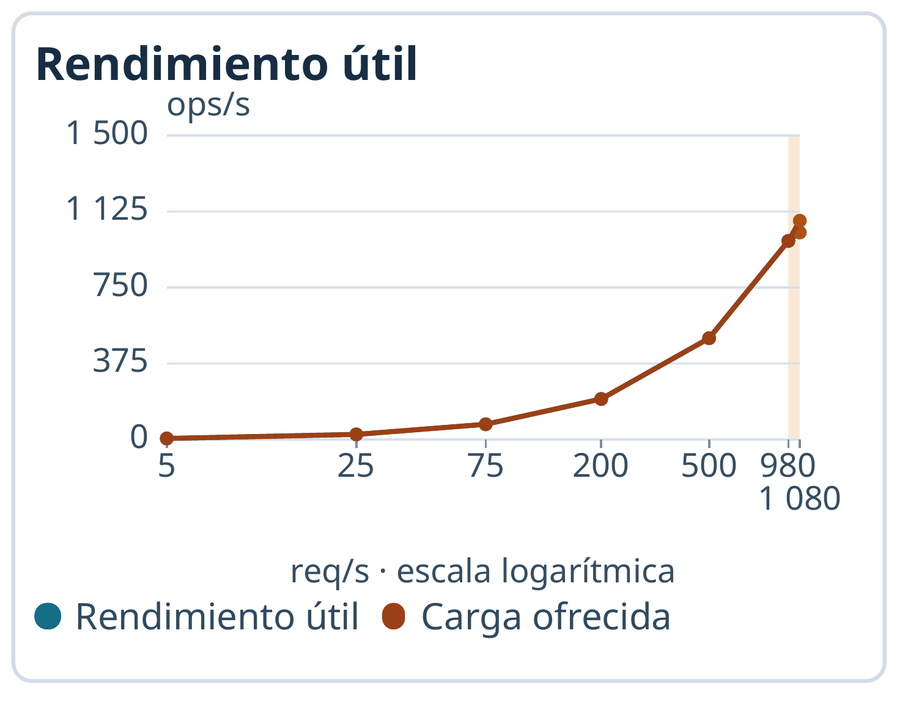 |

| **Carga (req/s)** | **Intento** | **Rendimiento (ops/s)** | **Error (%)** | **p95 (ms)** |
| --- | --- | --- | --- | --- |
| 5 | 1 | 5,06 | 0 | 61,459 |
| 25 | 1 | 25 | 0 | 84,599 |
| 75 | 1 | 75,06 | 0 | 44,977 |
| 200 | 1 | 200,06 | 0 | 30,192 |
| 500 | 1 | 500 | 0 | 28,966 |
| 980 | 1 | 980,06 | 0 | 43,021 |
| 1 080 | 1 | 1 021,56 | 5,42 | 61,515 |
| 1 080 | 2 | 1 021,67 | 5,41 | 74,516 |

#### Reproducción HLS en MediaMTX

Rampa y meseta

Se probó **la reproducción HLS de MediaMTX** con Firefox y HLS.js sobre cinco emisiones. El umbral fue de **25 a 50 reproductores**, con p95 de 537 ms al primer fotograma a 25 y errores de red repetidos a 50.

| Latencia p95 | Rendimiento |
| :---: | :---: |
| 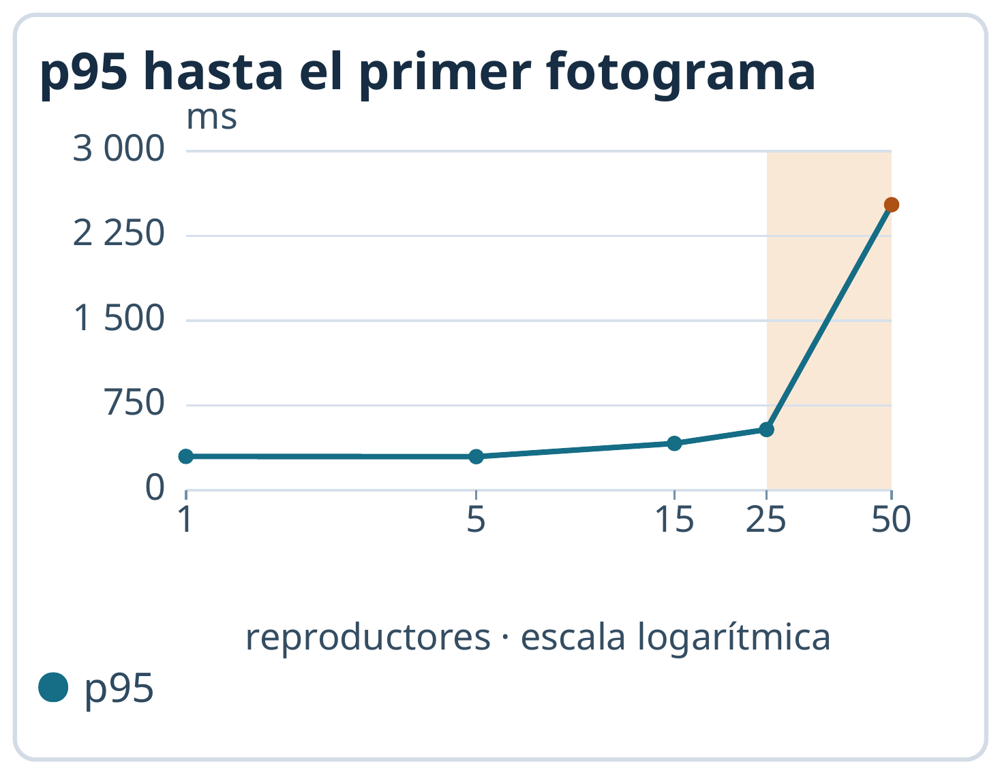 | 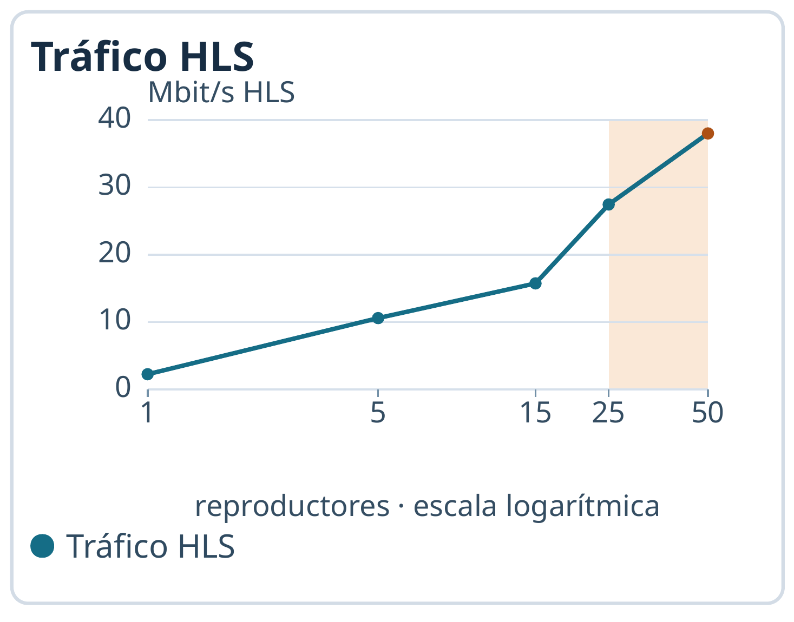 |

| **Carga (reproductores)** | **Intento** | **Rendimiento (Mbit/s HLS)** | **Error (%)** | **p95 (ms)** |
| --- | --- | --- | --- | --- |
| 1 | 1 | 2,25 | 0 | 299 |
| 5 | 1 | 10,59 | 0 | 297 |
| 15 | 1 | 15,75 | 0 | 414 |
| 25 | 1 | 27,47 | 0 | 537 |
| 50 | 1 | 42,95 | 46 | 2 507 |
| 50 | 2 | 38,03 | 18 | 2 527 |

#### Chat en vivo por WebSocket

18 s por escalón

El **servicio Chat** se probó por WebSocket en una sala con cinco emisores. El umbral fue de **500 a 600 conexiones**. Al ofrecer 600, quedaron 512 listas y faltaron 6 336 entregas en cada intento.

| Latencia p95 | Rendimiento |
| :---: | :---: |
| 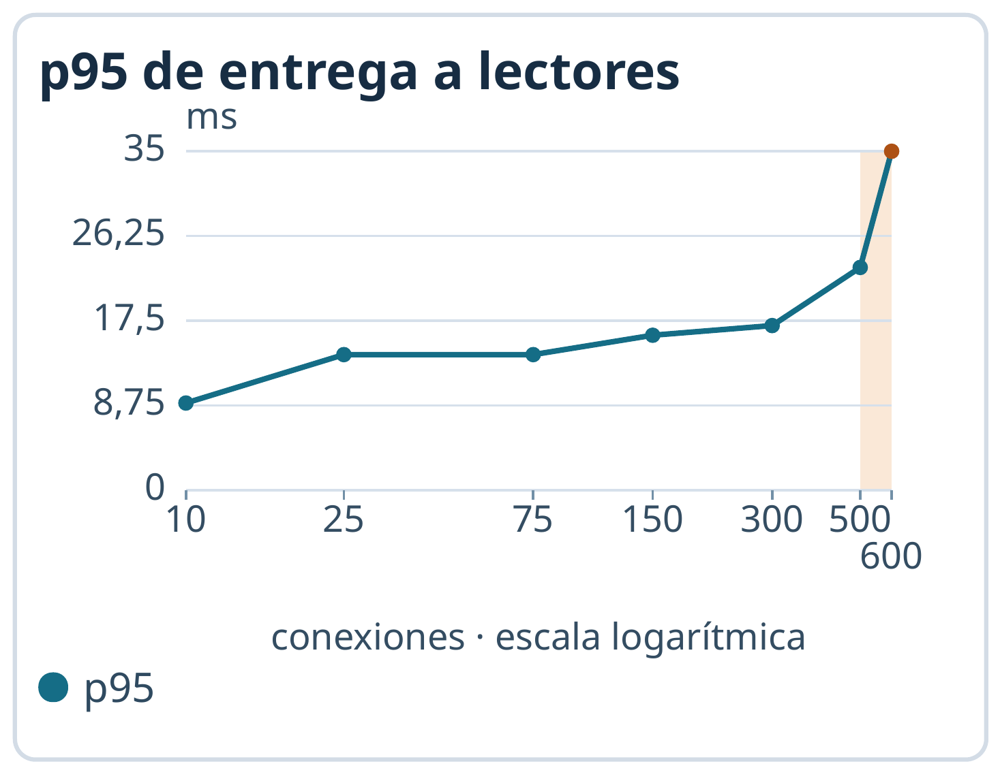 | 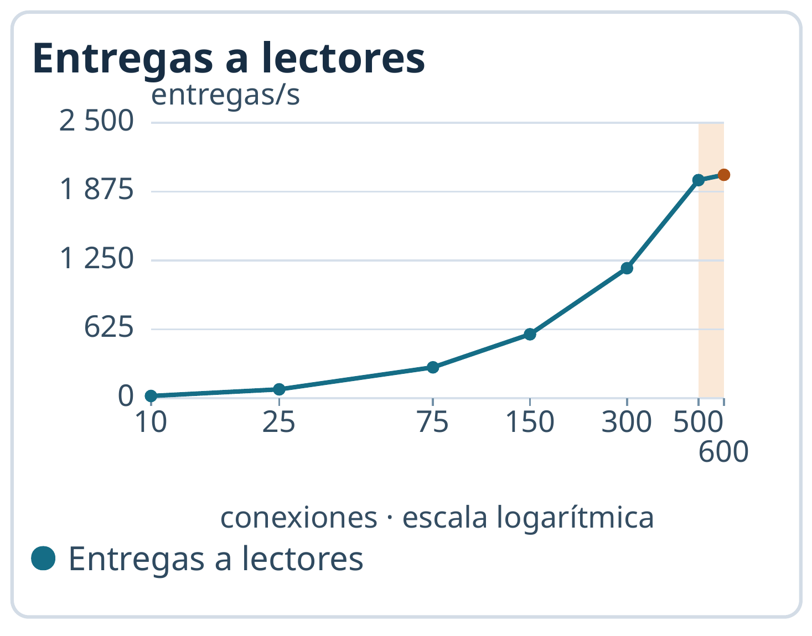 |

| **Carga (conexiones)** | **Intento** | **Rendimiento (entregas/s)** | **Error (%)** | **p95 (ms)** |
| --- | --- | --- | --- | --- |
| 10 | 1 | 20 | 0 | 9 |
| 25 | 1 | 80 | 0 | 14 |
| 75 | 1 | 280 | 0 | 14 |
| 150 | 1 | 580 | 0 | 16 |
| 300 | 1 | 1 180 | 0 | 17 |
| 500 | 1 | 1 980 | 0 | 23 |
| 600 | 1 | 2 028 | 14,67 | 20 |
| 600 | 2 | 2 028 | 14,67 | 35 |

#### Chat de una grabación

16 s por escalón

Se probó **el historial del servicio Chat** leyendo la primera página de mensajes de una grabación. El umbral fue de **980 a 1 080 req/s**, con cerca de 8,2 % de errores a 1 080, principalmente por el WAF.

| Latencia p95 | Rendimiento |
| :---: | :---: |
| 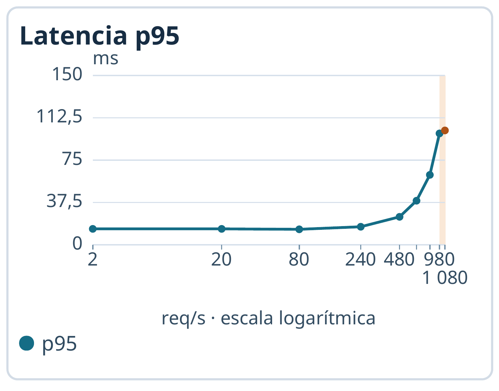 |  |

| **Carga (req/s)** | **Intento** | **Rendimiento (ops/s)** | **Error (%)** | **p95 (ms)** |
| --- | --- | --- | --- | --- |
| 2 | 1 | 2,06 | 0 | 14,112 |
| 20 | 1 | 20,06 | 0 | 14,095 |
| 80 | 1 | 80 | 0 | 13,72 |
| 240 | 1 | 240,06 | 0 | 15,981 |
| 480 | 1 | 480,06 | 0 | 24,772 |
| 650 | 1 | 650 | 0 | 39,059 |
| 825 | 1 | 825,06 | 0 | 61,955 |
| 980 | 1 | 979,38 | 0 | 98,7 |
| 980 | 1 | 624,56 | 6,75 | 556,232 |
| 1 080 | 1 | 989,88 | 8,15 | 70,299 |
| 1 080 | 2 | 988,56 | 8,17 | 101,338 |

#### Biblioteca VOD

24 s por escalón

Se probó **la biblioteca del servicio VOD** consultando los metadatos de grabaciones públicas. El umbral fue de **980 a 1 080 req/s**, con cerca de 5,9 % de HTTP 429 del WAF a 1 080.

| Latencia p95 | Rendimiento |
| :---: | :---: |
| 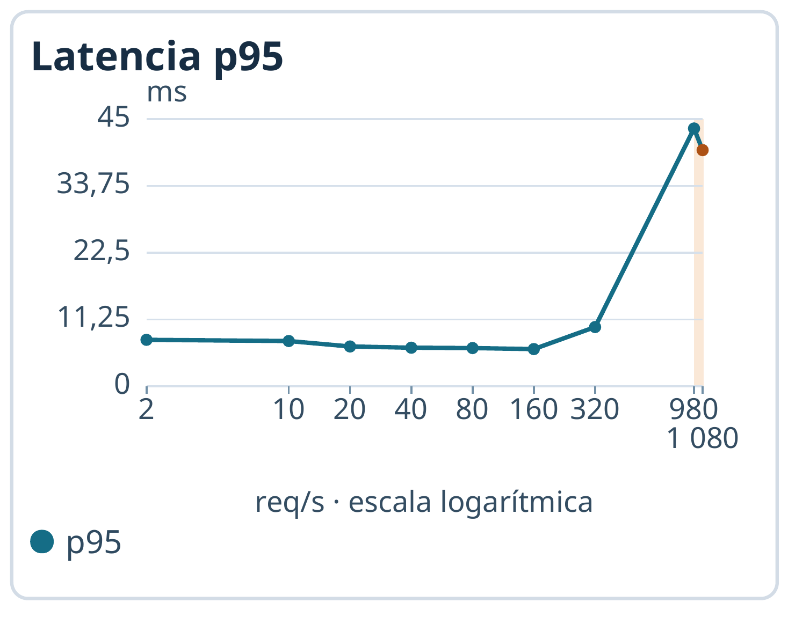 |  |

| **Carga (req/s)** | **Intento** | **Rendimiento (ops/s)** | **Error (%)** | **p95 (ms)** |
| --- | --- | --- | --- | --- |
| 2 | 1 | 2 | 0 | 7,825 |
| 10 | 1 | 10,04 | 0 | 7,623 |
| 20 | 1 | 20 | 0 | 6,707 |
| 40 | 1 | 40,04 | 0 | 6,5 |
| 80 | 1 | 80 | 0 | 6,438 |
| 160 | 1 | 160,04 | 0 | 6,263 |
| 320 | 1 | 320,04 | 0 | 9,977 |
| 980 | 1 | 980,04 | 0 | 43,434 |
| 1 080 | 1 | 1 016,12 | 5,91 | 38,575 |
| 1 080 | 2 | 1 015,92 | 5,94 | 39,787 |

#### Lectura de segmentos VOD

16 s por escalón

El **servicio VOD** recibió consultas de la lista HLS y lecturas de hasta 128 KiB de un segmento. El umbral fue de **980 a 1 080 req/s**, con cerca de 8 % de errores por intento a 1 080 y saturación del equipo en uno.

| Latencia p95 | Rendimiento |
| :---: | :---: |
| 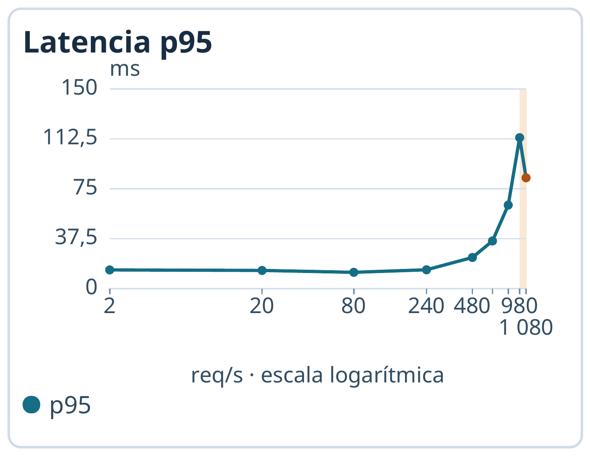 |  |

| **Carga (req/s)** | **Intento** | **Rendimiento (ops/s)** | **Error (%)** | **p95 (ms)** |
| --- | --- | --- | --- | --- |
| 2 | 1 | 2,06 | 0 | 14,048 |
| 20 | 1 | 20,06 | 0 | 13,663 |
| 80 | 1 | 80 | 0 | 12,249 |
| 240 | 1 | 240,06 | 0 | 14,153 |
| 480 | 1 | 479,12 | 0 | 23,405 |
| 650 | 1 | 650,06 | 0 | 35,792 |
| 825 | 1 | 825 | 0 | 62,807 |
| 980 | 1 | 980,06 | 0 | 113,467 |
| 980 | 1 | 979,25 | 0 | 139,634 |
| 1 080 | 1 | 990,12 | 8,09 | 116,592 |
| 1 080 | 2 | 993,81 | 7,99 | 83,28 |

#### Bandeja y preferencias de notificaciones

16 s por escalón

La **API de Notificaciones** recibió lecturas autenticadas de bandeja y preferencias en partes iguales. El umbral fue de **980 a 1 080 req/s**, con cerca de 5,2 % de HTTP 429 del WAF a 1 080.

| Latencia p95 | Rendimiento |
| :---: | :---: |
| 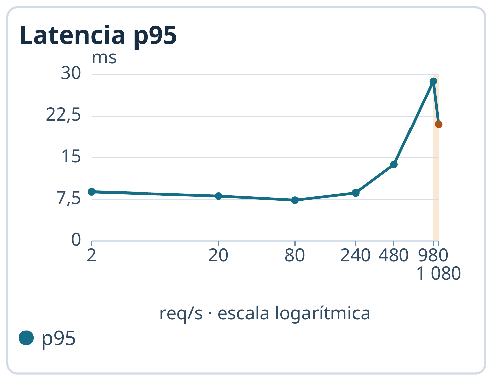 | 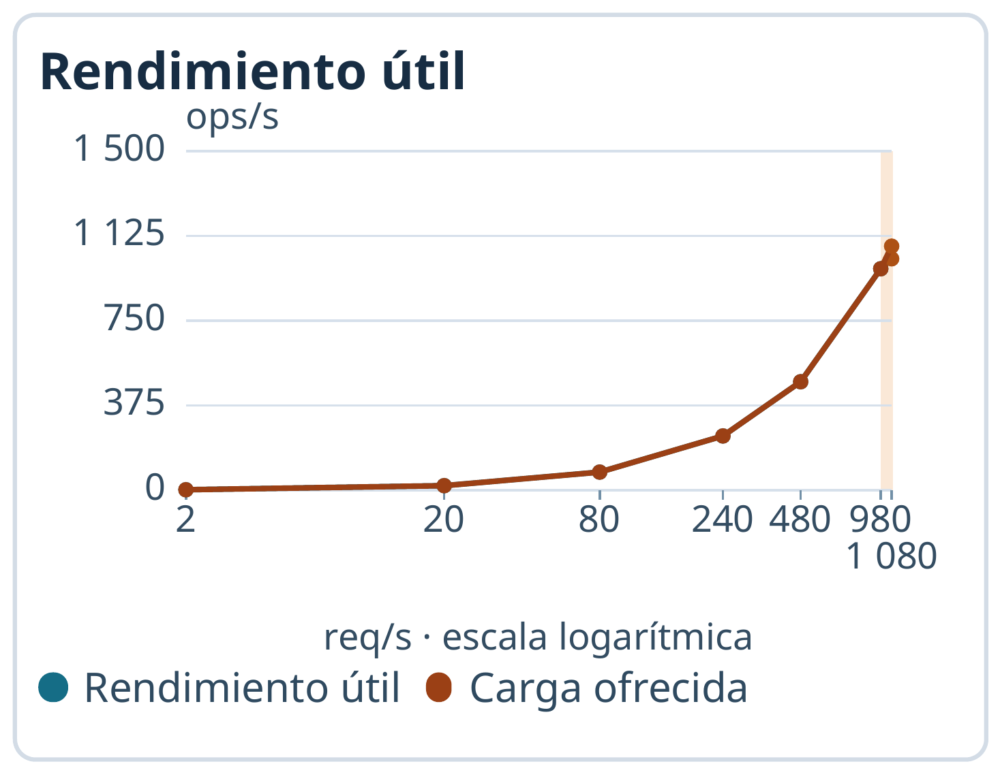 |

| **Carga (req/s)** | **Intento** | **Rendimiento (ops/s)** | **Error (%)** | **p95 (ms)** |
| --- | --- | --- | --- | --- |
| 2 | 1 | 2,06 | 0 | 8,866 |
| 20 | 1 | 20,06 | 0 | 8,126 |
| 80 | 1 | 80,06 | 0 | 7,384 |
| 240 | 1 | 240 | 0 | 8,677 |
| 480 | 1 | 480,06 | 0 | 13,781 |
| 980 | 1 | 980,06 | 0 | 28,742 |
| 1 080 | 1 | 1 024,06 | 5,18 | 17,161 |
| 1 080 | 2 | 1 024,12 | 5,18 | 21,029 |

## Prototipo

### Instrucciones para descargar y ejecutar el prototipo

#### Prerrequisitos

- Git.

- Docker Desktop con Docker Compose 2.24.4 o superior.

- Python 3.12 o superior.

- OpenSSL.

- Al menos 30 GB de espacio disponible para Docker.

#### Descargar los artefactos

```bash
git clone https://github.com/SWARCH-1A/streaming.git
cd streaming
```

#### Construir y ejecutar el sistema

```bash
python3 infra/local/dev.py init
python3 infra/local/dev.py build
python3 infra/local/dev.py up
python3 infra/local/dev.py status
```

Después de iniciar los servicios, acceder a:

```text
https://localhost:3445
```

Para detener el sistema:

```bash
python3 infra/local/dev.py down
```
