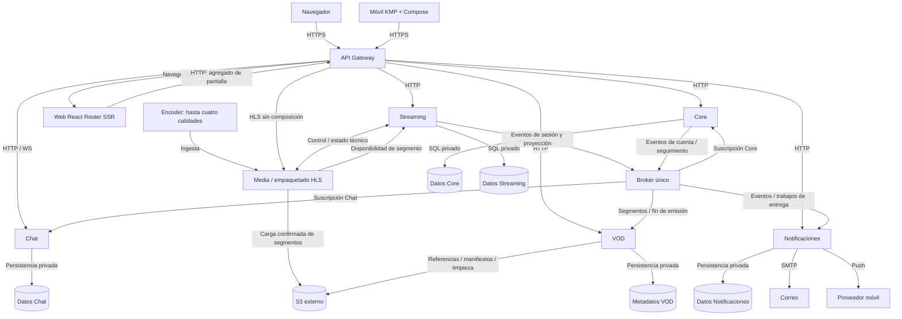
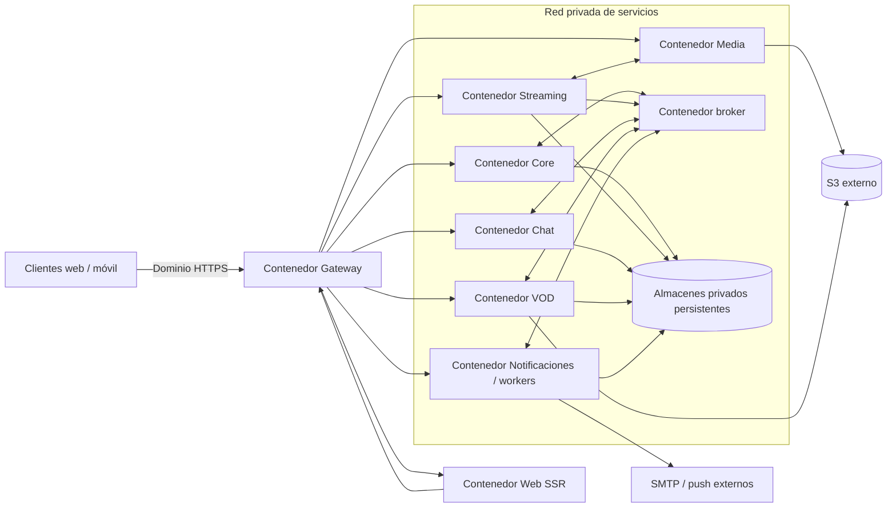

# Arquitectura de STREAMING — P2

El diseño de [ADR-015](adr/ADR-015-arquitectura-p2.md) cubre web SSR, aplicación móvil,
agregación por pantalla, comunicación híbrida, grabación VOD y notificaciones. Su aceptación
se verifica mediante [SPEC-15](spec-p2/spec_15_int.md); los componentes dibujados no acreditan
implementación. [Alcance](alcance_p2.md) y [decisiones pendientes](decisiones_pendientes_p2.md)
definen las políticas y los contratos aún abiertos.

## Contexto

Visitantes y usuarios descubren canales, consumen live/VOD y consultan chat desde web y móvil.
El streamer publica desde un encoder y administra su canal, grabaciones y moderación. Un
administrador puede retirar contenido y suspender cuentas. SMTP y push entregan avisos;
el almacenamiento S3 externo conserva los objetos audiovisuales.

## Componentes y conectores

La flecha de carga representa la responsabilidad técnica de persistir el segmento antes de
avisar; Streaming/Media y VOD deben cerrar qué proceso ejecuta esa carga. El broker transporta
referencias y metadatos, no bytes de video. Las llamadas HTTP síncronas entre servicios para
consultas y autorización se describen en los [flujos](integracion_sistema_p1.md).

| Unidad | Responsabilidad y datos propios | Conectores |
| --- | --- | --- |
| Core | Cuentas, sesiones, perfiles, canales, seguimiento, catálogo y Discovery; transacciones SQL locales | HTTP, GraphQL, publicación/consumo de eventos |
| Streaming | Configuración, claves, cupos, sesión, generaciones, reloj, leases y estado autoritativo | HTTP de control/contexto; eventos; adaptador Media |
| Media | Ingesta, validación de fuente, empaquetado HLS y captura de segmentos | Encoder, control Streaming, HLS, S3 |
| Chat | Mensajes durables, secuencia, dedupe, cuota, bloqueos, supresiones y replay | HTTP, WebSocket, contextos de autorización y eventos |
| VOD | Biblioteca, vínculo a sesión, metadatos, borradores, publicación y referencias a objetos | HTTP, broker y S3 |
| Notificaciones | Bandeja, lectura, preferencias, dispositivos e intentos por medio | HTTP, broker, SMTP y push |
| Gateway | Entrada HTTPS, rutas, agregados por pantalla, timeouts y errores parciales | HTTP, Upgrade WS y HLS |
| Web SSR | Rutas, carga inicial de datos y renderizado HTML; hidratación en navegador | HTTP al Gateway; HLS/WS en navegador |
| Móvil | Presentación de espectador y sesión nativa segura | APIs Gateway, HLS/WS y push |
| Broker | Distribución durable y aislamiento de consumidores/trabajos | Protocolo y producto pendientes |

## Capas y descomposición

La presentación comprende Web y móvil. El Gateway compone sus consultas. La capa de aplicación
reside en los dominios; los adaptadores conectan HTTP, mensajería, almacenamiento y proveedores.
Una vista agregada no desplaza permisos ni escrituras al Gateway.

Core mantiene módulos de Cuentas, Canales/seguimiento, Catálogo y Discovery en un proceso Java.
Streaming conserva su proceso Rust y Chat su proceso Go. VOD y Notificaciones son unidades
independientes. Sus tecnologías y las del Gateway se seleccionan por responsable mediante ADR.
Web usa TypeScript y móvil Kotlin. Watch parties y subtítulos requieren concretar su SPEC y
ubicación funcional antes de atribuirles un nuevo proceso.

## Despliegue

Cada servicio conserva credenciales y propiedad de escritura. VOD tiene persistencia privada;
compartir un servidor de base de datos no permite compartir tablas ni credenciales. La selección
de motores y la distribución física deben acreditar al menos cuatro componentes de datos,
incluyendo relacional y NoSQL. El broker no sustituye una base de negocio.

Core, Streaming, Chat, VOD y Notificaciones constituyen cinco unidades de dominio. La clasificación
del Gateway de agregación como sexta unidad lógica debe validarse con el criterio docente,
además de su función de comunicación/orquestación. Los módulos internos de Core no cuentan
como procesos independientes. Este punto permanece en P2-18.

El dominio público usa HTTPS y mantiene bloqueadas las rutas internas. Los puertos, lenguajes
nuevos, imágenes de contenedor y comandos P2 se fijan con la implementación. Para local se
admite configuración sencilla y almacenamiento compatible S3 configurable; MinIO y RustFS
son candidatos. Los comandos existentes siguen descritos en el [README](../README.md) y
el [runbook P1](../infra/p1/README.md).

## Aislamiento y recuperación

Una caída de Chat no interrumpe HLS; una de Notificaciones no revierte LIVE. El Gateway conserva
secciones utilizables y distingue error de ausencia. Un contexto de permiso no comprobado
impide la operación protegida. Las proyecciones públicas no autorizan escrituras.

Cada productor persiste la intención de evento con su cambio local. Cada consumidor confirma
solo tras persistir su responsabilidad; dedupe y versiones evitan regresiones por reentrega.
La recuperación de una proyección no reconstruye mensajes ni objetos perdidos: cada dueño
necesita su almacenamiento y recuperación correspondientes.

VOD conserva todas las rendiciones recibidas y valida el medio antes de publicar. La limpieza
es reintentable, con retirada de acceso inmediata. La suspensión de cuenta afecta también a
manifiestos, segmentos, subtítulos y replay; no basta ocultar enlaces de la interfaz.
