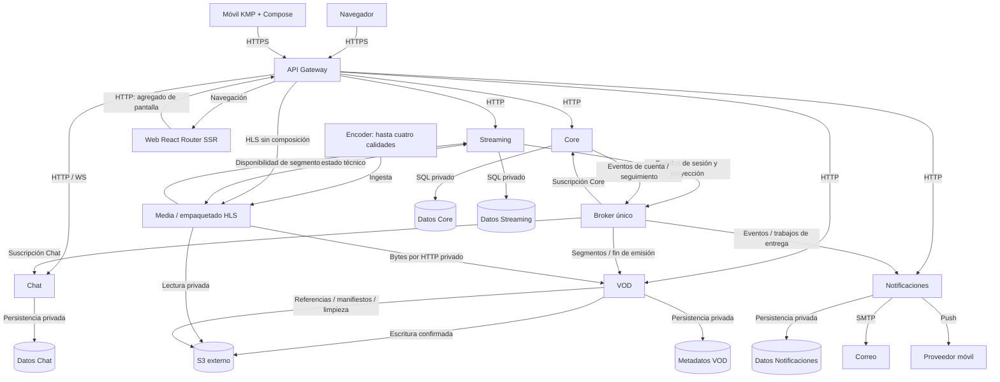
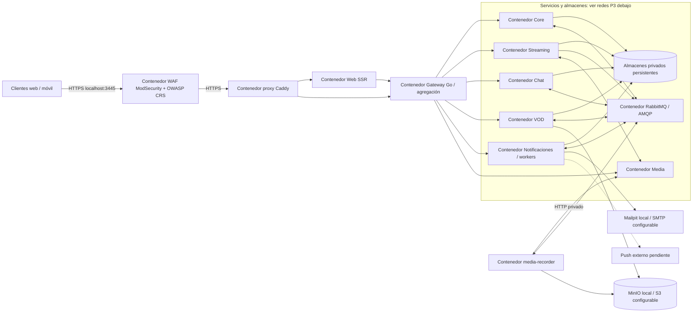
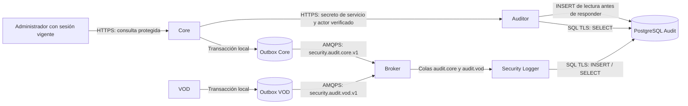

# Arquitectura de STREAMING — P2

El diseño de [ADR-015](adr/ADR-015-arquitectura-p2.md) cubre web SSR, aplicación móvil,
agregación por pantalla, comunicación híbrida, grabación VOD y notificaciones. Su aceptación
se verifica mediante [SPEC-15](spec-p2/spec_15_int.md); los componentes dibujados no acreditan
implementación. [Alcance](alcance_p2.md) y [decisiones pendientes](decisiones_pendientes_p2.md)
definen las políticas y los contratos aún abiertos.

## Contexto

Visitantes y usuarios descubren canales, consumen live/VOD y consultan chat desde web y móvil.
El streamer publica desde un encoder y administra su canal, grabaciones y moderación. Un
administrador puede retirar contenido y suspender cuentas. SMTP y push entregan avisos;
el almacenamiento S3 externo conserva los objetos audiovisuales.

## Componentes y conectores

VOD es escritor y verificador S3; Media conserva buffer durable, transfiere por HTTP privado y
publica avisos confirmados. Media entrega bytes con otra identidad S3 de solo lectura (ADR-022). El broker transporta
referencias y metadatos, no bytes de video. Las llamadas HTTP síncronas entre servicios para
consultas y autorización se describen en los [flujos](integracion_sistema_p1.md).

| Unidad | Responsabilidad y datos propios | Conectores |
| --- | --- | --- |
| Core | Cuentas, sesiones, perfiles, canales, seguimiento, catálogo y Discovery; transacciones SQL locales | HTTP, GraphQL, publicación/consumo de eventos |
| Streaming | Configuración, claves, cupos, sesión, generaciones, reloj, leases y estado autoritativo | HTTP de control/contexto; eventos; adaptador Media |
| Media | Ingesta, validación de fuente, empaquetado HLS y captura de segmentos | Encoder, control Streaming, HLS, S3 |
| Chat | Mensajes durables, secuencia, dedupe, cuota, bloqueos, supresiones y replay | HTTP, WebSocket, contextos de autorización y eventos |
| VOD | Biblioteca, vínculo a sesión, metadatos, borradores, publicación y referencias a objetos | HTTP, broker y S3 |
| Notificaciones | Bandeja, lectura, preferencias, dispositivos e intentos por medio | HTTP, broker, SMTP y push |
| Gateway | Entrada HTTPS, rutas, agregados por pantalla, timeouts y errores parciales | HTTP, Upgrade WS y HLS |
| Web SSR | Rutas, carga inicial de datos y renderizado HTML; hidratación en navegador | HTTP al Gateway; HLS/WS en navegador |
| Móvil | Presentación de espectador y sesión nativa segura | APIs Gateway, HLS/WS y push |
| Broker | Distribución durable y aislamiento de consumidores/trabajos | RabbitMQ / AMQP 0-9-1 con TLS (ADR-016) |

## Capas y descomposición

La presentación comprende Web y móvil. El Gateway compone sus consultas. La capa de aplicación
reside en los dominios; los adaptadores conectan HTTP, mensajería, almacenamiento y proveedores.
Una vista agregada no desplaza permisos ni escrituras al Gateway.

Core mantiene módulos de Cuentas, Canales/seguimiento, Catálogo y Discovery en un proceso Java.
Streaming conserva su proceso Rust y Chat su proceso Go. VOD y Notificaciones son unidades
independientes. VOD usa Go/PostgreSQL/MinIO (ADR-022), Notificaciones TypeScript/PostgreSQL/SMTP
(ADR-020), y Gateway Go con Caddy (ADR-023). Cuentas publica trabajos de recuperación y ofrece contratos privados
de entrega; Notificaciones implementa su consumidor y SMTP STARTTLS (ADR-017/020),
verificados con Mailpit local. Push sigue pendiente de provisión y adaptadores.
Web usa TypeScript y móvil Kotlin. Watch parties es un módulo de Core (ADR-025) y no añade proceso; los subtítulos son una capacidad VOD con pistas WebVTT y clientes Web/móvil (SPEC-22), sin otro proceso.

## Despliegue

Esta vista resume los procesos P2; la pertenencia concreta a redes y Auditor P3 se detalla en
la [vista segmentada de despliegue](p3/segmentacion-red.md#vista-de-despliegue-pertenencia-a-redes).
La instalación completa usa 14 bridges: una red explícita por almacén y su propietario,
zona API, mensajería y dependencias de medios/SMTP. Auditor tiene bridges exclusivas para
Core, broker y su PostgreSQL; no se conecta a la mensajería general. La zona API conserva
el nombre `default` y las IP de proxy/Gateway, y excluye los almacenes. [ADR-030](adr/ADR-030-segmentacion-red.md).

Cada servicio conserva credenciales y propiedad de escritura. VOD tiene persistencia privada;
compartir un servidor de base de datos no permite compartir tablas ni credenciales. La selección
de motores del despliegue local son seis PostgreSQL privados (incluido Audit), Redis para vivo/cuota y MinIO
para objetos S3. El broker no sustituye una base de negocio.

Core, Streaming, Chat, VOD y Notificaciones constituyen cinco unidades de dominio. La clasificación
del Gateway de agregación como sexta unidad lógica debe validarse con el criterio docente,
además de su función de comunicación/orquestación. Los módulos internos de Core no cuentan
como procesos independientes. Este punto permanece en P2-18.

El dominio público usa HTTPS y mantiene bloqueadas las rutas internas. El WAF
([ADR-031](adr/ADR-031-waf-modsecurity-crs.md)) publica solo loopback 3445, inspecciona cada petición
con ModSecurity y el OWASP CRS en modo bloqueo y la reenvía cifrada a Caddy, que ya no publica puertos;
ambos comparten solo la red de borde `edge`. Media RTMPS publica loopback 11938 y Mailpit su buzón
local en 8025. Los demás servicios y bases quedan en redes del proyecto. Con Audit P3, los 22 servicios persistentes y el inicializador
S3 se levantan con `infra/local/dev.py`; comandos e inventario en el [README](../README.md).
El cliente Kotlin se construye fuera de Docker para Android/iOS; completa los cinco lenguajes
junto a Java, Rust, Go y TypeScript. La recuperación consistente de los doce volúmenes
se describe en el [runbook local](../infra/local/README.md#backup-y-recuperación-del-perfil-completo-p2).

## Aislamiento y recuperación

Una caída de Chat no interrumpe HLS; una de Notificaciones no revierte LIVE. El Gateway conserva
secciones utilizables y distingue error de ausencia. Un contexto de permiso no comprobado
impide la operación protegida. Las proyecciones públicas no autorizan escrituras.

Cada productor persiste la intención de evento con su cambio local. Cada consumidor confirma
solo tras persistir su responsabilidad; dedupe y versiones evitan regresiones por reentrega.
La recuperación de una proyección no reconstruye mensajes ni objetos perdidos: cada dueño
necesita su almacenamiento y recuperación correspondientes.

VOD conserva todas las rendiciones recibidas y valida el medio antes de publicar. La limpieza
es reintentable, con retirada de acceso inmediata. La suspensión de cuenta afecta también a
manifiestos, segmentos, subtítulos y replay; no basta ocultar enlaces de la interfaz.

La selección RabbitMQ y la integración inicial Streaming–Core/Chat están en [ADR-016](adr/ADR-016-rabbitmq-eventos-p2.md). Las nueve familias se integran en el [perfil local](../infra/broker/README.md). Push
permanece sin proveedor; SPEC-15/19 distinguen las plataformas y recorridos verificados.

## Contribución P3 — Security Logger y Auditor

La Persona 4 agrega la responsabilidad transversal definida en
[SPEC-25](spec-p3/spec_25_security_audit.md) y [ADR-028](adr/ADR-028-security-logger-auditor.md).
Los responsables de vistas pueden integrar estos elementos en sus entregables de capas,
componentes y despliegue:

Logger y Auditor son componentes del runtime `services/audit`; su base `audit-db` es privada.
El despliegue local añade ambos mediante `infra/audit/compose.yaml`, sin publicar puertos al
host. Core/VOD conservan autorización y repositorios propios. Logger confirma recepción solo
tras persistir; Auditor se consulta a través de Core, que verifica ADMIN en cada solicitud.
Los roles SQL separan lectura de inserción y ambos carecen de modificación/borrado del
historial. [ADR-030](adr/ADR-030-segmentacion-red.md) concreta su segmentación: `audit-query`
solo con Core, `audit-messaging` solo con broker y `audit-data` solo con su PostgreSQL.
Se conservan los permisos de aplicación y el perfil Zero Trust de ADR-029.
