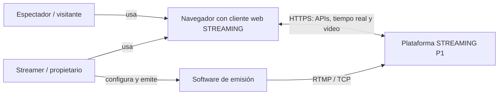
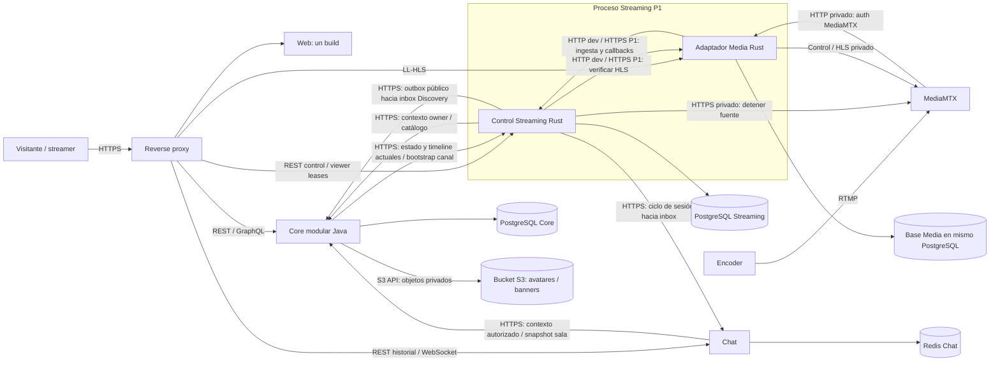

# Arquitectura de STREAMING

La arquitectura de P1 reparte el trabajo entre Core, Streaming, Chat, Media y Web. Core mantiene
juntas las operaciones de cuentas, perfiles y canales que necesitan una misma transacción.
Streaming controla las emisiones, Chat maneja los mensajes y MediaMTX transporta el video.

[ADR-005](adr/ADR-005-streaming-rust-y-proyeccion-discovery.md) explica la separación de Streaming;
[ADR-011](adr/ADR-011-streaming-tres-contenedores-p1.md), cómo desplegamos su adaptador Media en P1.
Las siguientes vistas describen esa organización y las condiciones para ampliarla.

## Unidades de ejecución

| Unidad | Responsabilidad y datos | Motivo de la frontera |
| --- | --- | --- |
| Web | Una aplicación React/TypeScript con un solo build, según ADR-007. Incluye rutas, formularios, reproductor, chat y accesibilidad. | Interfaz de usuario con módulos internos. |
| Core | Java/Spring: Cuentas, Canales, Catálogo y Discovery. PostgreSQL propio y objetos de imagen en S3; registro en una transacción. | Integridad cuenta–perfil–canal y consultas SQL locales con proyección pública Streaming. |
| Streaming | Rust/Axum/Tokio/SQLx con pools y PostgreSQL privado: configuración, claves, sesiones, cupos, clock, generaciones, leases e inbox/outbox. | Autonomía de desarrollo, release y operación del control de emisiones; costo de coordinación aceptado en ADR-005. |
| Chat | Salas, mensajes, deduplicación, cuota, secuencias, historial y realtime; Go + Redis efímero según ADR Chat. | Conexiones largas, fan-out y fallo independientes de video; persistencia temporal propia. |
| Media | MediaMTX RTMP/LL-HLS separado; adaptador técnico Rust dentro del proceso Streaming P1, con base/rol propios. | Motor separado por códecs/ancho de banda; control y adaptador comparten release/fallos según ADR-011. |
| Reverse proxy | HTTPS, encaminamiento, límites, Upgrade WS y forwarding confiable. | Infraestructura con tabla explícita de upstreams. |

Core, Streaming y Chat ejecutan nuestra lógica en procesos separados y se comunican por HTTP.
Sus implementaciones usan Java, Rust y Go; Web usa TypeScript, elegido en ADR-007.
Para aceptar RNF-001/003/007 necesitamos comprobar los artefactos y su ejecución.
SQL, YAML, HTML y CSS no cuentan como lenguajes de propósito general para ese requisito.

Discovery ofrece GraphQL dentro de Core. SPEC-13 exige evidencia de REST, GraphQL sobre HTTP
y WebSocket Upgrade. Antes de cerrar RNF-006, también debemos confirmar con el evaluador qué
patrones reconoce como tipos de conector distintos.

## Vista de contexto (C4 nivel 1)

El navegador y el codificador son sistemas externos. Proxy, Web, Core, Streaming, Chat, Media y
almacenes se detallan en la vista C&C.

## Método de la vista C&C

Un elemento arquitectónico se delimita por responsabilidades, frontera e interfaces. En una vista C&C,
un componente es un elemento computacional o almacén con presencia en ejecución, nombre funcional y
puertos; un conector es un camino de interacción en ejecución entre componentes y sus roles describen
cómo participan. La relación de attachment une un puerto del componente con un rol del conector. Por
eso una carpeta o endpoint por sí solo no demuestra que exista un componente, y una flecha sin
protocolo ni semántica no describe suficientemente un conector (Vergara Vargas, 2026a, diap. 2;
Vergara Vargas, 2026b, diap. 3–7). Esta lectura coincide con distinguir estructuras dinámicas por
sus elementos e interacciones en tiempo de ejecución (Rozanski & Woods, 2011, cap. 2).

En ejecución existen Web, Core, Streaming, Chat, Media, proxy y sus almacenes. Cuentas, Canales,
Catálogo y Discovery son módulos locales Core; sus llamadas usan interfaces de aplicación. Las flechas
representan protocolos y semántica de interacción, incluido loopback entre adaptador/control en P1; la tabla identifica puertos y roles.

## Vista C4/C&C

Los módulos de Core usan transacciones y claves foráneas locales para relacionar cuentas, perfiles,
canales y catálogo. Cada repositorio se encarga de las escrituras de su módulo; las consultas
compuestas usan vistas o DTO públicos con columnas explícitas.

El proveedor predeterminado de imágenes es S3. Core guarda avatares y portadas en un bucket privado
y sirve sus bytes en `/api/profile/avatars/{key}` y `/api/channels/banners/{key}`. Esas URLs no
exponen el endpoint, las credenciales ni las ACL del bucket. Para desarrollo local y pruebas se
puede seleccionar almacenamiento en filesystem. El Compose raíz usa esa alternativa.

Discovery combina los datos locales con la proyección SQL de los datos públicos de Streaming.
Cada servicio conserva su almacén y sus credenciales: las interacciones entre procesos se hacen
por contratos, sin consultar tablas ajenas ni abrir transacciones entre bases.

## Puertos y conectores

| Interacción | Puerto iniciador / rol | Puerto receptor / rol | Protocolo y semántica |
| --- | --- | --- | --- |
| Web y APIs | Navegador / cliente | Proxy / entrada pública | HTTPS REST Core/Streaming, GraphQL Discovery y recursos Web. |
| Chat público | Navegador / cliente realtime | Chat a través de proxy / sala | WS Upgrade e historial REST; anónimo lee, envío autorizado por mensaje. |
| Ingesta | Encoder / publicador | Media / fuente | RTMP TCP separado; adaptador solicita autorización Streaming antes de aceptar. |
| Reproducción | Player / lector | Media a través de proxy / entrega | LL-HLS HTTPS; bytes entregados por MediaMTX. |
| Presencia del player | Player / cliente | Streaming / API de leases | Tras primer frame crea lease; heartbeat10s, cierre inmediato y expiry30s; conteo de reproducciones activas. |
| Contexto Chat | Chat / cliente privado | Core / API privada | Identidad/autor locales y estado/timeline Streaming actual por mensaje, sin caché de permisos. |
| Estado autoritativo | Core / cliente privado | Streaming / contexto y snapshots | HTTPS; contexto de sesión para Chat y batch público para bootstrap de canal. |
| Comandos protegidos | Streaming / cliente privado | Core / contexto owner | Sesión, propiedad y catálogo tipado; autorización acotada, sin lock entre bases. |
| Ciclo de sesión | Streaming / outbox | Chat / inbox | HTTPS idempotente, ACK durable, versiones/retry/DLQ; informativo para sala. |
| Proyección pública | Streaming / outbox y snapshot | Discovery en Core / inbox y staging | Snapshots completos/versionados; frescura <=5s, dedupe y reconstrucción consistente con watermark. |
| Señales Media | Adaptador Rust / cliente privado | Streaming / ingest y callbacks | HTTP loopback autenticado en desarrollo; HTTPS con CA explícita en ADR-014; intent/event IDs, generaciones y ACK tras persistir. |
| Control Media | Streaming / cliente multimedia | Media / control y HLS privado | Corte de fuente y comprobación de playlist/segmento/frame real. |
| SQL | Core o Streaming / cliente propio | PostgreSQL privado / almacén | Pool y transacciones locales; sin lectura ni FK entre bases. |
| Historial | Chat / cliente propio | Redis Chat / servidor | Persistencia antes de ACK; Core/Streaming no leen mensajes. |
| Imágenes | Core / cliente S3 | Bucket privado / almacén de objetos | PUT/GET/COPY/DELETE/LIST; Core publica las rutas de avatar/portada sin exponer el bucket. |

## Invariantes y coordinación

- Registro: cuenta ACTIVE, perfil, canal y resultado idempotente confirman juntos; fallo revierte todo.
- Emisión: Rust controla configuración, claves, cupos, estado y reloj. Core valida cada comando protegido.
  streamId persiste; sessionId cambia por emisión. LIVE/PLAYABLE requiere evidencia real Media.
- Viewer count: leases de reproducción mantenidos por Rust, anónimos e independientes de Chat.
  Cuenta instancias activas; no asegura personas únicas ni sirve como medida económica o permiso.
- Discovery: búsqueda/ranking/paginación SQL sobre datos Core y proyección pública Streaming. Observación/
  publicación <=2s y transporte/aplicación <=3s en perfil nominal; atraso marca UNKNOWN/frescura falsa.
  No autoriza Chat ni accede al SQL Streaming.
- Chat: cada envío nuevo obtiene contexto Core; Core consulta estado/timeline actual Streaming. Eventos
  Rust→Chat informan sala. La siguiente autorización tras logout/ENDED rechaza; operación en vuelo acotada.
- Bootstrap por handle: cuenta/perfil/canal locales y un batch Streaming; falla Streaming conserva canal
  y marca estado desconocido. El registro no depende de Streaming.
- Integración conecta contratos, infraestructura y evidencia después del desarrollo del módulo.
  Cada dueño conserva la lógica de sus casos de uso.

## Despliegue y aislamiento

Topología: proxy, Web, Core, Streaming con adaptador Rust, Chat, MediaMTX, PostgreSQL Core/Streaming,
Redis Chat (AOF) y bucket S3 privado para imágenes. Bases separadas con credenciales privadas pueden compartir motor físico sin compartir tablas. El stack propio SPEC-04 usa exactamente tres contenedores: PostgreSQL (bases Streaming/Media), Streaming con adaptador y MediaMTX, según ADR-011.
Core accede a imágenes en S3 o filesystem explícito compartido; Media conserva segmentos.
[ADR-014](adr/ADR-014-perfil-integrado-tls-p1.md) materializa el [Compose raíz](../compose.yaml) de
nueve servicios: core/core-db, chat/chat-db, live/live-db/media-server y web/proxy separados.
HTTPS localhost:3445 y RTMPS localhost:11938 son las entradas locales predeterminadas.
Los fixtures de aceptación conservan ocho contenedores con Web/proxy juntos y diez con dos
réplicas Core/Chat, usando HTTPS3443 y RTMPS11936. Core8081/8082, Streaming8080/8091,
Chat8085/8086, autorización Media8090 y HLS8888 son TLS privados; SQL y Redis también usan TLS.
El [runbook](../infra/p1/README.md) configura readiness, CA, secretos y proveedor de imágenes.
/internal/* queda bloqueado públicamente. TLS privado y secretos específicos por consumidor/operación.

P1 comienza con una réplica de control Streaming, que mide los plazos con referencias de reloj
monotónico. Si pierde la referencia de tiempo o al responsable de la sesión, la termina sin
conceder otra ventana de reconexión. Para usar varias réplicas primero hay que probar el bloqueo
del responsable anterior (fencing), el enrutamiento al responsable vigente y el traspaso de control.

Los módulos Core se replican juntos. Con S3, las réplicas comparten los objetos; con filesystem,
necesitan un volumen de imágenes compartido. Las réplicas Chat deben compartir orden, cuota,
deduplicación y distribución de mensajes. Media se dimensiona según bitrate y CPU.
SPEC-13 comprueba el escalado y sus límites, considerando que los contenedores del mismo host
comparten recursos físicos.

Si Core cae, fallan los nuevos comandos protegidos y las nuevas autorizaciones de Chat;
todos los módulos Core comparten esa caída. Si Streaming cae, deja de estar disponible su control
y tampoco se pueden autorizar nuevos mensajes Chat. Media puede conservar una fuente y una
reproducción existentes, aunque no garantizamos que continúen indefinidamente.

Una caída de Chat no corta HLS. Un fallo del receptor Discovery tampoco revierte LIVE ni bloquea
las entregas a Chat; la búsqueda pasa a indicar datos desactualizados según las reglas de frescura.
Como el adaptador comparte proceso con Streaming, un reinicio de este último también afecta
la autorización Media y la entrega pública HLS. MediaMTX mantiene su proceso separado.

## Validación de la arquitectura

La aceptación del sistema verifica los contextos Core, los clientes y snapshots Streaming,
el inbox/proyección Discovery, los consumidores Chat/Web y el transporte MediaMTX/adaptador.
SPEC-10 define los schemas neutrales; SPEC-12, el proxy y Web; SPEC-13, el despliegue,
la recuperación y el perfil de carga. La selección de una frontera requiere esta validación integrada.
Lecturas SQL Core usan vistas/DTO publicados, columnas explícitas y propiedad de escritura clara,
versionados según RNF-041/042 y sin secretos.

### Referencias metodológicas

La definición de componente, conector, puertos, roles y attachments sigue las diapositivas y el
Laboratorio 2 del curso; la nota de runtime y estructuras dinámicas se apoya en Rozanski y Woods. El
laboratorio solicita como entregable la vista C&C y la descripción de elementos (Vergara Vargas,
2026c, pp. 7–8).

1. Vergara Vargas, J. A. (2026a). *Architectural Elements, Relations and Properties* [Diapositivas de clase, curso 2026-II], diap. 2. Universidad Nacional de Colombia.
2. Vergara Vargas, J. A. (2026b). *Component-and-Connector (C&C) Structure* [Diapositivas de clase, curso 2026-II], diaps. 2–7. Universidad Nacional de Colombia.
3. Vergara Vargas, J. A. (2026c, 24 de septiembre). *Laboratory 2: Components and Connectors* [Guía de laboratorio, curso 2026-II], pp. 7–8. Universidad Nacional de Colombia.
4. Rozanski, N., & Woods, E. (2011). *Software Systems Architecture: Working with Stakeholders Using Viewpoints and Perspectives* (2.ª ed.). Addison-Wesley Professional.
