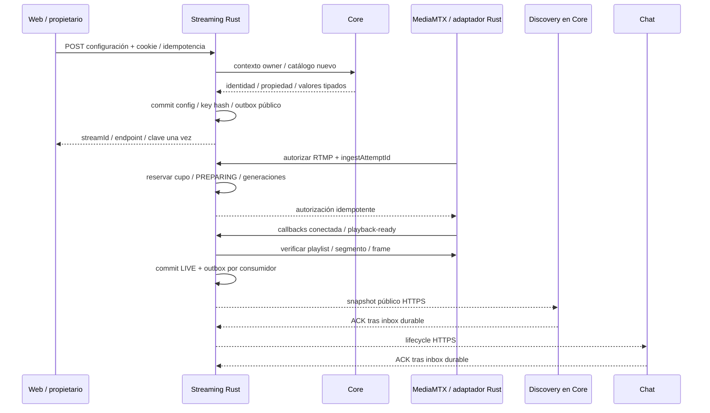
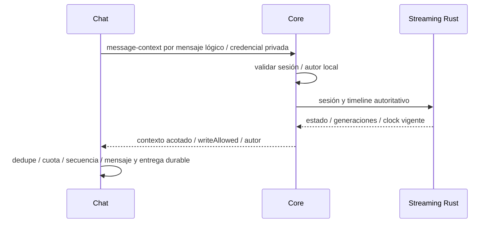

# Flujos de integración — arquitectura P1

Estos flujos muestran cómo colaboran Core, Streaming, Chat y Media en P1, según ADR-005.
Cuentas, Canales, Catálogo y Discovery se comunican dentro de Core. Entre procesos usamos los
[contratos del sistema](contratos_modelo_datos.md), donde se define el significado de los datos
y las operaciones.

El trabajo de integración conecta esos contratos, prepara la infraestructura y comprueba los
recorridos. La lógica de cada operación permanece en el módulo responsable.

En P1 el adaptador Media comparte proceso con Streaming según ADR-011. Los contratos técnicos de autorización/callbacks se conservan en HTTP loopback autenticado en desarrollo y HTTPS con CA explícita en el perfil persistente ADR-014; MediaMTX sigue en otro contenedor. Fallo/reinicio del proceso Streaming afecta también autorización Media y HLS.

## A — Registro y canal inicial

Al registrar un usuario, Core crea la cuenta ACTIVE, el perfil, el canal y el resultado idempotente
en una misma transacción PostgreSQL. Si una escritura falla, se revierten todas. Si la transacción
termina pero se pierde la respuesta, repetir la solicitud con la misma clave recupera los mismos IDs.

El usuario inicia sesión en una operación aparte. El canal se puede consultar desde el commit,
sin esperar eventos ni depender de que Streaming esté disponible.

## B — Configurar e iniciar emisión

LIVE no espera a Discovery ni Chat. Core no genera/recibe claves; Streaming conserva solo hash y las muestra una vez. Validación Core y commit Streaming no son transacción compartida: contextos nuevos, no cacheados, con presupuesto <=1 s. OBS entrega solo la clave opaca; Streaming resuelve la configuración por su hash único y RTMP valida clave y cupo; no exige una sesión de navegador activa del encoder.

## C — Pérdida, gracia, retorno y stop

Streaming coordina los callbacks y los temporizadores mediante SQL y el reloj monotónico del
responsable de la sesión. Una pérdida de fuente abre una sola ventana de reconexión de 30 s.
Durante ella se conservan `sessionId` y `streamGeneration`; una reconexión crea otra `sourceGeneration`.

Si la reproducción se comprueba antes del plazo, continúa la misma sesión. Si han pasado 30 s o más,
se pierde el responsable o su referencia de tiempo, o el propietario solicita stop, la sesión termina.
ENDED invalida los leases, congela la línea temporal, libera el cupo y guarda el evento de ciclo de vida
y el snapshot en el outbox. El adaptador corta la fuente y un callback tardío no vuelve a abrirla.

P1 usa una réplica Streaming. Para habilitar failover primero hay que probar el fencing y la
continuidad del reloj.

Canal muestra LIVE/reconectando y Discovery excluye lo no reproducible según snapshot/frescura. Chat permite escribir en gracia solo mediante contexto vigente, sin depender del atraso de eventos.

## D — Metadata y proyección Discovery

Para editar metadatos, Streaming solicita a Core un contexto nuevo con la identidad, la propiedad
del canal y la validación de los valores enviados: deben estar activos y ser del tipo correcto.
PATCH confirma `metadataVersion` y el snapshot público. Los campos omitidos conservan sus asociaciones,
incluido el último nombre de un valor desactivado (tombstone).

GraphQL combina esa proyección con Cuentas, Canales y Catálogo mediante consultas locales de Core.
Conserva las reglas de orden, cursor y filtros, sin consultar el SQL de Streaming ni hacer una
llamada HTTP por resultado.

Outbox/inbox idempotentes, projectionVersion y posición de commit evitan regresiones; estado/metadata/conteo deben ser visibles <=5 s en perfil normal. Edad del productor >5 s marca UNKNOWN/excluye PLAYABLE; conteo tiene freshness independiente. Snapshot paginado consistente con watermark y recepción durable concurrente permiten reconciliar/reconstruir. No rejuvenecer fecha al recibir un evento viejo. El player consulta Streaming autoritativo; proyección no es permiso.

## E — Chat y contexto autorizado

Chat conserva una llamada Core por mensaje nuevo; Core consulta Streaming dentro del presupuesto agregado <=400 ms. El intento de persistencia Chat exige <=500 ms desde iniciar el contexto, usando monotónico local; no es un deadline de commit físico Redis. Core caído invalida nuevos contextos; Streaming caído impide autorizar desde datos Discovery. Logout/ENDED rechazan la siguiente autorización; operaciones en vuelo ya autorizadas pueden confirmar dentro del presupuesto. Los eventos lifecycle llegan desde Streaming con producer=streaming y no conceden permiso. Snapshot de sala se delega a Streaming; historia conocida puede permanecer disponible en Chat.

## F — Player, leases y bootstrap canal

Core compone cuenta/perfil/canal localmente y solicita un batch público Streaming para bootstrap; conserva datos del canal con UNKNOWN si falla Streaming. Web obtiene playback/estado/timeline actual desde Streaming y HLS desde Media. Después de primer frame crea lease idempotente; heartbeat 10 s, expiración 30 s y cierre/ENDED inmediato del lease. Pausar conserva el búfer de vídeo; ENDED detiene nuevas descargas y el player consume los segmentos locales antes de mostrar la finalización. Conteo best-effort deriva de leases, no de Chat ni valores cliente. Snapshots agrupados se entregan a Discovery; no transportan tokens.

## Fallos y recuperación

| Fallo | Resultado esperado | Recuperación |
| --- | --- | --- |
| Core / PostgreSQL Core | Registro no publica parcial; comandos protegidos Streaming y nuevos contextos Chat fallan cerrados; HLS puede continuar | Readiness/reinicio, resultado idempotente y backup |
| Streaming / PostgreSQL Streaming | Nuevas ingestas/control/leases/contexto Chat no disponibles; Discovery degrada frescura | Persistencia, cierre sin nueva gracia, replay y reconciliación |
| Discovery / delivery de proyección | Búsqueda atrasada/UNKNOWN según edad; HLS/Chat no esperan al consumidor | Inbox/outbox por consumidor, DLQ, snapshot/watermark |
| Chat / su almacén | HLS continúa; sin ACK sin persistencia | Lifecycle/snapshot, dedupe e historial/entrega durable |
| Media | Sin LIVE ficticio; PREPARING/gracia/ENDED | Callbacks durables, retries/DLQ, generaciones y control de fuente |
| Imágenes / proxy | Error visible; referencia anterior conservada ante fallo archivo | Limpieza/compensación local y configuración observable |

No se promete aislamiento entre control Streaming y su adaptador Media, ni entre módulos dentro de Core ni disponibilidad indefinida de HLS sin control. Las capacidades de las otras iteraciones se priorizan según catálogo/fases futuras; no se implementan durante la integración P1.
