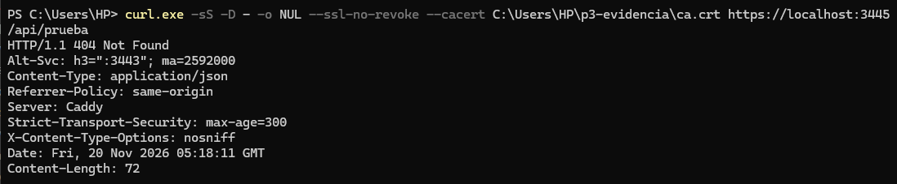
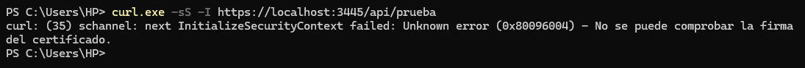

# Escenario de seguridad 1: Canal Seguro

## Escenario

Un atacante conectado a la misma red que Vault tv captura el tráfico entre el navegador y el sistema, o entre dos servicios internos, para leer credenciales, cookies de sesión o datos de los usuarios.

| Parte | Valor |
| --- | --- |
| Fuente | Atacante con acceso a la red (misma Wi-Fi o red de Docker), sin credenciales del sistema. |
| Estímulo | Captura pasiva del tráfico (sniffing) o intento de hacerse pasar por un servicio (man-in-the-middle). |
| Artefacto | Conexiones entre clientes y Caddy, y entre los servicios internos, las bases de datos, Redis, RabbitMQ, MinIO y el servidor SMTP. |
| Entorno | Operación normal, con el sistema desplegado con Docker Compose. |
| Respuesta | Todo el tráfico viaja cifrado con TLS. Cada cliente valida el certificado del servidor contra la CA privada del proyecto y rechaza la conexión si no coincide. El navegador recibe HSTS y no vuelve a intentar HTTP. |
| Medida de respuesta | 0 credenciales o datos de usuario legibles en una captura de tráfico; 100 % de las conexiones internas con TLS y verificación del certificado; una conexión con un certificado no firmado por la CA se rechaza. |

## Tácticas aplicadas

- **Cifrar datos** (resistir ataques): TLS en todas las conexiones, públicas e internas.
- **Autenticar actores** (resistir ataques): los clientes verifican el certificado y el nombre del servidor (`verify-full`, `tls_trust_pool`, `SSL_VERIFY_HOSTNAME`).
- **Limitar la exposición** (resistir ataques): la única entrada pública es el WAF por HTTPS (puerto 3445 del host, [ADR-030](../adr/ADR-030-waf-modsecurity-crs.md)), que reenvía cifrado a Caddy; no hay puerto HTTP publicado.
- **Verificar la integridad de los mensajes** (detectar ataques): TLS usa cifrado autenticado, así que un mensaje modificado en el camino se descarta.

## Patrón aplicado: Canal Seguro (Secure Channel)

**Problema.** Los datos que viajan por la red pueden ser leídos o modificados por cualquiera que tenga acceso a ella.

**Solución.** Crear un canal cifrado y autenticado entre cada par de componentes antes de enviar datos. En Vault tv el canal es TLS y la confianza se basa en una CA privada que el script de inicialización crea para cada despliegue (`infra/p1/manage.py`).

| Conexión | Protocolo seguro | Cómo se valida el servidor |
| --- | --- | --- |
| Navegador → WAF | HTTPS (TLS 1.2/1.3) en el puerto 3445 | Certificado `web.crt` firmado por la CA; HSTS |
| App Android → WAF | HTTPS; `usesCleartextTraffic="false"` | La CA del proyecto instalada en el teléfono |
| WAF → Caddy | HTTPS | `proxy_ssl_verify on` con `ca.crt` y el nombre `proxy` |
| Emisor de video → servidor de medios | RTMPS (puerto 11938) | Certificado firmado por la CA |
| Caddy → servicios (Core, Streaming, Chat, VOD, Notifications, Gateway, Web) | HTTPS | `tls_trust_pool file /run/secrets/ca.crt` |
| Servicio → servicio (por ejemplo, Chat → Core) | HTTPS | CA privada |
| Servicios → PostgreSQL | TLS | `sslmode=verify-full` con `ca.crt` |
| Chat → Redis | `rediss://` (TLS) | CA privada |
| Servicios → RabbitMQ | AMQPS (puerto 5671) | Verificación de certificado y de nombre |
| VOD y grabador → MinIO | HTTPS | CA privada |
| Notifications → servidor SMTP | STARTTLS obligatorio | `NOTIFICATIONS_SMTP_REQUIRE_TLS=true` |

**Cambio en el Prototipo 3.** Caddy ahora envía la cabecera `Strict-Transport-Security` (HSTS). Con ella, el navegador recuerda que Vault tv solo funciona con HTTPS: si alguien escribe `http://` o un atacante intenta bajar la conexión a HTTP, el navegador usa HTTPS sin preguntar, y no deja continuar si el certificado es inválido.

- El valor por defecto es `max-age=300` (5 minutos), porque el despliegue local usa `localhost` y un valor largo afectaría a otras aplicaciones locales del mismo equipo. Con un dominio real se usaría `max-age=31536000` (un año): `HSTS_MAX_AGE=31536000 python3 infra/local/dev.py up`. El script escribe ese valor en el Caddyfile que genera en cada `up`, así que los contenedores de Caddy no necesitan la variable.
- La prueba `test_public_origin_sends_hsts_on_every_profile` (`infra/p1/test_profiles.py`) comprueba que la cabecera está en los tres perfiles de despliegue.

## Evidencia

1. **Cabecera HSTS.** Con el sistema arriba:

   ```bash
   curl -sI --cacert <estado>/ca.crt https://localhost:3445/ | grep -i strict-transport-security
   ```

   Resultado esperado: `strict-transport-security: max-age=300`. En Windows, `curl.exe` necesita además `--ssl-no-revoke`, porque la CA privada no publica lista de revocación.

   

2. **Tráfico cifrado.** En el Laboratorio 5 capturamos con Wireshark el tráfico hacia Core. Por HTTP, el usuario y la contraseña se leían en texto plano; por HTTPS, Wireshark solo mostraba el handshake TLS y datos cifrados (*Application Data*).

3. **Certificado no confiable.** Una conexión que no confía en la CA del proyecto se rechaza:

   ```bash
   curl -sI https://localhost:3445/   # sin --cacert: falla con un error de certificado
   ```

   

## Límites

- Los servicios validan el certificado del servidor, pero el servidor no pide certificado al cliente (no hay TLS mutuo). La autenticación de cada servicio se cubre en el escenario de Zero Trust.
- La CA es privada: cada navegador o teléfono que use el sistema debe confiar en ella.
