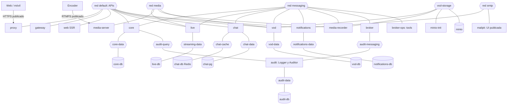

# Segmentación de red — Prototipo 3

Patrón: **Network Segmentation**. Táctica: limitar acceso y movimiento lateral mediante
fronteras de red según propiedad de datos. Decisión:
[ADR-030](../adr/ADR-030-segmentacion-red.md). Responsabilidad:
[SPEC-24](../spec-p2/spec_24_deployment.md). Apoya RNF-025/027/028/032 sin sustituir
autenticación, autorización ni TLS.

## Escenario de seguridad

| Elemento | Definición |
| --- | --- |
| Fuente | Atacante que controla un contenedor de aplicación, por ejemplo Chat. |
| Estímulo | Intenta conectarse al PostgreSQL de Core, VOD o Auditor por DNS o IP conocida. |
| Entorno | Despliegue completo local funcionando, con Docker/host administrados por el equipo. |
| Artefacto | Redes bridge, interfaces y motores persistentes de cada dominio. |
| Respuesta | El servicio ajeno no tiene una red compartida ni un puerto publicado para llegar al almacén. Su servicio propietario conserva acceso. |
| Medida | Cero conexiones TCP exitosas desde servicios ajenos a cada almacén; conexiones del propietario y dependencias requeridas exitosas. Se comprueban DNS e IP directa. |

El estímulo se valida como intento de conexión; esta contribución no añade un IDS ni promete
un evento de auditoría por paquete descartado. Security Logger conserva su escenario de aplicación.

## Redes y miembros exactos

Los nombres corresponden al modelo fusionado de los tres Compose; Docker añade el prefijo del
proyecto. `internal` indica aislamiento externo de la red, además de la pertenencia explícita.

| Red | Miembros | internal |
| --- | --- | --- |
| `default` (zona API) | proxy, gateway, web, core, live, chat, vod, notifications | No |
| `core-data` | core, core-db | Sí |
| `streaming-data` | live, live-db | Sí |
| `chat-cache` | chat, chat-db (Redis) | Sí |
| `chat-data` | chat, chat-pg | Sí |
| `vod-data` | vod, vod-db | Sí |
| `notifications-data` | notifications, notifications-db | Sí |
| `audit-data` | audit, audit-db | Sí |
| `vod-storage` | minio, vod, media-recorder, minio-init | Sí |
| `messaging` | broker, core, live, chat, vod, notifications, media-recorder, broker-ops | Sí |
| `audit-messaging` | broker, audit | Sí |
| `audit-query` | core, audit | Sí |
| `media` | live, media-server, media-recorder, vod | No |
| `smtp` | notifications, mailpit | No |

`live` contiene Streaming y el adaptador Media; `live-db` conserva sus bases lógicas.
`minio-init` es efímero y `broker-ops` solo se inicia con el perfil `tools`.
Navegador/móvil acceden por Caddy; el encoder, por RTMPS. No entran a las redes de datos.
El MinIO local sirve objetos VOD; Core usa sus volúmenes filesystem en este perfil.

## Vista de despliegue: pertenencia a redes

Las líneas representan pertenencia a una red, sin dirección de llamada. Cada nodo `red`
es una bridge Docker; los procesos conectados a varias bridges conservan sus interfaces separadas.

Se conservan los puertos publicados HTTPS `3445→3443`, RTMPS `11938→1936` y Mailpit
`8025→8025`, configurables según el runbook. Las bases, Redis, MinIO, AMQP y Auditor no
publican puertos. `lan` solo amplía la publicación HTTPS como antes.

## Accesos y límites

Gateway y SSR consultan APIs, sin conectividad a bases ni al broker. Los dominios producen
o consumen eventos en `messaging`; Auditor usa el mismo broker por una bridge exclusiva.
Solo Core comparte `audit-query` con Auditor; la consulta pública pasa por la sesión ADMIN
de Core. El propio broker comparte una red con Auditor y sigue dentro de la frontera de confianza.

Cada miembro puede alcanzar todos los puertos de los pares de su bridge. La segmentación
no es una lista de permisos por puerto ni evita abusos de una API accesible. Los tokens y TLS
actuales siguen validándose. Los roles S3 conservan la separación escritor VOD/lector Media
dentro de `vod-storage`. El host y su administrador Docker están fuera del escenario de aislamiento.

## Aplicación y evidencia

En una instalación existente, ejecutar `init` y `up` con la guía raíz; conservar los volúmenes.
El arranque recrea servicios con nuevas interfaces y puede interrumpir emisiones. La zona API
mantiene `default` y su IPAM para reutilizar la red previa y las IP de confianza del proxy/Gateway.

La [aceptación reproducible](../../tests/integration/network-segmentation/README.md) distingue
el aislamiento TCP con fixtures de la integración real TLS. El modelo completo incluye 14 redes
y 23 servicios contando ambos auxiliares; el perfil normal no ejecuta `broker-ops`.

La verificación de esta contribución ejecutó 14 pruebas locales de infraestructura, la matriz
TCP completa (108 accesos permitidos y 373 bloqueados), actualización desde la red única sin
`down` previo y el smoke real de servicios TLS con registro/login y consulta ADMIN de auditoría.
No acredita reproducción audiovisual ni rendimiento bajo carga.
