# Laboratorio 5. Verificación del canal seguro (Grupo 3).

El Grupo 1 mostró que un mensaje enviado por HTTP se lee en Wireshark. El Grupo 2 puso TLS en el mismo canal con OpenSSL. Esta guía comprueba que el canal ahora va cifrado, que el servidor es quien dice ser y que el cliente no acepta un servidor cuya CA no conoce. Termina con una tabla comparativa antes/después.

El caso principal es el ejemplo de Node.js (`ejemplo-http` y `ejemplo-https`). El caso complementario es el login real de Core (Vault tv), que demuestra que el resultado se mantiene en el proyecto.

> **Estado de esta guía.** Los dos casos se ejecutaron en Windows el 9 de noviembre de 2026: el caso principal (Node, secciones 3 a 7) y el complemento con Core (sección 8). Los resultados verificados se muestran en las figuras.

## 1. Qué vamos a comprobar

| Propiedad | Qué significa | Cómo la comprobamos |
| --- | --- | --- |
| Confidencialidad | Un observador del trayecto no puede leer el mensaje | Wireshark: el marcador `LAB_CANAL_INSEGURO` deja de ser legible |
| Autenticación del servidor | El cliente comprueba que habla con el servidor correcto | `openssl s_client` y rechazo de curl cuando no confía en la CA |

Los datos son ficticios. La captura se hace en loopback (`127.0.0.1`): el tráfico no sale del computador.

## 2. Herramientas y carpeta de trabajo

Se necesitan Node.js 22 o posterior, curl, Wireshark (en Windows, con Npcap para el loopback) y OpenSSL. En Windows, OpenSSL viene con **Git Bash**. Para el caso Core también se necesitan Docker Desktop y Python 3.10 o posterior.

Abre el repositorio y entra en `labs/secure-channel`. Allí están `ejemplo-http`, `ejemplo-https` y `docs`. Todos los comandos de las secciones 3 a 7 se ejecutan desde esa carpeta; los de la sección 8, desde la raíz del repositorio.

Comprueba las versiones y anótalas en la sección 10:

```powershell
node --version
curl.exe --version
```

```sh
openssl version
```

Guarda los archivos de captura (`.pcapng`) **fuera del repositorio**, por ejemplo en `C:\Users\<tu-usuario>\Desktop\lab5-evidencia\`. Las imágenes del informe van en `docs/imagenes/` con el prefijo `g3-`.

No fotografíes ni abras `ca.key` ni `server.key`. Son secretos y no se suben al repositorio.

## 3. Antes: el canal HTTP

Este paso repite la captura del Grupo 1 para tener una línea base propia.

1. Terminal 1, inicia el servidor:

   ```powershell
   node ejemplo-http/server.mjs
   ```

   Debe mostrar `Servidor del laboratorio: http://127.0.0.1:18080/mensaje`.

2. En Wireshark pulsa **Ctrl+K**. En **Entrada**, selecciona con un solo clic **Adapter for loopback traffic capture**. En el filtro de captura escribe `tcp port 18080`, pulsa Tab y luego **Iniciar**.

3. Terminal 2, envía el mensaje:

   ```powershell
   curl.exe --noproxy "*" --http1.1 --include `
     --header "Content-Type: application/json" `
     --data-binary "@ejemplo-http/solicitud.json" `
     http://127.0.0.1:18080/mensaje
   ```

   La respuesta debe ser `HTTP/1.1 200 OK` con `"recibido": true`.

4. Detén la captura con el cuadrado rojo. En el filtro de visualización escribe `tcp.port == 18080 && http` y pulsa Enter. Debes ver `POST /mensaje` y `HTTP/1.1 200 OK`.

   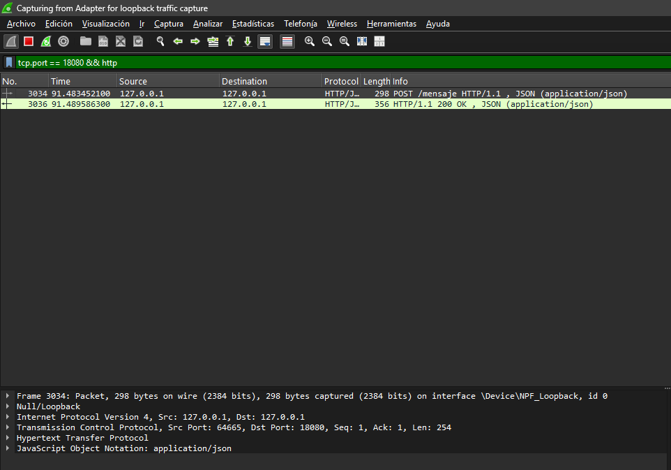

   *Figura 1. Petición y respuesta HTTP en la captura del puerto 18080.*

5. Clic derecho en `POST /mensaje` y **Seguir → Flujo TCP**. Selecciona **Conversación completa** y **ASCII**. El usuario y `LAB_CANAL_INSEGURO` se leen sin esfuerzo.

   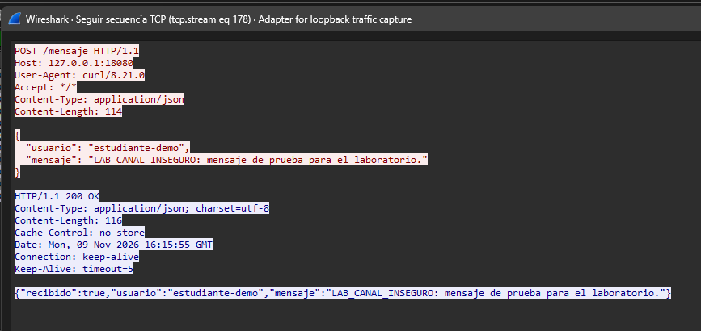

   *Figura 2. El contenido viaja en texto plano.*

6. Guarda la captura como `http-18080.pcapng` en la carpeta de evidencia. Cierra el servidor con Ctrl+C.

## 4. Certificados con OpenSSL

Abre **Git Bash** en `ejemplo-https` y ejecuta los comandos de [GRUPO-2.md](GRUPO-2.md), sección A2. Resumen:

```sh
mkdir certs
openssl genpkey -algorithm EC -pkeyopt ec_paramgen_curve:P-256 -out certs/ca.key
openssl req -x509 -new -key certs/ca.key -sha256 -days 30 -config ca.cnf -out certs/ca.crt
openssl genpkey -algorithm EC -pkeyopt ec_paramgen_curve:P-256 -out certs/server.key
openssl req -new -key certs/server.key -config server.cnf -out certs/server.csr
openssl x509 -req -in certs/server.csr -CA certs/ca.crt -CAkey certs/ca.key -CAcreateserial -sha256 -days 30 -extfile server.cnf -extensions server -out certs/server.crt
openssl verify -CAfile certs/ca.crt -verify_hostname localhost certs/server.crt
```

El último comando debe mostrar `certs/server.crt: OK`.

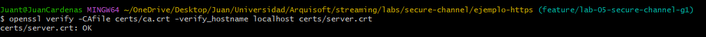

*Figura 3. El certificado del servidor es válido para `localhost` y está firmado por la CA del laboratorio.*

Si `mkdir certs` indica que la carpeta existe, ya generaste los archivos antes. Borra `certs/` solo si quieres rehacerlos.

## 5. Después: el canal HTTPS

1. Terminal 1, desde `labs/secure-channel`:

   ```powershell
   node ejemplo-https/server.mjs
   ```

   Debe mostrar `Servidor del laboratorio: https://localhost:18443/mensaje`.

2. En Wireshark inicia una captura nueva en loopback con filtro de captura `tcp port 18443`.

3. Terminal 2:

   ```powershell
   curl.exe --noproxy "*" --http1.1 --include `
     --cacert "ejemplo-https/certs/ca.crt" `
     --header "Content-Type: application/json" `
     --data-binary "@ejemplo-http/solicitud.json" `
     https://localhost:18443/mensaje
   ```

   La respuesta debe ser la misma que por HTTP. No uses `-k` ni `--insecure`. En Windows, curl usa Schannel y comprueba la revocación del certificado; como nuestra CA no publica una lista de revocación, en nuestra ejecución fue necesario agregar `--ssl-revoke-best-effort` al final del comando (figura 4). Esa opción solo tolera que no haya información de revocación: la cadena de confianza y el nombre se siguen validando.

   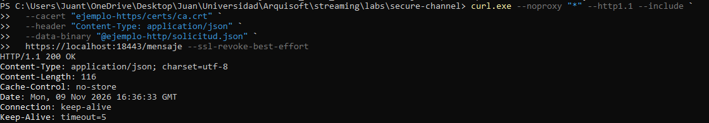

   *Figura 4. El servidor responde igual que por HTTP, pero ahora con TLS.*

4. Detén la captura. Aplica el filtro `tcp.port == 18443 && tls`. Debes ver `Client Hello`, `Server Hello` y paquetes `Application Data`. Si Wireshark no los reconoce como TLS, usa **Analizar → Decodificar como… → TLS** para el puerto 18443.

   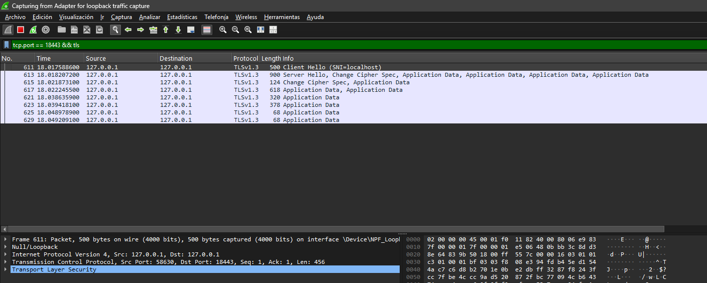

   *Figura 5. Handshake TLS seguido de datos de aplicación cifrados.*

5. Clic derecho en un paquete del flujo y **Seguir → Flujo TCP**. El contenido es ilegible.

   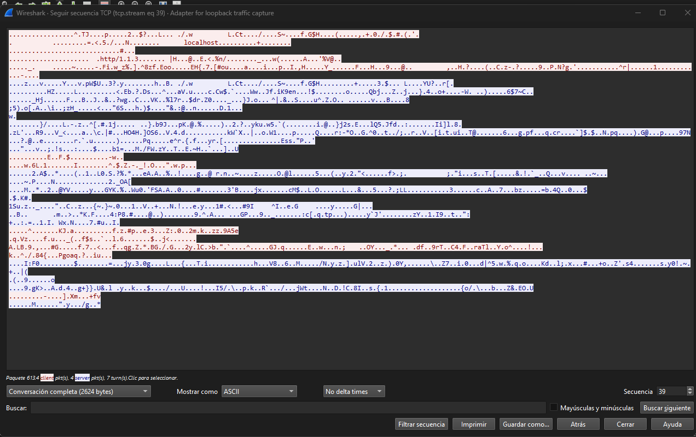

   *Figura 6. El mismo mensaje, ahora ilegible para el observador.*

6. Busca el marcador: **Ctrl+F**, tipo de búsqueda **Cadena**, campo **Bytes del paquete**, texto `LAB_CANAL_INSEGURO`. No debe haber resultados.

   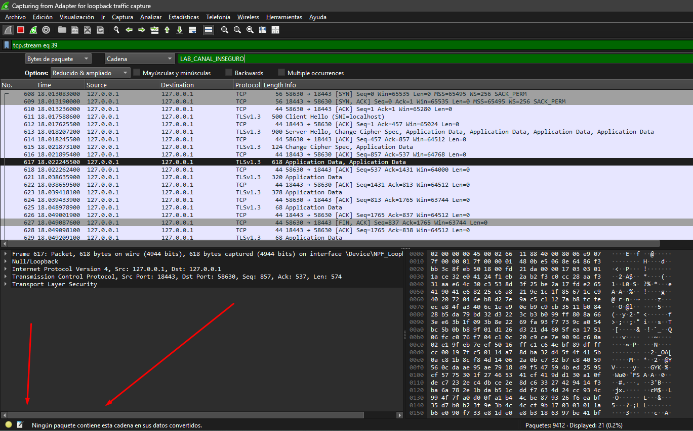

   *Figura 7. El marcador no aparece en los paquetes del flujo de la petición (`tcp.stream eq 39`).*

7. Guarda la captura como `https-18443.pcapng`. No cargues claves de sesión TLS en Wireshark: invalidaría la comparación. Deja el servidor encendido para la sección 6.

## 6. Verificar el certificado y el handshake

Con el servidor HTTPS encendido, abre **Git Bash** en `ejemplo-https`.

1. Handshake completo, confiando en la CA del laboratorio:

   ```sh
   openssl s_client -connect localhost:18443 -CAfile certs/ca.crt -servername localhost </dev/null
   ```

   Anota la versión del protocolo, el cifrado y que termine con `Verify return code: 0 (ok)`.

   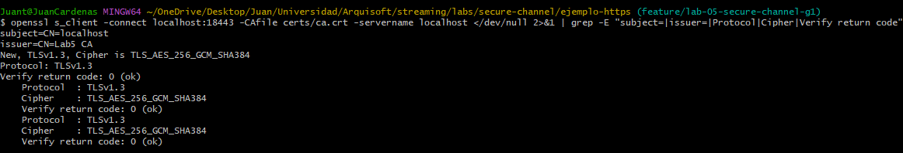

   *Figura 8. Handshake verificado contra la CA del laboratorio.*

2. Datos del certificado:

   ```sh
   openssl x509 -in certs/server.crt -noout -subject -issuer -dates -ext subjectAltName
   ```

   Comprueba que el emisor es `Lab5 CA`, que las fechas son vigentes y que el SAN contiene `DNS:localhost` e `IP Address:127.0.0.1`.

   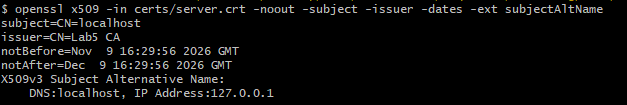

   *Figura 9. Asunto, emisor, vigencia y nombres del certificado.*

## 7. Rechazo de una CA no confiable

Un cliente seguro no debe aceptar un servidor cuyo certificado no puede verificar. Con el servidor HTTPS encendido, en PowerShell desde `labs/secure-channel`, repite la petición **sin** `--cacert`. El sistema no conoce a `Lab5 CA`, así que la conexión debe fallar:

```powershell
curl.exe --noproxy "*" --http1.1 https://localhost:18443/mensaje
```

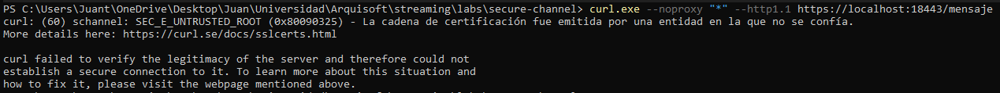

*Figura 10. El cliente rechaza un servidor cuya CA no conoce.*

Anota el mensaje exacto en la sección 10. Con Schannel (curl de Windows) los mensajes difieren de los de OpenSSL.

## 8. Complemento: el login real de Core

Este caso repite la comparación con el recorrido real de Vault tv. Sigue [VAULT-TV.md](VAULT-TV.md) y [GRUPO-2.md](GRUPO-2.md), parte B. Desde la **raíz del repositorio**, con Docker Desktop abierto y un comando a la vez:

```powershell
python labs/secure-channel/lab.py init
python labs/secure-channel/lab.py build
python labs/secure-channel/lab.py up --mode http
python labs/secure-channel/lab.py seed
python labs/secure-channel/lab.py capture --mode http
python labs/secure-channel/lab.py verify --mode http
python labs/secure-channel/lab.py certs
python labs/secure-channel/lab.py up --mode https
python labs/secure-channel/lab.py capture --mode https
python labs/secure-channel/lab.py verify --mode https
```

Si un comando falla, no continúes: revisa `lab.py logs` y la sección de problemas de [VAULT-TV.md](VAULT-TV.md). Core usa el puerto 8081 en ambos modos.

En nuestra ejecución los diez comandos terminaron sin errores. `capture` respondió `CSRF: 200; login: 200; authenticated profile: 200` en los dos modos. `verify --mode http` dio `true` en `reassembledLogin`, `exactFictitiousCredentialsReadable` y `sessionCookieReadable`: por HTTP, la contraseña y la cookie de sesión se leen en la captura. `certs` emitió el certificado `CN=core-lab`, firmado por `Vault tv Lab5 private CA`, con SAN `DNS:core-lab`, `DNS:localhost` e `IP Address:127.0.0.1` y vigente hasta el 9 de diciembre de 2026.

Abre en Wireshark `labs/secure-channel/.state/http/traffic.pcap` y después `labs/secure-channel/.state/https/traffic.pcap`, con el filtro `tcp.port == 8081`. Si Wireshark no encuentra el archivo por estar dentro de la carpeta oculta `.state`, cópialo a una carpeta de evidencia fuera del repositorio y ábrelo desde allí. Si la columna Protocol solo muestra TCP, usa **Analizar → Decodificar como…** con el puerto 8081 y elige HTTP o TLS según el modo.

1. En HTTP, localiza `POST /api/identity/sessions` y sigue el flujo TCP. Se leen `login` y `password`. **Oculta la contraseña completa antes de publicar la imagen**; deja visible el marcador `LAB5_CANAL_INSEGURO`.

   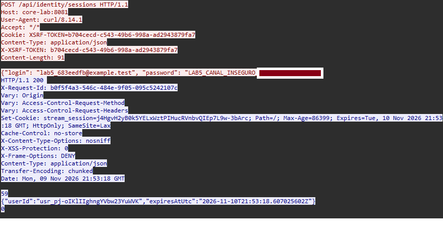

   *Figura 11. Credenciales ficticias legibles en HTTP. Se leen el correo, el comienzo de la contraseña (`LAB5_CANAL_INSEGURO`), el token CSRF y la cookie de sesión que devuelve Core.*

2. En HTTPS, el mismo recorrido solo muestra handshake y datos cifrados.

   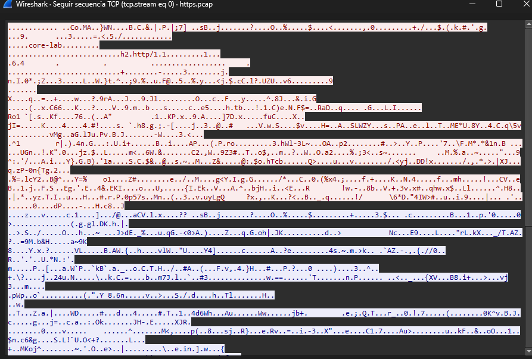

   *Figura 12. El mismo recorrido por HTTPS: el flujo TCP es ilegible. Solo se distinguen `core-lab` y `h2.http/1.1`, que el cliente envía sin cifrar en el `Client Hello` (nombre del servidor, SNI, y protocolo, ALPN). Las credenciales, cookies y respuestas no aparecen.*

3. La salida de `verify --mode https` debe mostrar `tlsClientHello`, `encryptedApplicationRecords`, `clientFlowWithExplicitCa` y `markerNotReadable` en `true`. El campo `negativeCaAndHostnameTests` aparece como `PENDING GROUP 3`: el script no lo comprueba. Esta guía solo cubre en la sección 7 el rechazo de una CA no confiable, no el caso del nombre incorrecto.

   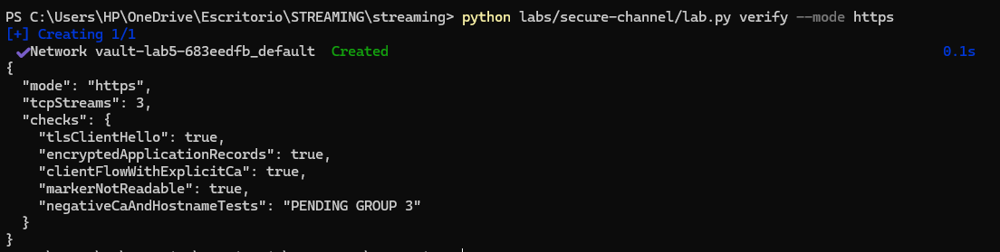

   *Figura 13. Comprobaciones automáticas del modo HTTPS: las cuatro en `true`.*

Los PCAP y `.state/` contienen sesiones y credenciales ficticias. No los publiques.

## 9. Tabla comparativa antes/después

Completa la columna HTTPS con lo que observaste. Una celda vacía significa que no se comprobó.

| Aspecto | HTTP (antes) | HTTPS (después) | Evidencia |
| --- | --- | --- | --- |
| Puerto del ejemplo Node | 18080 | 18443 | Salida del servidor |
| Protocolo en Wireshark | HTTP | TLS | Figuras 1 y 5 |
| Contenido de la petición | JSON legible | `Application Data` ilegible | Figuras 2 y 6 |
| Marcador `LAB_CANAL_INSEGURO` | Visible | No aparece | Figura 7 |
| Handshake | No existe | Client Hello, Server Hello y certificado | Figura 5 |
| Versión y cifrado | No aplica | TLS 1.3, `TLS_AES_256_GCM_SHA384` | Figura 8 |
| Identidad del servidor | No se comprueba | `Verify return code: 0 (ok)` | Figura 8 |
| Certificado | No aplica | Emitido por `Lab5 CA`, SAN `localhost` y `127.0.0.1` | Figura 9 |
| CA no confiable | No aplica | Rechazada: `SEC_E_UNTRUSTED_ROOT` | Figura 10 |
| Respuesta funcional | 200 | 200 | Figura 4 |
| Login de Core (credenciales) | Correo, contraseña y cookie de sesión legibles | Ilegibles; solo handshake TLS y datos cifrados | Figuras 11 y 12 |
| Comprobaciones automáticas de Core | `exactFictitiousCredentialsReadable: true` | `tlsClientHello`, `encryptedApplicationRecords`, `clientFlowWithExplicitCa` y `markerNotReadable` en `true` | Figura 13 |
| Respuesta funcional de Core | Login 200 | Login 200 | Salida de `capture` |

## 10. Registro de la ejecución

| Dato | Valor |
| --- | --- |
| Fecha, sistema operativo y terminal | 9 de noviembre de 2026; Windows 11; PowerShell (curl) y Git Bash (OpenSSL) |
| Rama | `feature/lab-05-secure-channel-g1` |
| Commit base del laboratorio (`git rev-parse HEAD` antes de agregar esta guía) | `a1bc68940506b780e3653cad30efa5fd10f096cd` |
| Versión de curl | 8.21.0 (según el `User-Agent` de la figura 2); usa Schannel |
| Versión de OpenSSL | 3.5.5 (Git Bash) |
| Versión de Node | v24.13.1 |
| Versión de Wireshark | 4.6.8 |
| Versión de Npcap | 1.88 (libpcap 1.10.6, 64-bit time_t) |
| Versiones de Python, Docker y Compose (caso Core) | Python 3.11.1; Docker 29.1.2; Docker Compose 2.40.3 |
| Certificado de Core | `CN=core-lab`, emitido por `Vault tv Lab5 private CA`; vigente hasta el 9 de diciembre de 2026 |
| Versión de TLS y cifrado negociados | TLS 1.3, `TLS_AES_256_GCM_SHA384` |
| Vigencia del certificado del servidor | 9 de noviembre al 9 de diciembre de 2026 (30 días) |
| Error sin confiar en la CA | `curl: (60) schannel: SEC_E_UNTRUSTED_ROOT (0x80090325) - La cadena de certificación fue emitida por una entidad en la que no se confía.` |
| Ajustes necesarios | `--ssl-revoke-best-effort` en curl para Windows (la CA no publica lista de revocación). Caso Core: con `core.autocrlf=true`, `services/core/mvnw` queda con fin de línea CRLF y `build` falla con `./mvnw: not found` (código 127); se convirtió a LF solo para construir y se restauró después |

## 11. Conclusión

Resultados verificados en el caso Node:

- **Confidencialidad.** Por HTTP, el usuario y `LAB_CANAL_INSEGURO` se leen en el flujo TCP (figura 2). Por HTTPS, la captura solo muestra el handshake TLS 1.3 y datos de aplicación cifrados (figuras 5 y 6), y la búsqueda del marcador no encuentra nada en el flujo (figura 7).
- **Autenticación del servidor.** `openssl s_client` verifica la cadena contra `Lab5 CA` con `Verify return code: 0 (ok)` (figura 8), y el certificado incluye `localhost` y `127.0.0.1` en el SAN (figura 9).
- **Rechazo de lo no confiable.** curl rechaza el servidor cuando no confía en la CA (figura 10).

En el login real de Core se repite el resultado. Por HTTP se leen el correo, la contraseña y la cookie de sesión (figura 11). Por HTTPS el mismo login funciona igual, pero la captura solo contiene el handshake y datos cifrados (figuras 12 y 13).

No se probaron el rechazo por nombre incorrecto, el rechazo de una CA distinta ni qué versiones de TLS acepta el servidor (solo se observó TLS 1.3). Por eso no se afirma nada sobre esos puntos. Una captura ilegible por sí sola no prueba que el canal sea seguro: la prueba es el conjunto de las tres comprobaciones.

Alcance: este laboratorio demuestra confidencialidad y autenticación del servidor para un trayecto concreto, en loopback. No demuestra que todo Vault tv sea seguro ni cubre ataques activos.

## 12. Problemas comunes

| Síntoma | Qué hacer |
| --- | --- |
| Wireshark no ofrece la interfaz de loopback | Instalar Npcap y reiniciar Wireshark |
| `Faltan la llave o el certificado en ejemplo-https/certs` | Ejecutar la sección 4 |
| `EADDRINUSE` al iniciar un servidor | Cerrar el servidor anterior con Ctrl+C |
| La captura HTTPS no muestra TLS | **Analizar → Decodificar como… → TLS** para el puerto 18443 |
| curl indica `CERT_TRUST_REVOCATION_STATUS_UNKNOWN` | Agregar `--ssl-revoke-best-effort` |
| `certificate has expired` | Regenerar los certificados (duran 30 días) |
| La petición de la sección 7 no falla | Revisar que no usaste `-k` ni `--cacert` |

## Referencias

- [GRUPO-2.md](GRUPO-2.md), [VAULT-TV.md](VAULT-TV.md) y [README.md](README.md).
- [OpenSSL s_client](https://docs.openssl.org/3.0/man1/openssl-s_client/) y [x509](https://docs.openssl.org/3.0/man1/openssl-x509/).
- [Follow TCP Stream en Wireshark](https://www.wireshark.org/docs/wsug_html_chunked/ChAdvFollowStreamSection.html).
- [TLS 1.3, RFC 8446](https://www.rfc-editor.org/rfc/rfc8446.html).
