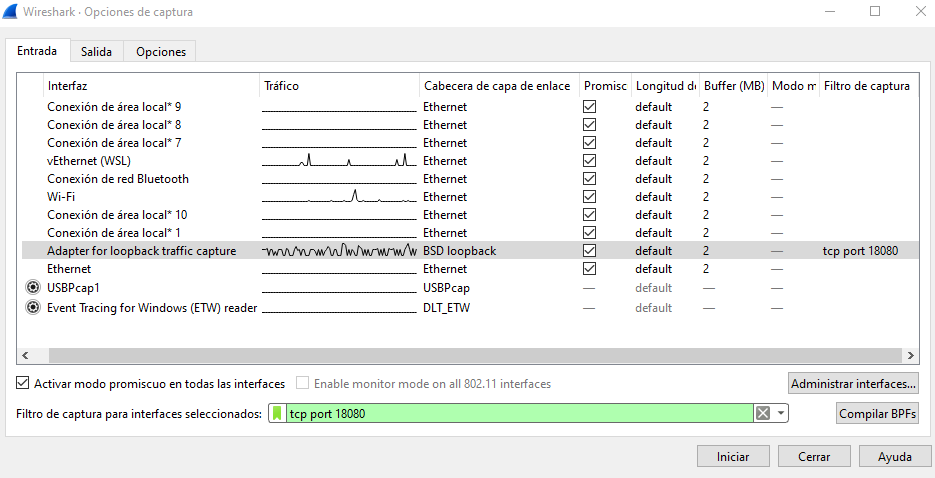
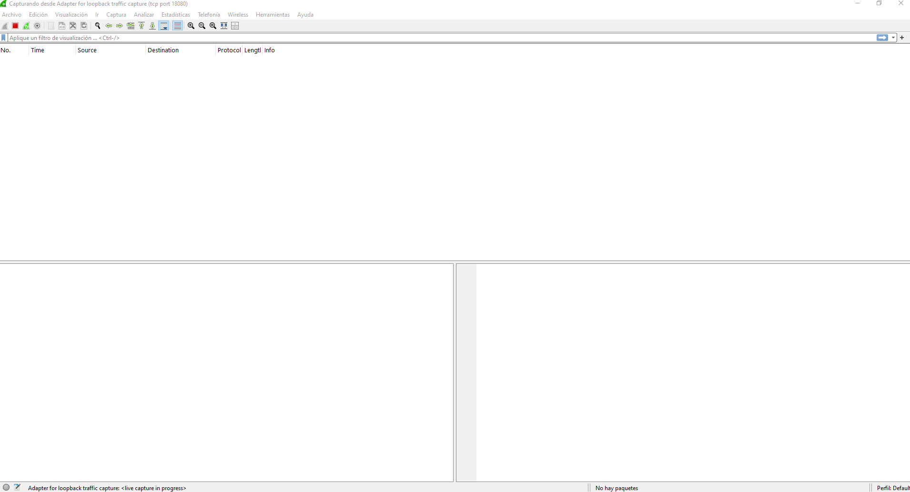
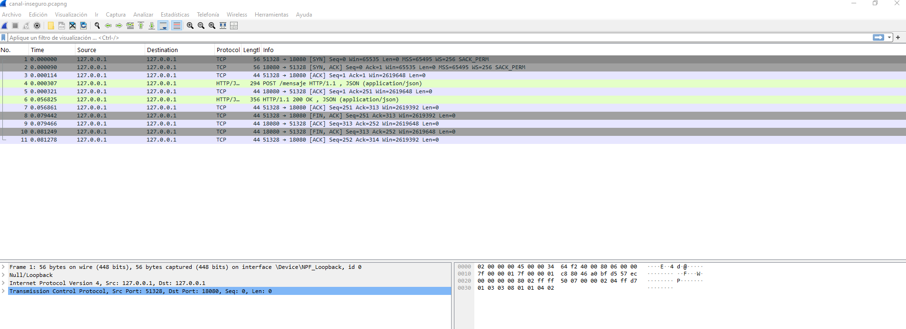
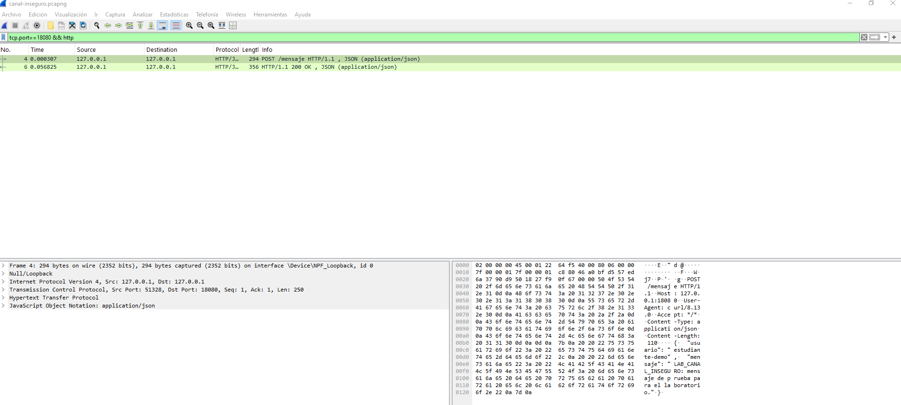
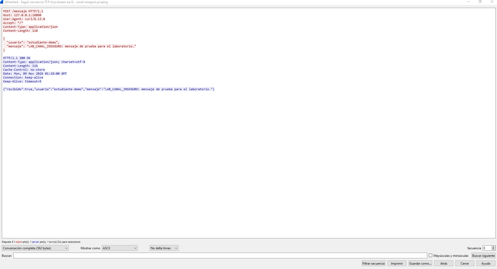

# Laboratorio 5. Canal inseguro.

## 1. Qué vamos a comprobar

Vamos a probar un canal HTTP entre un cliente y un servidor que se ejecutan en el mismo computador. El cliente utiliza curl para enviar un mensaje en formato JSON. El servidor, implementado con Node.js, lo recibe en la dirección `127.0.0.1:18080/mensaje` y devuelve una confirmación. Todos los datos utilizados son ficticios.

El servidor se crea con el módulo `node:http`, incluido en Node.js. Escucha en el puerto 18080 y atiende solicitudes `POST /mensaje`. Al recibir el JSON, comprueba que tenga los campos `usuario` y `mensaje` y responde con un estado 200 y el contenido recibido.

### Por qué es inseguro

Este canal utiliza HTTP sin TLS, por lo que el contenido viaja sin cifrar. Quien pueda capturar el tráfico de ese trayecto puede reconstruir la conversación y leer los mensajes. Esta exposición puede aprovecharse mediante captura de tráfico, también llamada sniffing. En un sistema que enviara información sensible por ese canal, podrían quedar expuestos datos privados.

En la práctica observaremos tráfico local con Wireshark. La dirección `127.0.0.1` corresponde a loopback: la comunicación vuelve al mismo computador y no sale por Wi-Fi. La demostración consiste en leer el mensaje desde la captura; no implica intervenir una red ajena ni modificar lo enviado.

### Herramientas y archivos

Se necesitan Node.js 22 o posterior, curl y Wireshark. En Windows, Wireshark debe contar con Npcap para capturar el tráfico de loopback.

El ZIP está en el repositorio público `SWARCH-1A/streaming`, en la rama `feature/lab-05-secure-channel-g1`, dentro de [labs/secure-channel/docs/Grupo-1-HTTP-Wireshark.zip](https://github.com/SWARCH-1A/streaming/blob/feature/lab-05-secure-channel-g1/labs/secure-channel/docs/Grupo-1-HTTP-Wireshark.zip). Contiene esta guía y los archivos del ejemplo. Tras extraerlo, utilizaremos la carpeta `ejemplo-http` para iniciar el servidor y enviar la petición.

| Archivo | Para qué sirve |
| --- | --- |
| `server.mjs` | Inicia el servidor HTTP en `127.0.0.1:18080`. |
| `handler.mjs` | Recibe el JSON, comprueba sus campos y prepara la respuesta. |
| `solicitud.json` | Contiene el usuario y el mensaje ficticios que enviará curl. |

El mensaje incluye el texto `LAB_CANAL_INSEGURO`, que nos permitirá reconocerlo dentro de la captura.

<!-- page:portrait -->

## 2. Iniciar el servidor

Abre la carpeta extraída donde se encuentran `ejemplo-http`, `docs` y `README.md`. Haz clic en la barra de dirección del Explorador, escribe `powershell` y pulsa Enter. La terminal se abrirá en esa carpeta. Comprueba las herramientas:

```powershell
node --version
curl.exe --version
```

Después inicia el servidor:

```powershell
node ejemplo-http/server.mjs
```

Debe aparecer:

```text
Servidor del laboratorio: http://127.0.0.1:18080/mensaje
Déjalo abierto. Para terminar, pulsa Ctrl+C en esta terminal.
```

Deja esta terminal abierta. El programa permanece a la espera de peticiones, por lo que no volverá a mostrar el indicador habitual para escribir comandos. Abre una segunda ventana de PowerShell desde la misma carpeta; la utilizaremos después para ejecutar curl.

## 3. Preparar la captura en Wireshark

1. Abre Wireshark. Si hay una captura en curso, detenla con el cuadrado rojo de la barra superior.
2. Entra en **Captura → Opciones** o pulsa **Ctrl+K**.
3. En la pestaña **Entrada**, selecciona la fila **Adapter for loopback traffic capture** con **un solo clic**. No mantengas pulsadas Ctrl ni Shift. Comprueba que solo esa fila quede seleccionada; las casillas de la columna «Promiscuo» no sirven para seleccionar la interfaz.
4. En el campo inferior **Filtro de captura para interfaces seleccionadas**, escribe:

```text
tcp port 18080
```

5. No pulses Enter. Pulsa **Tab** para salir del campo y comprobar que el filtro no aparece como inválido.
El doble clic sobre una interfaz puede iniciar la captura directamente. Por eso seleccionamos con un solo clic y usamos el botón Iniciar cuando la configuración está lista. El filtro limita la captura al puerto del ejemplo.

<!-- page:landscape -->

Deberías ver algo parecido a esta configuración, con loopback seleccionado y el filtro del puerto 18080:



*Figura 1. Interfaz y filtro preparados antes de iniciar la captura.*

Pulsa **Iniciar**, en la parte inferior derecha. La lista puede estar vacía hasta que envíes el mensaje con curl:



*Figura 2. Captura en curso, todavía sin paquetes de la petición.*

<!-- page:portrait -->

## 4. Enviar la petición y observar el tráfico

En la segunda terminal, situada en la misma carpeta, ejecuta:

```powershell
curl.exe --noproxy "*" --http1.1 --include `
  --header "Content-Type: application/json" `
  --data-binary "@ejemplo-http/solicitud.json" `
  http://127.0.0.1:18080/mensaje
```

Copia el bloque completo. El acento grave al final de las tres primeras líneas permite continuar el comando en PowerShell; no debe tener espacios después. Curl lee `solicitud.json` y lo envía mediante POST. La opción `--include` muestra las cabeceras de la respuesta y `--noproxy` evita que la petición local pase por un proxy configurado en el equipo.

La respuesta debe comenzar por `HTTP/1.1 200 OK` e incluir estos datos:

```json
{
  "recibido": true,
  "usuario": "estudiante-demo",
  "mensaje": "LAB_CANAL_INSEGURO: mensaje de prueba para el laboratorio."
}
```

El estado 200 indica que el servidor atendió la petición. No demuestra que el canal esté protegido.

Después de enviar el mensaje, vuelve a Wireshark. Cuando aparezcan los paquetes, pulsa el **cuadrado rojo de Detener** en la barra superior. Así podrás revisar la conversación con calma.

<!-- page:landscape -->

La lista debería verse parecida a esta. Aparecen paquetes TCP del inicio y cierre de la conexión, además de la petición y la respuesta HTTP:



*Figura 3. Lista de paquetes de nuestra prueba. El POST aparece en el número 4 y la respuesta en el 6.*

En la barra situada encima de los paquetes, escribe este filtro y pulsa Enter:

```text
tcp.port == 18080 && http
```

Al aplicarlo deberías ver algo parecido a esta captura: una fila con `POST /mensaje` y otra con `HTTP/1.1 200 OK`. Los números de paquete pueden cambiar en otra ejecución.



*Figura 4. Vista de la lista después de aplicar el filtro HTTP.*

Este filtro solo cambia lo que se muestra en pantalla. Su sintaxis es distinta de la del filtro de captura utilizado antes de iniciar.

<!-- page:landscape -->

## 5. Leer el contenido del canal

1. Selecciona la fila `POST /mensaje`, pulsa el botón derecho y abre **Seguir → Flujo TCP / Follow → TCP Stream**.
2. En la parte inferior del diálogo, selecciona **Conversación completa / Entire conversation** y **Mostrar datos como: ASCII / Show data as: ASCII**.

Deberías ver la solicitud y la respuesta juntas, como en esta imagen. En nuestra captura, el texto rojo corresponde al cliente y el azul al servidor:



*Figura 5. Contenido de la conversación reconstruida en ASCII.*

En nuestra prueba se pudo leer el usuario `estudiante-demo`, el mensaje `LAB_CANAL_INSEGURO` y la respuesta `"recibido":true`. Wireshark obtuvo ese contenido de los paquetes capturados. El mensaje viajó sin cifrar: JSON organiza los datos y TCP los transporta, pero ninguno aporta cifrado por sí mismo.

Esta observación requiere acceso al trayecto del tráfico; no demuestra que cualquier persona conectada al mismo Wi-Fi pueda leer las conversaciones de los demás. Para terminar, pulsa **Ctrl+C** en la terminal del servidor.
