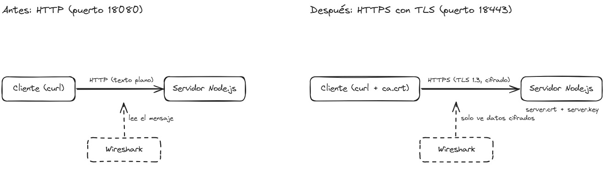
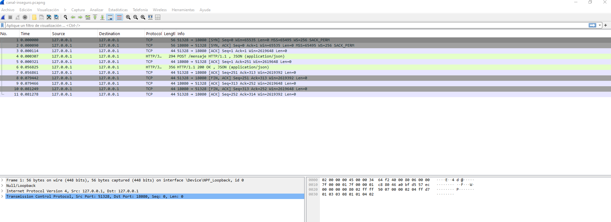
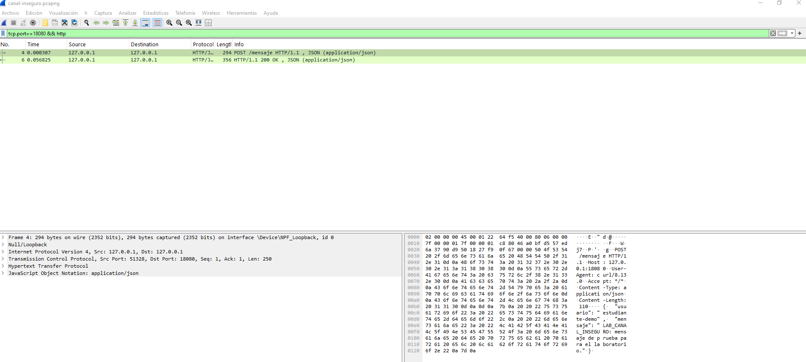
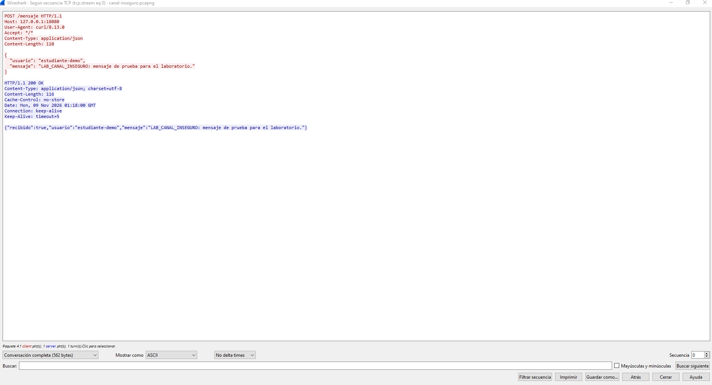
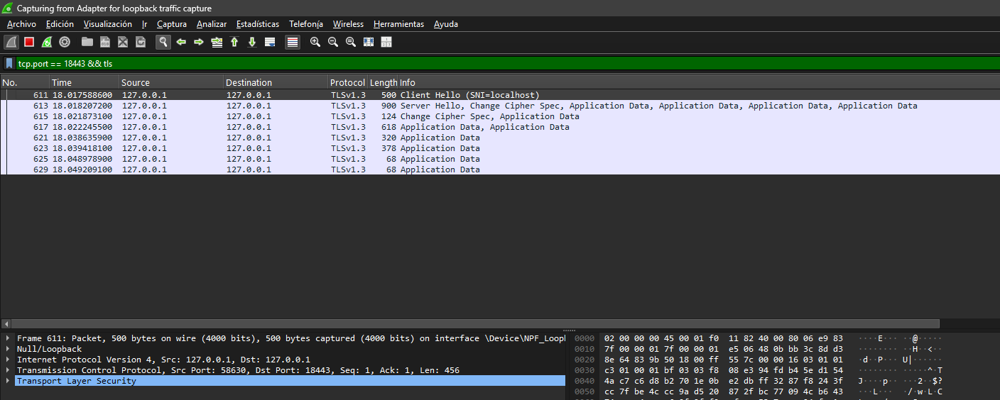
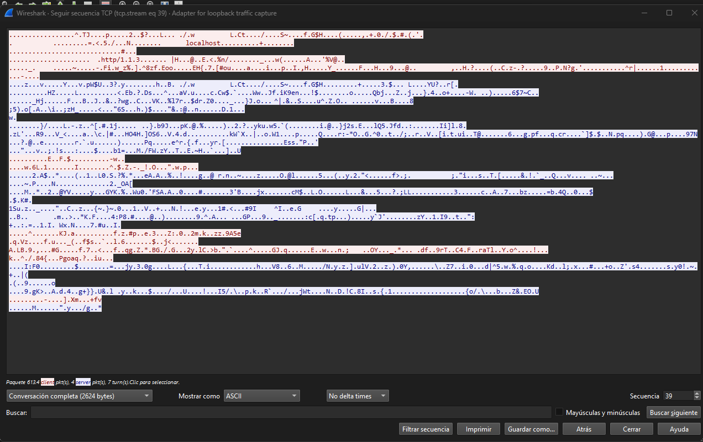
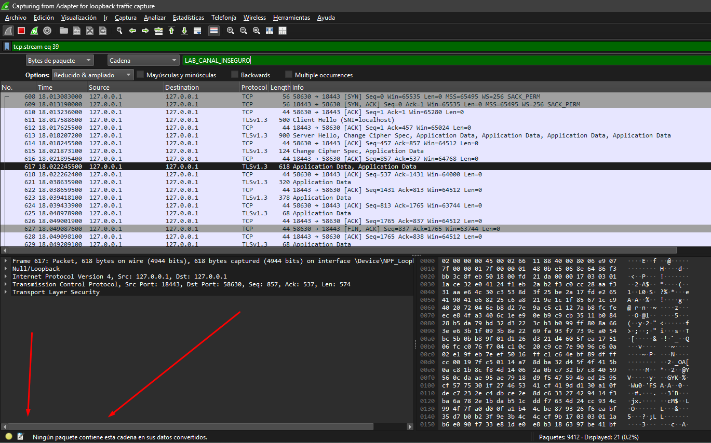
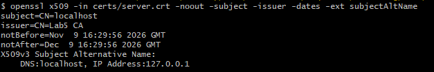
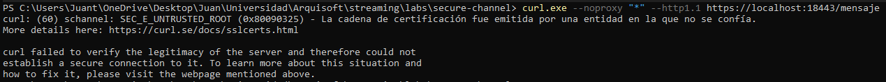

# Laboratorio 5. Canal seguro con TLS

**Grupo 1A**

**Docente:** Jeisson Andres Vergara Vargas

**Integrantes:**

- Laura Vanesa Alvarez Lafont
- Juan David Ardila Pacheco
- Juan David Cardenas Galvis
- Nelson Ivan Castellanos Betancourt
- David Sebastian Hurtado Sanchez
- Daniel Santiago Rodriguez Rodriguez

Bogotá, D. C., 9 de noviembre de 2026

---

**Universidad Nacional de Colombia** · Sede Bogotá\
Facultad de Ingeniería · Ingeniería de Sistemas y Computación\
Arquitectura de Software · Periodo 2026-II

---

## Contenido

- [1. Introducción](#1-introducción)
  - [1.1 Objetivo](#11-objetivo)
  - [1.2 El patrón Canal Seguro](#12-el-patrón-canal-seguro)
  - [1.3 Escenario de calidad](#13-escenario-de-calidad)
  - [1.4 Vista arquitectónica](#14-vista-arquitectónica)
  - [1.5 Requisitos y precauciones](#15-requisitos-y-precauciones)
- [2. Canal inseguro con HTTP](#2-canal-inseguro-con-http)
- [3. Canal seguro con TLS: certificados con OpenSSL](#3-canal-seguro-con-tls-certificados-con-openssl)
- [4. Verificación y resultados](#4-verificación-y-resultados)
- [5. Recomendaciones](#5-recomendaciones)
- [Referencias](#referencias)

## 1. Introducción

### 1.1 Objetivo

Implementar el patrón de seguridad **Canal Seguro** en un ejemplo reproducible (un servidor Node.js y un cliente curl) y documentar el proceso para que otro equipo pueda repetirlo. El capítulo 2 muestra el problema, el capítulo 3 aplica el patrón con TLS y certificados de OpenSSL, el capítulo 4 verifica el resultado y el capítulo 5 reúne recomendaciones.

### 1.2 El patrón Canal Seguro

**Propósito.** Proteger los datos en tránsito entre dos extremos para que un observador del trayecto no pueda leerlos y el cliente sepa con quién habla.

**Cómo funciona.** Los extremos negocian una sesión TLS. El servidor presenta un certificado firmado por una autoridad certificadora (CA) en la que el cliente confía. Si la verificación pasa, los datos viajan cifrados.

**Componentes:** cliente, servidor, protocolo TLS, certificado y llave privada del servidor, y CA de confianza.

**Costos:** hay que emitir, distribuir y renovar certificados, proteger las llaves privadas y asumir una pequeña sobrecarga en el handshake.

### 1.3 Escenario de calidad

El atributo de calidad que trabajamos es la seguridad, en concreto la confidencialidad de los datos en tránsito y la autenticación del servidor. Para el escenario pensamos en alguien que tiene acceso al trayecto entre el cliente y el servidor y captura el tráfico mientras el cliente envía un usuario y un mensaje por `POST /mensaje`. El sistema está en operación normal; nosotros lo probamos en loopback y con datos ficticios.

Lo que esperamos es que lo capturado no se pueda leer, que el cliente pueda comprobar que habla con el servidor correcto y que rechace a uno cuya CA no conoce. Lo medimos con tres resultados: por HTTP el marcador `LAB_CANAL_INSEGURO` se lee completo en Wireshark, por HTTPS ese marcador no aparece, y `openssl s_client` termina con `Verify return code: 0 (ok)` mientras que curl sin la CA falla.

### 1.4 Vista arquitectónica

Vista de componentes y conectores (C&C) del mismo sistema en dos configuraciones. Solo cambia el conector entre el cliente y el servidor: de HTTP a HTTPS con TLS.



*Figura 1. A la izquierda, el cliente y el servidor se comunican por HTTP en el puerto 18080 y Wireshark lee el mensaje. A la derecha, el conector es HTTPS con TLS 1.3 en el puerto 18443 y Wireshark solo ve datos cifrados.*

**Leyenda:** caja con borde continuo = componente; flecha = conector; caja con borde punteado = observador externo (Wireshark), que no forma parte del sistema; flecha punteada = captura del tráfico.

**Componentes y conectores: descripción**

| Elemento | Tipo | Responsabilidad y propiedades |
| --- | --- | --- |
| Cliente (curl) | Componente | Envía `POST /mensaje` con un JSON. Con HTTPS usa `ca.crt` como CA de confianza. |
| Servidor Node.js (`handler.mjs`) | Componente | Valida el JSON y responde 200. Escucha en `18080` (HTTP) o `18443` (HTTPS). Con HTTPS usa `server.crt` y `server.key`. |
| HTTP | Conector | Solicitud y respuesta síncronas en texto plano. Sin cifrado y sin autenticación del servidor. |
| HTTPS con TLS | Conector | Mismo protocolo de aplicación sobre TLS 1.3 (`TLS_AES_256_GCM_SHA384`). Cifra el contenido y autentica al servidor con su certificado. |
| Wireshark | Observador externo | Captura el tráfico del trayecto. Es la fuente del escenario de calidad, no un componente del sistema. |

### 1.5 Requisitos y precauciones

- Node.js 22 o posterior, curl, OpenSSL y Wireshark. En Windows, OpenSSL viene con Git Bash y Wireshark necesita Npcap para capturar el tráfico de loopback. Los comandos de Node y curl se escriben para PowerShell; los de OpenSSL, para Git Bash o una terminal de macOS o Linux.
- Todos los datos son ficticios y las capturas se hacen en loopback (`127.0.0.1`): el tráfico no sale del computador.
- Observar el tráfico requiere acceso al trayecto. El ejercicio no demuestra que alguien en el mismo Wi-Fi pueda leer las conversaciones de otros ni cubre ataques activos.
- `ca.key` y `server.key` son secretos: no se suben a ningún repositorio ni se comparten.

## 2. Canal inseguro con HTTP

### 2.1 Qué vamos a comprobar

Vamos a probar un canal HTTP entre un cliente y un servidor que se ejecutan en el mismo computador. El cliente utiliza curl para enviar un mensaje en formato JSON. El servidor, implementado con Node.js, lo recibe en la dirección `127.0.0.1:18080/mensaje` y devuelve una confirmación. Todos los datos utilizados son ficticios.

El servidor se crea con el módulo `node:http`, incluido en Node.js. Escucha en el puerto 18080 y atiende solicitudes `POST /mensaje`. Al recibir el JSON, comprueba que tenga los campos `usuario` y `mensaje` y responde con un estado 200 y el contenido recibido.

#### Por qué es inseguro

Este canal utiliza HTTP sin TLS, por lo que el contenido viaja sin cifrar. Quien pueda capturar el tráfico de ese trayecto puede reconstruir la conversación y leer los mensajes. Esta exposición puede aprovecharse mediante captura de tráfico, también llamada sniffing. En un sistema que enviara información sensible por ese canal, podrían quedar expuestos datos privados.

En la práctica observaremos tráfico local con Wireshark. La dirección `127.0.0.1` corresponde a loopback: la comunicación vuelve al mismo computador y no sale por Wi-Fi. La demostración consiste en leer el mensaje desde la captura; no implica intervenir una red ajena ni modificar lo enviado.

#### Archivos

Crea una carpeta de trabajo con una subcarpeta `ejemplo-http` y estos archivos:

`ejemplo-http/server.mjs`

```js
import { createServer } from 'node:http';
import { handleRequest } from './handler.mjs';

const server = createServer(handleRequest);
server.on('error', (error) => {
  console.error(`No se pudo iniciar el servidor: ${error.message}`);
  process.exitCode = 1;
});
server.listen(18080, '127.0.0.1', () => {
  console.log('Servidor del laboratorio: http://127.0.0.1:18080/mensaje');
  console.log('Déjalo abierto. Para terminar, pulsa Ctrl+C en esta terminal.');
});
```

`ejemplo-http/solicitud.json`

```json
{
  "usuario": "estudiante-demo",
  "mensaje": "LAB_CANAL_INSEGURO: mensaje de prueba para el laboratorio."
}
```

`ejemplo-http/handler.mjs` recibe el JSON, comprueba que tenga `usuario` y `mensaje` y responde 200 con el contenido recibido:

```js
export async function handleRequest(request, response) {
  const reply = (status, body) => {
    const payload = JSON.stringify(body);
    response.writeHead(status, {
      'Content-Type': 'application/json; charset=utf-8',
      'Content-Length': Buffer.byteLength(payload),
      'Cache-Control': 'no-store',
    });
    response.end(payload);
  };

  if (request.url !== '/mensaje') { reply(404, { error: 'La ruta del ejemplo es /mensaje.' }); return; }
  if (request.method !== 'POST') { reply(405, { error: 'Envía una solicitud POST.' }); return; }
  if (request.headers['content-type']?.split(';')[0].trim() !== 'application/json') {
    reply(415, { error: 'Usa Content-Type: application/json.' }); return;
  }

  try {
    const chunks = [];
    let size = 0;
    for await (const chunk of request) {
      size += chunk.length;
      if (size > 16384) { reply(413, { error: 'El ejemplo admite hasta 16 KiB.' }); return; }
      chunks.push(chunk);
    }
    const body = JSON.parse(Buffer.concat(chunks).toString('utf8'));
    if (!body || typeof body.usuario !== 'string' || !body.usuario.trim()
      || typeof body.mensaje !== 'string' || !body.mensaje.trim()) {
      reply(400, { error: 'Incluye usuario y mensaje como textos no vacíos.' }); return;
    }
    reply(200, { recibido: true, usuario: body.usuario, mensaje: body.mensaje });
  } catch {
    if (!response.headersSent && !response.destroyed) {
      reply(400, { error: 'Revisa que el cuerpo sea un JSON válido.' });
    }
  }
}
```

El mensaje incluye el texto `LAB_CANAL_INSEGURO`, que nos permitirá reconocerlo dentro de la captura.

### 2.2 Iniciar el servidor

Abre la carpeta de trabajo que contiene `ejemplo-http`. Haz clic en la barra de dirección del Explorador, escribe `powershell` y pulsa Enter. La terminal se abrirá en esa carpeta. Comprueba las herramientas:

```powershell
node --version
curl.exe --version
```

Después inicia el servidor:

```powershell
node ejemplo-http/server.mjs
```

Debe aparecer:

```text
Servidor del laboratorio: http://127.0.0.1:18080/mensaje
Déjalo abierto. Para terminar, pulsa Ctrl+C en esta terminal.
```

Deja esta terminal abierta. El programa permanece a la espera de peticiones, por lo que no volverá a mostrar el indicador habitual para escribir comandos. Abre una segunda ventana de PowerShell desde la misma carpeta; la utilizaremos después para ejecutar curl.

### 2.3 Preparar la captura en Wireshark

1. Abre Wireshark. Si hay una captura en curso, detenla con el cuadrado rojo de la barra superior.
2. Entra en **Captura → Opciones** o pulsa **Ctrl+K**.
3. En la pestaña **Entrada**, selecciona la fila **Adapter for loopback traffic capture** con **un solo clic**. No mantengas pulsadas Ctrl ni Shift. Comprueba que solo esa fila quede seleccionada; las casillas de la columna «Promiscuo» no sirven para seleccionar la interfaz.
4. En el campo inferior **Filtro de captura para interfaces seleccionadas**, escribe:

```text
tcp port 18080
```

5. No pulses Enter. Pulsa **Tab** para salir del campo y comprobar que el filtro no aparece como inválido.

El doble clic sobre una interfaz puede iniciar la captura directamente; por eso se selecciona con un solo clic. El filtro limita la captura al puerto del ejemplo.

Pulsa **Iniciar**, en la parte inferior derecha. La lista puede estar vacía hasta que envíes el mensaje con curl.

### 2.4 Enviar la petición y observar el tráfico

En la segunda terminal, situada en la misma carpeta, ejecuta:

```powershell
curl.exe --noproxy "*" --http1.1 --include `
  --header "Content-Type: application/json" `
  --data-binary "@ejemplo-http/solicitud.json" `
  http://127.0.0.1:18080/mensaje
```

Copia el bloque completo. El acento grave al final de las tres primeras líneas permite continuar el comando en PowerShell; no debe tener espacios después. Curl lee `solicitud.json` y lo envía mediante POST. La opción `--include` muestra las cabeceras de la respuesta y `--noproxy` evita que la petición local pase por un proxy configurado en el equipo.

La respuesta debe comenzar por `HTTP/1.1 200 OK` e incluir estos datos:

```json
{
  "recibido": true,
  "usuario": "estudiante-demo",
  "mensaje": "LAB_CANAL_INSEGURO: mensaje de prueba para el laboratorio."
}
```

El estado 200 indica que el servidor atendió la petición. No demuestra que el canal esté protegido.

Después de enviar el mensaje, vuelve a Wireshark. Cuando aparezcan los paquetes, pulsa el **cuadrado rojo de Detener** en la barra superior. Así podrás revisar la conversación con calma.

La lista debería verse parecida a esta. Aparecen paquetes TCP del inicio y cierre de la conexión, además de la petición y la respuesta HTTP:



*Figura 2. Lista de paquetes de nuestra prueba. El POST aparece en el número 4 y la respuesta en el 6.*

En la barra situada encima de los paquetes, escribe este filtro y pulsa Enter:

```text
tcp.port == 18080 && http
```

Al aplicarlo deberías ver algo parecido a esta captura: una fila con `POST /mensaje` y otra con `HTTP/1.1 200 OK`. Los números de paquete pueden cambiar en otra ejecución.



*Figura 3. Vista de la lista después de aplicar el filtro HTTP.*

Este filtro solo cambia lo que se muestra en pantalla. Su sintaxis es distinta de la del filtro de captura utilizado antes de iniciar.

### 2.5 Leer el contenido del canal

1. Selecciona la fila `POST /mensaje`, pulsa el botón derecho y abre **Seguir → Flujo TCP / Follow → TCP Stream**.
2. En la parte inferior del diálogo, selecciona **Conversación completa / Entire conversation** y **Mostrar datos como: ASCII / Show data as: ASCII**.

Deberías ver la solicitud y la respuesta juntas, como en esta imagen. En nuestra captura, el texto rojo corresponde al cliente y el azul al servidor:



*Figura 4. Contenido de la conversación reconstruida en ASCII.*

En nuestra prueba se pudo leer el usuario `estudiante-demo`, el mensaje `LAB_CANAL_INSEGURO` y la respuesta `"recibido":true`. Wireshark obtuvo ese contenido de los paquetes capturados. El mensaje viajó sin cifrar: JSON organiza los datos y TCP los transporta, pero ninguno aporta cifrado por sí mismo.

Esta observación requiere acceso al trayecto del tráfico; no demuestra que cualquier persona conectada al mismo Wi-Fi pueda leer las conversaciones de los demás. Para terminar, pulsa **Ctrl+C** en la terminal del servidor.

## 3. Canal seguro con TLS: certificados con OpenSSL

En el capítulo anterior el mensaje viajó legible. Aquí se protege el mismo canal con TLS. La receta sirve para cualquier proyecto. La comprobación de que el tráfico va cifrado y de que el cliente rechaza certificados falsos se hace en el capítulo 4.

### 3.1 Qué necesita TLS

El servidor necesita una llave privada y un certificado. El certificado dice para qué nombres vale la llave, por ejemplo `localhost`. Una autoridad certificadora (CA) lo firma. El cliente confía en esa CA, así que puede comprobar que habla con el servidor correcto antes de enviar datos.

En producción la CA es pública, como Let's Encrypt. En el laboratorio creamos una CA privada con OpenSSL. Los pasos en el servidor y en el cliente son los mismos.

Usaremos estos archivos de la carpeta `ejemplo-https`:

| Archivo | Para qué sirve |
| --- | --- |
| `ca.cnf` | Datos de la CA del laboratorio. |
| `server.cnf` | Datos del certificado del servidor. `subjectAltName` lista sus nombres: `localhost` y `127.0.0.1`. |
| `server.mjs` | Inicia el servidor HTTPS en `127.0.0.1:18443`. Usa el mismo `handler.mjs` del capítulo 2. |

Crea la carpeta `ejemplo-https` junto a `ejemplo-http`. Contenido de los archivos de configuración:

`ejemplo-https/ca.cnf`

```ini
[req]
prompt = no
distinguished_name = dn
x509_extensions = ca

[dn]
CN = Lab5 CA

[ca]
basicConstraints = critical, CA:TRUE, pathlen:0
keyUsage = critical, keyCertSign, cRLSign
subjectKeyIdentifier = hash
```

`ejemplo-https/server.cnf`

```ini
[req]
prompt = no
distinguished_name = dn

[dn]
CN = localhost

[server]
basicConstraints = critical, CA:FALSE
keyUsage = critical, digitalSignature
extendedKeyUsage = serverAuth
subjectAltName = DNS:localhost, IP:127.0.0.1
subjectKeyIdentifier = hash
authorityKeyIdentifier = keyid, issuer
```

Los archivos generados quedan en `ejemplo-https/certs/`, que Git ignora. `ca.key` y `server.key` son secretos: no se suben al repositorio ni se comparten.

### 3.2 Generar la CA, la llave y el certificado

En Windows, abre **Git Bash** en la carpeta `ejemplo-https`; Git for Windows ya incluye OpenSSL. En macOS o Linux usa una terminal normal. Ejecuta:

```sh
mkdir certs
openssl genpkey -algorithm EC -pkeyopt ec_paramgen_curve:P-256 -out certs/ca.key
openssl req -x509 -new -key certs/ca.key -sha256 -days 30 -config ca.cnf -out certs/ca.crt
openssl genpkey -algorithm EC -pkeyopt ec_paramgen_curve:P-256 -out certs/server.key
openssl req -new -key certs/server.key -config server.cnf -out certs/server.csr
openssl x509 -req -in certs/server.csr -CA certs/ca.crt -CAkey certs/ca.key -CAcreateserial -sha256 -days 30 -extfile server.cnf -extensions server -out certs/server.crt
openssl verify -CAfile certs/ca.crt -verify_hostname localhost certs/server.crt
```

Las dos primeras líneas de OpenSSL crean la CA. Las dos siguientes crean la llave del servidor y una solicitud de certificado (CSR). La quinta hace que la CA firme esa solicitud. La última comprueba el resultado y debe mostrar:

```text
certs/server.crt: OK
```

Si no tienes OpenSSL pero sí Docker, puedes reemplazar `openssl` por `docker run --rm -v "$PWD:/w" -w /w alpine/openssl`.

### 3.3 Iniciar el servidor HTTPS

Crea `ejemplo-https/server.mjs`. Reutiliza el `handler.mjs` del capítulo 2; solo cambia el transporte: `node:https` en lugar de `node:http`, con la llave y el certificado.

```js
import { readFileSync } from 'node:fs';
import { createServer } from 'node:https';
import { handleRequest } from '../ejemplo-http/handler.mjs';

const certs = new URL('./certs/', import.meta.url);
let options;
try {
  options = {
    key: readFileSync(new URL('server.key', certs)),
    cert: readFileSync(new URL('server.crt', certs)),
    minVersion: 'TLSv1.2',
  };
} catch (error) {
  console.error(`Faltan la llave o el certificado en ejemplo-https/certs: ${error.message}`);
  process.exit(1);
}

const server = createServer(options, handleRequest);
server.on('error', (error) => {
  console.error(`No se pudo iniciar el servidor: ${error.message}`);
  process.exitCode = 1;
});
server.listen(18443, '127.0.0.1', () => {
  console.log('Servidor del laboratorio: https://localhost:18443/mensaje');
  console.log('Déjalo abierto. Para terminar, pulsa Ctrl+C en esta terminal.');
});
```

Vuelve a la carpeta donde están `ejemplo-http` y `ejemplo-https` y ejecuta:

```powershell
node ejemplo-https/server.mjs
```

Debe aparecer:

```text
Servidor del laboratorio: https://localhost:18443/mensaje
Déjalo abierto. Para terminar, pulsa Ctrl+C en esta terminal.
```

Frente al `server.mjs` del capítulo 2, el cambio es usar `node:https` en lugar de `node:http` y pasarle la llave y el certificado. `handler.mjs` no cambia.

### 3.4 Enviar la petición confiando en la CA

En una segunda terminal, desde la misma carpeta:

```powershell
curl.exe --noproxy "*" --http1.1 --include `
  --cacert "ejemplo-https/certs/ca.crt" `
  --header "Content-Type: application/json" `
  --data-binary "@ejemplo-http/solicitud.json" `
  https://localhost:18443/mensaje
```

La respuesta debe ser la misma del capítulo 2: `HTTP/1.1 200 OK` y el JSON con `"recibido": true`.

`--cacert` le dice a curl que confíe en nuestra CA. No uses `-k` ni `--insecure`: esas opciones apagan la comprobación del certificado.

En Windows, curl usa Schannel y comprueba la revocación del certificado. Como nuestra CA no publica una lista de revocación, en nuestra ejecución fue necesario agregar `--ssl-revoke-best-effort` al final del comando (ver capítulo 4). Si curl muestra `CERT_TRUST_REVOCATION_STATUS_UNKNOWN`, es por esto. La opción solo tolera que no haya información de revocación: la cadena de confianza y el nombre se siguen validando.

### 3.5 Aplicarlo en otro proyecto

Cambia `subjectAltName` en `server.cnf` por los nombres que usa tu cliente. En Docker Compose suele ser el nombre del servicio, por ejemplo `DNS:api, DNS:localhost`. Luego configura el servidor y el cliente:

| Tecnología | Servidor | Cliente |
| --- | --- | --- |
| Node.js | `https.createServer({ key, cert }, app)` | `NODE_EXTRA_CA_CERTS=ca.crt` |
| Python (Uvicorn, requests) | `uvicorn app:app --ssl-keyfile server.key --ssl-certfile server.crt` | `requests.get(url, verify="ca.crt")` |
| Spring Boot | `server.ssl.*` con un almacén PKCS#12 (llave y certificado juntos) | `keytool -importcert -file ca.crt -keystore truststore.p12` |
| Go | `http.ListenAndServeTLS(":8443", "server.crt", "server.key", h)` | `tls.Config{RootCAs: pool}` |
| Nginx | `ssl_certificate server.crt; ssl_certificate_key server.key;` | Depende del cliente |

En todos los casos, permite solo TLS 1.2 y 1.3 y marca las cookies de sesión como `Secure`. Pasa las contraseñas por variables de entorno.

## 4. Verificación y resultados

El capítulo 2 mostró el mensaje legible en Wireshark y el capítulo 3 puso TLS sobre el mismo servicio. Este capítulo comprueba el resultado: lo que se leía en el capítulo 2 ya no se puede leer, el servidor demuestra su identidad y el cliente rechaza una CA desconocida.

Se usan el servidor HTTPS del apartado 3.3, los certificados del apartado 3.2 y la captura HTTP del capítulo 2 como referencia. Todo se ejecuta desde la carpeta que contiene `ejemplo-http` y `ejemplo-https`, con el servidor HTTPS encendido.

| Propiedad | Qué significa | Cómo se comprueba |
| --- | --- | --- |
| Confidencialidad | Un observador del trayecto no puede leer el mensaje | 4.1: el marcador `LAB_CANAL_INSEGURO` ya no aparece en Wireshark |
| Autenticación del servidor | El cliente comprueba que habla con el servidor correcto | 4.2: `openssl s_client` y certificado; 4.3: rechazo sin la CA |

### 4.1 El tráfico ya no se puede leer

1. En Wireshark pulsa **Ctrl+K**, selecciona **Adapter for loopback traffic capture**, escribe el filtro de captura `tcp port 18443` y pulsa **Iniciar**.
2. Envía la petición del apartado 3.4. En Windows, añade `--ssl-revoke-best-effort` al final si curl lo exige.
3. Detén la captura y aplica el filtro `tcp.port == 18443 && tls`. Debes ver `Client Hello`, `Server Hello` y paquetes `Application Data`. Si Wireshark no los reconoce como TLS, usa **Analizar → Decodificar como… → TLS** para el puerto 18443.

   

   *Figura 5. Handshake TLS seguido de datos de aplicación cifrados.*

4. Clic derecho en un paquete y **Seguir → Flujo TCP**. A diferencia de la figura 4, el contenido es ilegible.

   

   *Figura 6. El mismo mensaje de la figura 4, ahora ilegible para el observador.*

5. Busca el marcador: **Ctrl+F**, tipo **Cadena**, campo **Bytes del paquete**, texto `LAB_CANAL_INSEGURO`. No debe haber resultados.

   

   *Figura 7. El marcador no aparece en los paquetes del flujo de la petición.*

No cargues claves de sesión TLS en Wireshark: permitirían descifrar el flujo e invalidarían la comprobación.

### 4.2 El servidor es quien dice ser

Abre **Git Bash** en `ejemplo-https` y ejecuta:

```sh
openssl s_client -connect localhost:18443 -CAfile certs/ca.crt -servername localhost </dev/null
openssl x509 -in certs/server.crt -noout -subject -issuer -dates -ext subjectAltName
```

El primer comando debe mostrar la versión de TLS, el cifrado negociado y terminar con `Verify return code: 0 (ok)`. El segundo debe mostrar como emisor `Lab5 CA`, fechas vigentes y un SAN con `DNS:localhost` e `IP Address:127.0.0.1`.


*Figura 8. Handshake verificado contra la CA del laboratorio: TLS 1.3, `TLS_AES_256_GCM_SHA384`.*



*Figura 9. Asunto, emisor, vigencia y nombres del certificado.*

### 4.3 Rechazo de una CA no confiable

Repite la petición **sin** `--cacert`. El sistema no conoce a `Lab5 CA`, así que la conexión debe fallar:

```powershell
curl.exe --noproxy "*" --http1.1 https://localhost:18443/mensaje
```



*Figura 10. El cliente rechaza un servidor cuya CA no conoce (`SEC_E_UNTRUSTED_ROOT` con Schannel; con OpenSSL el mensaje difiere).*

### 4.4 Resultados

| Propiedad | HTTP (capítulo 2) | HTTPS (este capítulo) | Evidencia |
| --- | --- | --- | --- |
| Contenido de la petición | JSON legible | `Application Data` ilegible | Figuras 4 y 6 |
| Marcador `LAB_CANAL_INSEGURO` | Visible | No aparece | Figura 7 |
| Identidad del servidor | No se comprueba | `Verify return code: 0 (ok)`, SAN `localhost` y `127.0.0.1` | Figuras 8 y 9 |
| CA desconocida | No aplica | Conexión rechazada | Figura 10 |

La captura ilegible por sí sola no prueba que el canal sea seguro: la prueba es el conjunto de las tres comprobaciones. Con ellas, el contenido que el capítulo 2 permitía leer ya no se expone a un observador del trayecto.

Alcance: el laboratorio demuestra confidencialidad y autenticación del servidor en un trayecto concreto, en loopback.

## 5. Recomendaciones

Si otro grupo quiere repetir esto, lo primero que le diríamos es que ajuste el `subjectAltName` de `server.cnf` a los nombres con los que su cliente llama al servidor. En nuestro caso eran `localhost` y `127.0.0.1`, pero en Docker Compose suele ser el nombre del servicio, por ejemplo `api`. Si el nombre no está en el certificado, el cliente lo rechaza aunque la CA sea la correcta.

También les diríamos que no se acostumbren a apagar la verificación con `-k` o `--insecure`. Es tentador cuando algo falla, pero con eso el cifrado deja de servir, porque el cliente aceptaría a cualquier servidor. Lo correcto es darle al cliente la CA con `--cacert` o con `NODE_EXTRA_CA_CERTS`. La CA que creamos con OpenSSL es solo para el laboratorio; en producción conviene una CA pública como Let's Encrypt o la de la organización.

Del lado del servidor, nosotros fijamos `minVersion: 'TLSv1.2'` para aceptar solo TLS 1.2 y 1.3, y recomendamos marcar las cookies de sesión como `Secure`. Las llaves `ca.key` y `server.key` nunca deben subirse al repositorio, y los certificados hay que renovarlos antes de que venzan: los nuestros duran 30 días.

La receta es la misma en cualquier tecnología: llave y certificado en el servidor, CA de confianza en el cliente; la tabla de la sección 3.5 muestra dónde se configura cada pieza.

## Referencias

- OpenSSL Project. Manuales de `req`, `x509`, `verify` y `s_client` (versión 3.0). https://docs.openssl.org/3.0/
- Node.js. Módulo `https`. https://nodejs.org/api/https.html
- Spring Boot. Reference Documentation: SSL. https://docs.spring.io/spring-boot/reference/features/ssl.html
- Wireshark. User's Guide: Following Protocol Streams. https://www.wireshark.org/docs/wsug_html_chunked/ChAdvFollowStreamSection.html
- Rescorla, E. (2018). The Transport Layer Security (TLS) Protocol Version 1.3. RFC 8446. https://www.rfc-editor.org/rfc/rfc8446.html
