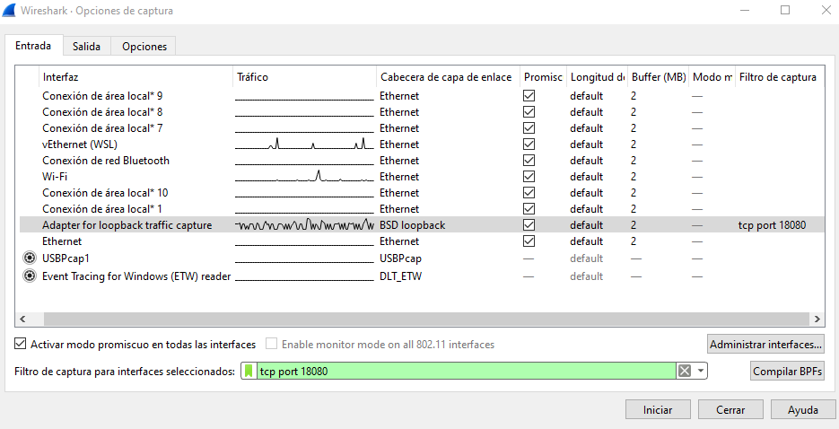
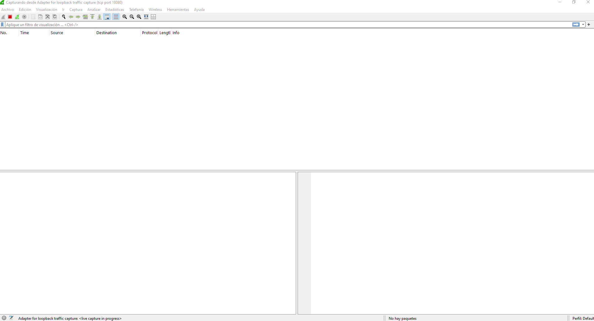
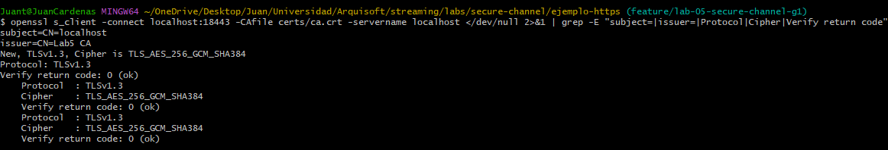

# Laboratorio 5. Canal seguro con TLS

**Grupo 1A · Proyecto Vault TV**

**Docente:** Jeisson Andres Vergara Vargas

**Integrantes:**

- Laura Vanesa Alvarez Lafont
- Juan David Ardila Pacheco
- Juan David Cardenas Galvis
- Nelson Ivan Castellanos Betancourt
- David Sebastian Hurtado Sanchez
- Daniel Santiago Rodriguez Rodriguez

Bogotá, D. C., 9 de noviembre de 2026

---

**Universidad Nacional de Colombia** · Sede Bogotá\
Facultad de Ingeniería · Ingeniería de Sistemas y Computación\
Arquitectura de Software · Periodo 2026-II

---

## Contenido

- [1. Introducción](#1-introducción)
  - [1.1 Objetivo](#11-objetivo)
  - [1.2 Estructura del documento](#12-estructura-del-documento)
  - [1.3 Requisitos](#13-requisitos)
  - [1.4 Alcance y precauciones](#14-alcance-y-precauciones)
- [2. Canal inseguro con HTTP](#2-canal-inseguro-con-http)
  - [2.1 Qué vamos a comprobar](#21-qué-vamos-a-comprobar)
  - [2.2 Iniciar el servidor](#22-iniciar-el-servidor)
  - [2.3 Preparar la captura en Wireshark](#23-preparar-la-captura-en-wireshark)
  - [2.4 Enviar la petición y observar el tráfico](#24-enviar-la-petición-y-observar-el-tráfico)
  - [2.5 Leer el contenido del canal](#25-leer-el-contenido-del-canal)
- [3. Canal seguro con TLS: certificados con OpenSSL](#3-canal-seguro-con-tls-certificados-con-openssl)
  - [3.1 Qué necesita TLS](#31-qué-necesita-tls)
  - [3.2 Generar la CA, la llave y el certificado](#32-generar-la-ca-la-llave-y-el-certificado)
  - [3.3 Iniciar el servidor HTTPS](#33-iniciar-el-servidor-https)
  - [3.4 Enviar la petición confiando en la CA](#34-enviar-la-petición-confiando-en-la-ca)
  - [3.5 Aplicarlo en otro proyecto](#35-aplicarlo-en-otro-proyecto)
- [4. Verificación del canal seguro](#4-verificación-del-canal-seguro)
  - [4.1 Qué vamos a comprobar](#41-qué-vamos-a-comprobar)
  - [4.2 Herramientas y carpeta de trabajo](#42-herramientas-y-carpeta-de-trabajo)
  - [4.3 Antes: el canal HTTP](#43-antes-el-canal-http)
  - [4.4 Certificados con OpenSSL](#44-certificados-con-openssl)
  - [4.5 Después: el canal HTTPS](#45-después-el-canal-https)
  - [4.6 Verificar el certificado y el handshake](#46-verificar-el-certificado-y-el-handshake)
  - [4.7 Rechazo de una CA no confiable](#47-rechazo-de-una-ca-no-confiable)
  - [4.8 Tabla comparativa antes y después](#48-tabla-comparativa-antes-y-después)
  - [4.9 Registro de la ejecución](#49-registro-de-la-ejecución)
  - [4.10 Conclusión](#410-conclusión)
  - [4.11 Problemas comunes](#411-problemas-comunes)
- [Referencias](#referencias)

## 1. Introducción

### 1.1 Objetivo

Este documento explica, paso a paso, cómo comprobar que un canal de comunicación sin cifrar expone la información que transporta y cómo protegerlo con TLS usando certificados generados con OpenSSL. Está escrito para que cualquier grupo pueda reproducir el ejercicio. Los archivos del ejemplo (servidor, solicitud y configuración de los certificados) están en el repositorio del proyecto: `SWARCH-1A/streaming`, rama `feature/lab-05-secure-channel-g1`, carpeta `labs/secure-channel`.

### 1.2 Estructura del documento

| Parte | Contenido |
| --- | --- |
| Capítulo 2 | Un servidor y un cliente sencillos (Node.js y curl) se comunican por HTTP. Con Wireshark se lee el mensaje dentro de la captura. |
| Capítulo 3 | Se crea una autoridad certificadora privada y un certificado con OpenSSL, y el mismo servidor pasa a HTTPS. |
| Capítulo 4 | Se comprueba que el canal protege: el tráfico va cifrado, el servidor es quien dice ser y el cliente rechaza una CA desconocida. Termina con una tabla comparativa antes y después. |

### 1.3 Requisitos

Se necesitan Node.js 22 o posterior, curl, OpenSSL y Wireshark. En Windows, OpenSSL viene con Git Bash y Wireshark necesita Npcap para capturar el tráfico de loopback. Los comandos de Node y curl se escriben para PowerShell; los de OpenSSL, para Git Bash o una terminal de macOS o Linux.

### 1.4 Alcance y precauciones

- Todos los datos son ficticios. Las capturas se hacen en loopback (`127.0.0.1`), por lo que el tráfico no sale del computador.
- Observar el tráfico requiere acceso al trayecto. El ejercicio no demuestra que cualquier persona conectada al mismo Wi-Fi pueda leer las conversaciones de los demás.
- El ejercicio demuestra confidencialidad y autenticación del servidor en un trayecto concreto. No demuestra que todo Vault TV sea seguro ni cubre ataques activos.
- Las llaves privadas (`ca.key`, `server.key`) son secretos: no se suben a ningún repositorio ni se comparten. Los archivos de captura se guardan fuera de la carpeta del proyecto.

## 2. Canal inseguro con HTTP

### 2.1 Qué vamos a comprobar

Vamos a probar un canal HTTP entre un cliente y un servidor que se ejecutan en el mismo computador. El cliente utiliza curl para enviar un mensaje en formato JSON. El servidor, implementado con Node.js, lo recibe en la dirección `127.0.0.1:18080/mensaje` y devuelve una confirmación. Todos los datos utilizados son ficticios.

El servidor se crea con el módulo `node:http`, incluido en Node.js. Escucha en el puerto 18080 y atiende solicitudes `POST /mensaje`. Al recibir el JSON, comprueba que tenga los campos `usuario` y `mensaje` y responde con un estado 200 y el contenido recibido.

#### Por qué es inseguro

Este canal utiliza HTTP sin TLS, por lo que el contenido viaja sin cifrar. Quien pueda capturar el tráfico de ese trayecto puede reconstruir la conversación y leer los mensajes. Esta exposición puede aprovecharse mediante captura de tráfico, también llamada sniffing. En un sistema que enviara información sensible por ese canal, podrían quedar expuestos datos privados.

En la práctica observaremos tráfico local con Wireshark. La dirección `127.0.0.1` corresponde a loopback: la comunicación vuelve al mismo computador y no sale por Wi-Fi. La demostración consiste en leer el mensaje desde la captura; no implica intervenir una red ajena ni modificar lo enviado.

#### Herramientas y archivos

Se necesitan Node.js 22 o posterior, curl y Wireshark. En Windows, Wireshark debe contar con Npcap para capturar el tráfico de loopback.

Los tres archivos están en el repositorio del proyecto (`SWARCH-1A/streaming`, rama `feature/lab-05-secure-channel-g1`), en la carpeta `labs/secure-channel/ejemplo-http`. Crea una carpeta de trabajo y copia allí la carpeta `ejemplo-http`. Usaremos esa carpeta para iniciar el servidor y enviar la petición.

| Archivo | Para qué sirve |
| --- | --- |
| `server.mjs` | Inicia el servidor HTTP en `127.0.0.1:18080`. |
| `handler.mjs` | Recibe el JSON, comprueba sus campos y prepara la respuesta. |
| `solicitud.json` | Contiene el usuario y el mensaje ficticios que enviará curl. |

El mensaje incluye el texto `LAB_CANAL_INSEGURO`, que nos permitirá reconocerlo dentro de la captura.

### 2.2 Iniciar el servidor

Abre la carpeta de trabajo que contiene `ejemplo-http`. Haz clic en la barra de dirección del Explorador, escribe `powershell` y pulsa Enter. La terminal se abrirá en esa carpeta. Comprueba las herramientas:

```powershell
node --version
curl.exe --version
```

Después inicia el servidor:

```powershell
node ejemplo-http/server.mjs
```

Debe aparecer:

```text
Servidor del laboratorio: http://127.0.0.1:18080/mensaje
Déjalo abierto. Para terminar, pulsa Ctrl+C en esta terminal.
```

Deja esta terminal abierta. El programa permanece a la espera de peticiones, por lo que no volverá a mostrar el indicador habitual para escribir comandos. Abre una segunda ventana de PowerShell desde la misma carpeta; la utilizaremos después para ejecutar curl.

### 2.3 Preparar la captura en Wireshark

1. Abre Wireshark. Si hay una captura en curso, detenla con el cuadrado rojo de la barra superior.
2. Entra en **Captura → Opciones** o pulsa **Ctrl+K**.
3. En la pestaña **Entrada**, selecciona la fila **Adapter for loopback traffic capture** con **un solo clic**. No mantengas pulsadas Ctrl ni Shift. Comprueba que solo esa fila quede seleccionada; las casillas de la columna «Promiscuo» no sirven para seleccionar la interfaz.
4. En el campo inferior **Filtro de captura para interfaces seleccionadas**, escribe:

```text
tcp port 18080
```

5. No pulses Enter. Pulsa **Tab** para salir del campo y comprobar que el filtro no aparece como inválido.
El doble clic sobre una interfaz puede iniciar la captura directamente. Por eso seleccionamos con un solo clic y usamos el botón Iniciar cuando la configuración está lista. El filtro limita la captura al puerto del ejemplo.

Deberías ver algo parecido a esta configuración, con loopback seleccionado y el filtro del puerto 18080:



*Figura 1. Interfaz y filtro preparados antes de iniciar la captura.*

Pulsa **Iniciar**, en la parte inferior derecha. La lista puede estar vacía hasta que envíes el mensaje con curl:



*Figura 2. Captura en curso, todavía sin paquetes de la petición.*

### 2.4 Enviar la petición y observar el tráfico

En la segunda terminal, situada en la misma carpeta, ejecuta:

```powershell
curl.exe --noproxy "*" --http1.1 --include `
  --header "Content-Type: application/json" `
  --data-binary "@ejemplo-http/solicitud.json" `
  http://127.0.0.1:18080/mensaje
```

Copia el bloque completo. El acento grave al final de las tres primeras líneas permite continuar el comando en PowerShell; no debe tener espacios después. Curl lee `solicitud.json` y lo envía mediante POST. La opción `--include` muestra las cabeceras de la respuesta y `--noproxy` evita que la petición local pase por un proxy configurado en el equipo.

La respuesta debe comenzar por `HTTP/1.1 200 OK` e incluir estos datos:

```json
{
  "recibido": true,
  "usuario": "estudiante-demo",
  "mensaje": "LAB_CANAL_INSEGURO: mensaje de prueba para el laboratorio."
}
```

El estado 200 indica que el servidor atendió la petición. No demuestra que el canal esté protegido.

Después de enviar el mensaje, vuelve a Wireshark. Cuando aparezcan los paquetes, pulsa el **cuadrado rojo de Detener** en la barra superior. Así podrás revisar la conversación con calma.

La lista debería verse parecida a esta. Aparecen paquetes TCP del inicio y cierre de la conexión, además de la petición y la respuesta HTTP:


*Figura 3. Lista de paquetes de nuestra prueba. El POST aparece en el número 4 y la respuesta en el 6.*

En la barra situada encima de los paquetes, escribe este filtro y pulsa Enter:

```text
tcp.port == 18080 && http
```

Al aplicarlo deberías ver algo parecido a esta captura: una fila con `POST /mensaje` y otra con `HTTP/1.1 200 OK`. Los números de paquete pueden cambiar en otra ejecución.


*Figura 4. Vista de la lista después de aplicar el filtro HTTP.*

Este filtro solo cambia lo que se muestra en pantalla. Su sintaxis es distinta de la del filtro de captura utilizado antes de iniciar.

### 2.5 Leer el contenido del canal

1. Selecciona la fila `POST /mensaje`, pulsa el botón derecho y abre **Seguir → Flujo TCP / Follow → TCP Stream**.
2. En la parte inferior del diálogo, selecciona **Conversación completa / Entire conversation** y **Mostrar datos como: ASCII / Show data as: ASCII**.

Deberías ver la solicitud y la respuesta juntas, como en esta imagen. En nuestra captura, el texto rojo corresponde al cliente y el azul al servidor:


*Figura 5. Contenido de la conversación reconstruida en ASCII.*

En nuestra prueba se pudo leer el usuario `estudiante-demo`, el mensaje `LAB_CANAL_INSEGURO` y la respuesta `"recibido":true`. Wireshark obtuvo ese contenido de los paquetes capturados. El mensaje viajó sin cifrar: JSON organiza los datos y TCP los transporta, pero ninguno aporta cifrado por sí mismo.

Esta observación requiere acceso al trayecto del tráfico; no demuestra que cualquier persona conectada al mismo Wi-Fi pueda leer las conversaciones de los demás. Para terminar, pulsa **Ctrl+C** en la terminal del servidor.

## 3. Canal seguro con TLS: certificados con OpenSSL

En el capítulo anterior el mensaje viajó legible. Aquí se protege el mismo canal con TLS. La receta sirve para cualquier proyecto. La comprobación de que el tráfico va cifrado y de que el cliente rechaza certificados falsos se hace en el capítulo 4.

### 3.1 Qué necesita TLS

El servidor necesita una llave privada y un certificado. El certificado dice para qué nombres vale la llave, por ejemplo `localhost`. Una autoridad certificadora (CA) lo firma. El cliente confía en esa CA, así que puede comprobar que habla con el servidor correcto antes de enviar datos.

En producción la CA es pública, como Let's Encrypt. En el laboratorio creamos una CA privada con OpenSSL. Los pasos en el servidor y en el cliente son los mismos.

Usaremos estos archivos de la carpeta `ejemplo-https` (en `labs/secure-channel/ejemplo-https` del repositorio):

| Archivo | Para qué sirve |
| --- | --- |
| `ca.cnf` | Datos de la CA del laboratorio. |
| `server.cnf` | Datos del certificado del servidor. `subjectAltName` lista sus nombres: `localhost` y `127.0.0.1`. |
| `server.mjs` | Inicia el servidor HTTPS en `127.0.0.1:18443`. Usa el mismo `handler.mjs` del capítulo 2. |

Los archivos generados quedan en `ejemplo-https/certs/`, que Git ignora. `ca.key` y `server.key` son secretos: no se suben al repositorio ni se comparten.

### 3.2 Generar la CA, la llave y el certificado

En Windows, abre **Git Bash** en la carpeta `ejemplo-https`; Git for Windows ya incluye OpenSSL. En macOS o Linux usa una terminal normal. Ejecuta:

```sh
mkdir certs
openssl genpkey -algorithm EC -pkeyopt ec_paramgen_curve:P-256 -out certs/ca.key
openssl req -x509 -new -key certs/ca.key -sha256 -days 30 -config ca.cnf -out certs/ca.crt
openssl genpkey -algorithm EC -pkeyopt ec_paramgen_curve:P-256 -out certs/server.key
openssl req -new -key certs/server.key -config server.cnf -out certs/server.csr
openssl x509 -req -in certs/server.csr -CA certs/ca.crt -CAkey certs/ca.key -CAcreateserial -sha256 -days 30 -extfile server.cnf -extensions server -out certs/server.crt
openssl verify -CAfile certs/ca.crt -verify_hostname localhost certs/server.crt
```

Las dos primeras líneas de OpenSSL crean la CA. Las dos siguientes crean la llave del servidor y una solicitud de certificado (CSR). La quinta hace que la CA firme esa solicitud. La última comprueba el resultado y debe mostrar:

```text
certs/server.crt: OK
```

Si no tienes OpenSSL pero sí Docker, puedes reemplazar `openssl` por `docker run --rm -v "$PWD:/w" -w /w alpine/openssl`.

### 3.3 Iniciar el servidor HTTPS

Vuelve a la carpeta donde están `ejemplo-http` y `ejemplo-https` y ejecuta:

```powershell
node ejemplo-https/server.mjs
```

Debe aparecer:

```text
Servidor del laboratorio: https://localhost:18443/mensaje
Déjalo abierto. Para terminar, pulsa Ctrl+C en esta terminal.
```

Frente al `server.mjs` del capítulo 2, el cambio es usar `node:https` en lugar de `node:http` y pasarle la llave y el certificado. `handler.mjs` no cambia.

### 3.4 Enviar la petición confiando en la CA

En una segunda terminal, desde la misma carpeta:

```powershell
curl.exe --noproxy "*" --http1.1 --include `
  --cacert "ejemplo-https/certs/ca.crt" `
  --header "Content-Type: application/json" `
  --data-binary "@ejemplo-http/solicitud.json" `
  https://localhost:18443/mensaje
```

La respuesta debe ser la misma del capítulo 2: `HTTP/1.1 200 OK` y el JSON con `"recibido": true`.

`--cacert` le dice a curl que confíe en nuestra CA. No uses `-k` ni `--insecure`: esas opciones apagan la comprobación del certificado.

En Windows, curl usa Schannel y comprueba la revocación del certificado. Como nuestra CA no publica una lista de revocación, en nuestra ejecución fue necesario agregar `--ssl-revoke-best-effort` al final del comando (ver capítulo 4). Si curl muestra `CERT_TRUST_REVOCATION_STATUS_UNKNOWN`, es por esto. La opción solo tolera que no haya información de revocación: la cadena de confianza y el nombre se siguen validando.

### 3.5 Aplicarlo en otro proyecto

Cambia `subjectAltName` en `server.cnf` por los nombres que usa tu cliente. En Docker Compose suele ser el nombre del servicio, por ejemplo `DNS:api, DNS:localhost`. Luego configura el servidor y el cliente:

| Tecnología | Servidor | Cliente |
| --- | --- | --- |
| Node.js | `https.createServer({ key, cert }, app)` | `NODE_EXTRA_CA_CERTS=ca.crt` |
| Python (Uvicorn, requests) | `uvicorn app:app --ssl-keyfile server.key --ssl-certfile server.crt` | `requests.get(url, verify="ca.crt")` |
| Spring Boot | `server.ssl.*` con un almacén PKCS#12 (llave y certificado juntos) | `keytool -importcert -file ca.crt -keystore truststore.p12` |
| Go | `http.ListenAndServeTLS(":8443", "server.crt", "server.key", h)` | `tls.Config{RootCAs: pool}` |
| Nginx | `ssl_certificate server.crt; ssl_certificate_key server.key;` | Depende del cliente |

En todos los casos, permite solo TLS 1.2 y 1.3 y marca las cookies de sesión como `Secure`. Pasa las contraseñas por variables de entorno.

## 4. Verificación del canal seguro

El capítulo 2 mostró que un mensaje enviado por HTTP se lee en Wireshark y el capítulo 3 puso TLS en el mismo canal con OpenSSL. Este capítulo comprueba que el canal ahora va cifrado, que el servidor es quien dice ser y que el cliente no acepta un servidor cuya CA no conoce. Termina con una tabla comparativa antes/después.

Este capítulo trabaja con el ejemplo de Node.js (`ejemplo-http` y `ejemplo-https`).

> **Ejecución.** Las pruebas se ejecutaron en Windows el 9 de noviembre de 2026 (secciones 4.3 a 4.7). Los resultados verificados se muestran en las figuras.

### 4.1 Qué vamos a comprobar

| Propiedad | Qué significa | Cómo la comprobamos |
| --- | --- | --- |
| Confidencialidad | Un observador del trayecto no puede leer el mensaje | Wireshark: el marcador `LAB_CANAL_INSEGURO` deja de ser legible |
| Autenticación del servidor | El cliente comprueba que habla con el servidor correcto | `openssl s_client` y rechazo de curl cuando no confía en la CA |

Los datos son ficticios. La captura se hace en loopback (`127.0.0.1`): el tráfico no sale del computador.

### 4.2 Herramientas y carpeta de trabajo

Se necesitan Node.js 22 o posterior, curl, Wireshark (en Windows, con Npcap para el loopback) y OpenSSL. En Windows, OpenSSL viene con **Git Bash**.

Trabaja en la carpeta de los capítulos anteriores, que contiene `ejemplo-http` y `ejemplo-https`. Todos los comandos de las secciones 4.3 a 4.7 se ejecutan desde esa carpeta.

Comprueba las versiones y anótalas en la sección 4.9:

```powershell
node --version
curl.exe --version
```

```sh
openssl version
```

Guarda los archivos de captura (`.pcapng`) **fuera de la carpeta del proyecto**, por ejemplo en `C:\Users\<tu-usuario>\Desktop\lab5-evidencia\`.

No fotografíes ni abras `ca.key` ni `server.key`. Son secretos y no se suben al repositorio.

### 4.3 Antes: el canal HTTP

Este paso repite la captura del capítulo 2 para tener una línea base propia.

1. Terminal 1, inicia el servidor:

   ```powershell
   node ejemplo-http/server.mjs
   ```

   Debe mostrar `Servidor del laboratorio: http://127.0.0.1:18080/mensaje`.

2. En Wireshark pulsa **Ctrl+K**. En **Entrada**, selecciona con un solo clic **Adapter for loopback traffic capture**. En el filtro de captura escribe `tcp port 18080`, pulsa Tab y luego **Iniciar**.

3. Terminal 2, envía el mensaje:

   ```powershell
   curl.exe --noproxy "*" --http1.1 --include `
     --header "Content-Type: application/json" `
     --data-binary "@ejemplo-http/solicitud.json" `
     http://127.0.0.1:18080/mensaje
   ```

   La respuesta debe ser `HTTP/1.1 200 OK` con `"recibido": true`.

4. Detén la captura con el cuadrado rojo. En el filtro de visualización escribe `tcp.port == 18080 && http` y pulsa Enter. Debes ver `POST /mensaje` y `HTTP/1.1 200 OK`.

   

   *Figura 6. Petición y respuesta HTTP en la captura del puerto 18080.*

5. Clic derecho en `POST /mensaje` y **Seguir → Flujo TCP**. Selecciona **Conversación completa** y **ASCII**. El usuario y `LAB_CANAL_INSEGURO` se leen sin esfuerzo.

   

   *Figura 7. El contenido viaja en texto plano.*

6. Guarda la captura como `http-18080.pcapng` en la carpeta de evidencia. Cierra el servidor con Ctrl+C.

### 4.4 Certificados con OpenSSL

Abre **Git Bash** en `ejemplo-https` y ejecuta los comandos de la sección 3.2. Resumen:

```sh
mkdir certs
openssl genpkey -algorithm EC -pkeyopt ec_paramgen_curve:P-256 -out certs/ca.key
openssl req -x509 -new -key certs/ca.key -sha256 -days 30 -config ca.cnf -out certs/ca.crt
openssl genpkey -algorithm EC -pkeyopt ec_paramgen_curve:P-256 -out certs/server.key
openssl req -new -key certs/server.key -config server.cnf -out certs/server.csr
openssl x509 -req -in certs/server.csr -CA certs/ca.crt -CAkey certs/ca.key -CAcreateserial -sha256 -days 30 -extfile server.cnf -extensions server -out certs/server.crt
openssl verify -CAfile certs/ca.crt -verify_hostname localhost certs/server.crt
```

El último comando debe mostrar `certs/server.crt: OK`.


*Figura 8. El certificado del servidor es válido para `localhost` y está firmado por la CA del laboratorio.*

Si `mkdir certs` indica que la carpeta existe, ya generaste los archivos antes. Borra `certs/` solo si quieres rehacerlos.

### 4.5 Después: el canal HTTPS

1. Terminal 1, desde `labs/secure-channel`:

   ```powershell
   node ejemplo-https/server.mjs
   ```

   Debe mostrar `Servidor del laboratorio: https://localhost:18443/mensaje`.

2. En Wireshark inicia una captura nueva en loopback con filtro de captura `tcp port 18443`.

3. Terminal 2:

   ```powershell
   curl.exe --noproxy "*" --http1.1 --include `
     --cacert "ejemplo-https/certs/ca.crt" `
     --header "Content-Type: application/json" `
     --data-binary "@ejemplo-http/solicitud.json" `
     https://localhost:18443/mensaje
   ```

   La respuesta debe ser la misma que por HTTP. No uses `-k` ni `--insecure`. En Windows, curl usa Schannel y comprueba la revocación del certificado; como nuestra CA no publica una lista de revocación, en nuestra ejecución fue necesario agregar `--ssl-revoke-best-effort` al final del comando (figura 9). Esa opción solo tolera que no haya información de revocación: la cadena de confianza y el nombre se siguen validando.

   

   *Figura 9. El servidor responde igual que por HTTP, pero ahora con TLS.*

4. Detén la captura. Aplica el filtro `tcp.port == 18443 && tls`. Debes ver `Client Hello`, `Server Hello` y paquetes `Application Data`. Si Wireshark no los reconoce como TLS, usa **Analizar → Decodificar como… → TLS** para el puerto 18443.

   

   *Figura 10. Handshake TLS seguido de datos de aplicación cifrados.*

5. Clic derecho en un paquete del flujo y **Seguir → Flujo TCP**. El contenido es ilegible.

   

   *Figura 11. El mismo mensaje, ahora ilegible para el observador.*

6. Busca el marcador: **Ctrl+F**, tipo de búsqueda **Cadena**, campo **Bytes del paquete**, texto `LAB_CANAL_INSEGURO`. No debe haber resultados.

   

   *Figura 12. El marcador no aparece en los paquetes del flujo de la petición (`tcp.stream eq 39`).*

7. Guarda la captura como `https-18443.pcapng`. No cargues claves de sesión TLS en Wireshark: invalidaría la comparación. Deja el servidor encendido para la sección 4.6.

### 4.6 Verificar el certificado y el handshake

Con el servidor HTTPS encendido, abre **Git Bash** en `ejemplo-https`.

1. Handshake completo, confiando en la CA del laboratorio:

   ```sh
   openssl s_client -connect localhost:18443 -CAfile certs/ca.crt -servername localhost </dev/null
   ```

   Anota la versión del protocolo, el cifrado y que termine con `Verify return code: 0 (ok)`.

   

   *Figura 13. Handshake verificado contra la CA del laboratorio.*

2. Datos del certificado:

   ```sh
   openssl x509 -in certs/server.crt -noout -subject -issuer -dates -ext subjectAltName
   ```

   Comprueba que el emisor es `Lab5 CA`, que las fechas son vigentes y que el SAN contiene `DNS:localhost` e `IP Address:127.0.0.1`.

   

   *Figura 14. Asunto, emisor, vigencia y nombres del certificado.*

### 4.7 Rechazo de una CA no confiable

Un cliente seguro no debe aceptar un servidor cuyo certificado no puede verificar. Con el servidor HTTPS encendido, en PowerShell desde `labs/secure-channel`, repite la petición **sin** `--cacert`. El sistema no conoce a `Lab5 CA`, así que la conexión debe fallar:

```powershell
curl.exe --noproxy "*" --http1.1 https://localhost:18443/mensaje
```


*Figura 15. El cliente rechaza un servidor cuya CA no conoce.*

Anota el mensaje exacto en la sección 4.9. Con Schannel (curl de Windows) los mensajes difieren de los de OpenSSL.

### 4.8 Tabla comparativa antes y después

La tabla resume lo observado en cada caso; la última columna indica la figura o la salida que lo respalda.

| Aspecto | HTTP (antes) | HTTPS (después) | Evidencia |
| --- | --- | --- | --- |
| Puerto del ejemplo Node | 18080 | 18443 | Salida del servidor |
| Protocolo en Wireshark | HTTP | TLS | Figuras 6 y 10 |
| Contenido de la petición | JSON legible | `Application Data` ilegible | Figuras 7 y 11 |
| Marcador `LAB_CANAL_INSEGURO` | Visible | No aparece | Figura 12 |
| Handshake | No existe | Client Hello, Server Hello y certificado | Figura 10 |
| Versión y cifrado | No aplica | TLS 1.3, `TLS_AES_256_GCM_SHA384` | Figura 13 |
| Identidad del servidor | No se comprueba | `Verify return code: 0 (ok)` | Figura 13 |
| Certificado | No aplica | Emitido por `Lab5 CA`, SAN `localhost` y `127.0.0.1` | Figura 14 |
| CA no confiable | No aplica | Rechazada: `SEC_E_UNTRUSTED_ROOT` | Figura 15 |
| Respuesta funcional | 200 | 200 | Figura 9 |

### 4.9 Registro de la ejecución

| Dato | Valor |
| --- | --- |
| Fecha, sistema operativo y terminal | 9 de noviembre de 2026; Windows 11; PowerShell (curl) y Git Bash (OpenSSL) |
| Rama | `feature/lab-05-secure-channel-g1` |
| Commit base del laboratorio (`git rev-parse HEAD` antes de agregar esta guía) | `a1bc68940506b780e3653cad30efa5fd10f096cd` |
| Versión de curl | 8.21.0 (según el `User-Agent` de la figura 7); usa Schannel |
| Versión de OpenSSL | 3.5.5 (Git Bash) |
| Versión de Node | v24.13.1 |
| Versión de Wireshark | 4.6.8 |
| Versión de Npcap | 1.88 (libpcap 1.10.6, 64-bit time_t) |
| Versión de TLS y cifrado negociados | TLS 1.3, `TLS_AES_256_GCM_SHA384` |
| Vigencia del certificado del servidor | 9 de noviembre al 9 de diciembre de 2026 (30 días) |
| Error sin confiar en la CA | `curl: (60) schannel: SEC_E_UNTRUSTED_ROOT (0x80090325) - La cadena de certificación fue emitida por una entidad en la que no se confía.` |
| Ajustes necesarios | `--ssl-revoke-best-effort` en curl para Windows (la CA no publica lista de revocación). |

### 4.10 Conclusión

Resultados verificados:

- **Confidencialidad.** Por HTTP, el usuario y `LAB_CANAL_INSEGURO` se leen en el flujo TCP (figura 7). Por HTTPS, la captura solo muestra el handshake TLS 1.3 y datos de aplicación cifrados (figuras 10 y 11), y la búsqueda del marcador no encuentra nada en el flujo (figura 12).
- **Autenticación del servidor.** `openssl s_client` verifica la cadena contra `Lab5 CA` con `Verify return code: 0 (ok)` (figura 13), y el certificado incluye `localhost` y `127.0.0.1` en el SAN (figura 14).
- **Rechazo de lo no confiable.** curl rechaza el servidor cuando no confía en la CA (figura 15).

No se probaron el rechazo por nombre incorrecto, el rechazo de una CA distinta ni qué versiones de TLS acepta el servidor (solo se observó TLS 1.3). Por eso no se afirma nada sobre esos puntos. Una captura ilegible por sí sola no prueba que el canal sea seguro: la prueba es el conjunto de las tres comprobaciones.

Alcance: este laboratorio demuestra confidencialidad y autenticación del servidor para un trayecto concreto, en loopback. No demuestra que todo Vault TV sea seguro ni cubre ataques activos.

### 4.11 Problemas comunes

| Síntoma | Qué hacer |
| --- | --- |
| Wireshark no ofrece la interfaz de loopback | Instalar Npcap y reiniciar Wireshark |
| `Faltan la llave o el certificado en ejemplo-https/certs` | Ejecutar la sección 4.4 |
| `EADDRINUSE` al iniciar un servidor | Cerrar el servidor anterior con Ctrl+C |
| La captura HTTPS no muestra TLS | **Analizar → Decodificar como… → TLS** para el puerto 18443 |
| curl indica `CERT_TRUST_REVOCATION_STATUS_UNKNOWN` | Agregar `--ssl-revoke-best-effort` |
| `certificate has expired` | Regenerar los certificados (duran 30 días) |
| La petición de la sección 4.7 no falla | Revisar que no usaste `-k` ni `--cacert` |

## Referencias

- OpenSSL Project. Manuales de `req`, `x509`, `verify` y `s_client` (versión 3.0). https://docs.openssl.org/3.0/
- Node.js. Módulo `https`. https://nodejs.org/api/https.html
- Spring Boot. Reference Documentation: SSL. https://docs.spring.io/spring-boot/reference/features/ssl.html
- Wireshark. User's Guide: Following Protocol Streams. https://www.wireshark.org/docs/wsug_html_chunked/ChAdvFollowStreamSection.html
- Rescorla, E. (2018). The Transport Layer Security (TLS) Protocol Version 1.3. RFC 8446. https://www.rfc-editor.org/rfc/rfc8446.html
